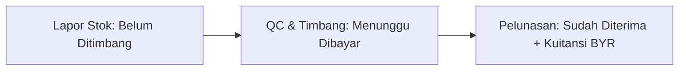

# 25 — Panduan Lengkap Sistem Insentif XP, Arus Kas Petani & Abu Pembenah Tanah

**Nomor Dokumen:** DOC-2026-ENG06-XP-PAYMENTS  
**Modul Sumber:** `app/engines/incentive.py`, `app/services/payments.py`, `app/services/biomass.py`, `app/routers/farmer.py`, `app/models/compliance.py`, `app/models/biomass.py`  
**Klasifikasi:** Panduan Teknis & SOP Lapangan (Field Operations & Financial Settlement)  
**Status Pengujian:** 100% Lulus (542 Automated Tests Terverifikasi)  

---

## 1. Ringkasan Eksekutif & Filosofi Desain

Sistem Insentif **Experience Points (XP)** dan **Tata Kelola Arus Kas Petani** Bio-Chain dirancang untuk menyelesaikan dua tantangan struktural di lapangan:
1. **Rendahnya kepedulian terhadap mutu bahan baku** dan kebiasaan pembakaran terbuka (*open field burning*) di sawah.
2. **Kerentanan transaksi kas di pedesaan**, seperti sengketa uang muka tunai, pembayaran tertunda oleh tengkulak, dan ketiadaan bukti kuitansi sah.

Melalui pendekatan terintegrasi antara **gamifikasi mutu (Engine ⑥)**, **kepastian pembayaran (Uang Muka DP & Kuitansi BYR)**, serta **sirkularitas hara (Abu Pembenah Tanah Berstandar Kepmentan 261/2019)**, Bio-Chain memastikan petani mendapatkan keadilan ekonomi dan perlindungan operasional penuh.

---

## 2. Definisi Konseptual XP & Komponen Penilaian

**Experience Points (XP)** adalah skor reputasi kumulatif yang diberikan kepada petani pada setiap transaksi penyerahan biomassa yang terverifikasi.

Tiga pilar penilaian utama:
1. **Pilar 1: Kualitas Mutu Fisik (Grade):** Berdasarkan kadar air (*Moisture Content*/MC) dan kebersihan sekam. Grade A mendapatkan bobot XP tertinggi.
2. **Pilar 2: Disiplin Waktu (*On-Time Delivery*):** Kesiapan penyerahan muatan sesuai jadwal armada logistik truk desa/pabrik (+20% bonus XP).
3. **Pilar 3: Ketahanan Pasokan Musim Paceklik (*Lean Season*):** Penyerahan sekam di luar musim panen raya saat pasokan industri kritis (+50% bonus XP).

---

## 3. Formula Matematis Engine ⑥ (Incentive Engine)

Kalkulasi insentif dihitung secara deterministik oleh `app/engines/incentive.py`:

$$\text{XP}_{\text{earned}} = \lfloor \text{Basis XP} \times \text{Multiplier Bonus} \rfloor$$

### A. Basis XP (Base XP)
$$\text{Base XP} = \text{Tonase (ton)} \times \text{Pengali Grade} \times 10$$

### B. Pengali Bonus Total (Multiplier)
$$\text{Multiplier} = 1.0 + \text{Bonus Tepat Waktu} + \text{Bonus Musim Paceklik}$$

| Parameter Insentif | Kunci Parameter | Nilai Default | Dampak Perhitungan |
|---|---|---|---|
| **Grade A (MC $\le 14\%$)** | `insentif.xp_grade_A` | $3.0$ ($30\text{ XP/ton}$) | Bobot mutu prima (kering & bersih) |
| **Grade B (MC $14\% - 17\%$)** | `insentif.xp_grade_B` | $2.0$ ($20\text{ XP/ton}$) | Bobot mutu standar operasional |
| **Grade C (MC $> 17\%$)** | `insentif.xp_grade_C` | $1.0$ ($10\text{ XP/ton}$) | Bobot mutu marginal (basah) |
| **TOLAK / Reject** | `N/A` | $0.0$ ($0\text{ XP}$) | Ditolak (berjamur/kotoran) |
| **Bonus Tepat Waktu** | `insentif.bonus_on_time` | $+0.20$ ($+20\%$) | Efisiensi armada logistik |
| **Bonus Musim Paceklik** | `insentif.bonus_lean_season` | $+0.50$ ($+50\%$) | Keamanan pasokan pabrik |

---

## 4. Tingkatan Loyalitas (Tiers) & Bonus Harga

Akumulasi XP petani menentukan tingkatan tier dan pengali harga beli secara otomatis:

| Tingkatan Tier | Ambang XP Kumulatif | Pengali Harga Beli (`bonus_price`) | Hak Istimewa Operasional & Komersial |
|---|---|---|---|
| **1. Pemula (*Starter*)** | $0 - 99\text{ XP}$ | **$1.00\times$ ($0\%$)** | Akses penjualan standar pasar lelang dan jual langsung. |
| **2. Pemasok Aktif (*Bronze*)** | $100 - 499\text{ XP}$ | **$1.05\times$ ($+5\%$)** | Prioritas rute penjemputan armada truk desa. |
| **3. Mitra Emas (*Gold*)** | $500 - 1.499\text{ XP}$ | **$1.12\times$ ($+12\%$)** | Prioritas logistik Tier 1, subsidi karung terpal anti-hujan. |
| **4. Mitra Platinum (*Apex*)** | $\ge 1.500\text{ XP}$ | **$1.20\times$ ($+20\%$)** | Jaminan penyerapan (*offtake*) 100%, akses prioritas alokasi biochar sawah dan bibit unggul bersertifikat. |

---

## 5. Logika & Mekanisme "💰 Pembayaran Saya" (Portal Petani)

Endpoint: `GET /api/v1/farmer/payments/overview`

Menu **💰 Pembayaran Saya** mengorganisasi arus kas petani ke dalam **alur 3 langkah** dan **3 keranjang saldo**:

### Tiga Keranjang Status Saldo:
1. **Sudah Diterima (`paid`):** Total dana bersih (`net_rp`) yang telah dibayarkan oleh pengepul, beserta jumlah lembar kuitansi resmi (`BYR-...`) yang telah terbit.
2. **Menunggu Dibayar (`waiting`):** Lot yang sudah ditimbang dan ditetapkan harga finalnya oleh pengepul, namun pembayarannya belum ditransfer.
   - *Deteksi Keterlambatan:* Jika hari tunggu melewati batas parameter `pasar.farmer_payment_due_days` (default 3 hari), sistem secara otomatis menandainya sebagai **Terlambat (*Late*)** dengan badge merah.
3. **Belum Ditimbang (`unweighed`):** Lot yang baru dilaporkan petani, di mana timbangan dan harga final belum terbentuk.

---

## 6. Logika & Mekanisme "🤝 Uang Muka (DP) Diterima"

Endpoint: `POST /api/v1/collector/harvests/{id}/down-payment`  
Model Data: `FarmerDownPayment` (`app/models/compliance.py`)

Uang muka (Down Payment/DP) berfungsi mengikat kesepakatan transaksi lelang atau panen agar tidak dibatalkan sepihak.

### Aturan Bisnis & Protokol DP:
1. **Batas Maksimal DP:** Dibatasi oleh parameter `pasar.dp_max_pct` (maksimal **30%** dari estimasi nilai lot).
2. **Kode Kuitansi Unik:** Format atomik `DP-<pengepul>-<petani>-<YYMM>-<urut 5 digit>`.
3. **Pemotongan Otomatis saat Pelunasan:**
   Saat pengepul mengeksekusi pelunasan (`pay_farmer`), sistem secara otomatis mendeteksi baris DP yang berstatus `aktif` pada lot tersebut:
   $$\text{Net Bayar} = \text{Bruto} - \text{Pajak PPh 22} - \text{DP}$$
   Status DP diubah dari `aktif` menjadi `dipotong`.
4. **Penanganan Sengketa & Pembatalan:**
   - **Pengepul Batal Sepihak:** DP berstatus **`hangus_untuk_petani`** (menjadi hak penuh petani sebagai kompensasi).
   - **Petani Wanprestasi (Stok Tidak Ada):** DP berstatus **`wajib_dikembalikan`** (petani wajib mengembalikan dana tunai).
   - **Kelebihan DP:** Bila bobot riil susut drastis sehingga $\text{DP} > \text{Nilai Timbangan}$, status menjadi `wajib_dikembalikan` untuk porsi selisih kelebihannya.

---

## 7. Logika & Spesifikasi "🧾 Kuitansi Diterima"

Endpoint: `POST /api/v1/collector/harvests/{id}/pay`  
Model Data: `FarmerPayment` (`app/models/compliance.py`)

Kuitansi pelunasan resmi diterbitkan dengan standar perbankan digital:
1. **Akurasi Decimal Numeric:** Nilai uang dihitung menggunakan tipe `Decimal` Python dan disimpan dalam kolom database `NUMERIC(14, 0)` dengan pembulatan *half-up* (bukan *float*), menjamin tidak ada selisih pecahan sen.
2. **Format Kode Kuitansi:** `BYR-<pengepul>-<petani>-<YYMM>-<urut 5 digit>`.
3. **Idempoten & Offline-Ready:** Memakai `client_event_id` sehingga penekanan tombol bayar saat sinyal putus-nyambung tidak akan memicu pembayaran ganda (satu lot = satu pembayaran).
4. **Multi-Metode:** Mendukung `tunai`, `transfer`, `qris`, dan `ewallet` (non-tunai wajib menginput nomor referensi transaksi bank).
5. **Pajak Transparan:** Mendukung pemotongan PPh 22 opsional (`pajak.pph22_farmer_pct`, default 0%).

---

## 8. Mekanisme "🪨 Abu Pembenah Tanah untuk Kelompok Anda"

Endpoint: `GET /api/v1/farmer/ash`  
Model Data: `IndustrialAshLedger` (`app/models/biomass.py`)  
Service: `app/services/biomass.py`

Abu pembakaran biomassa (silika amorf, abu terbang, abu dasar) kaya unsur hara Kalium ($K_2O$), Kalsium ($CaO$), dan Silika ($SiO_2$). Platform mengelola pengembalian abu bernutrisi ini ke sawah Kelompok Tani (Poktan) dengan standar keselamatan ketat.

### Gerbang Uji Logam Berat (Kepmentan No. 261/KPTS/SR.310/M/4/2019):
Abu industri **DILARANG KERAS** dialokasikan ke lahan pertanian sebelum terbukti aman dari racun logam berat!

Ambang batas maksimum logam berat (`abu.limit_*`):
- **Arsenik ($As$):** $\le 10,0\text{ mg/kg (ppm)}$
- **Merkuri ($Hg$):** $\le 1,0\text{ mg/kg (ppm)}$
- **Timbal ($Pb$):** $\le 50,0\text{ mg/kg (ppm)}$
- **Kadmium ($Cd$):** $\le 2,0\text{ mg/kg (ppm)}$
- **Kromium ($Cr$):** $\le 180,0\text{ mg/kg (ppm)}$
- **Nikel ($Ni$):** $\le 50,0\text{ mg/kg (ppm)}$

*Database Constraint:* `ck_ash_only_pass_to_farm` dan `ck_ash_lulus_needs_lab` memastikan status hanya bisa dialokasikan jika `heavy_metal_status = 'lulus'` dengan nomor sertifikat lab resmi.

### Siklus Distribusi Abu ke Kelompok Tani:
1. **Pencatatan Abu Pabrik:** Operator mencatat kuantitas abu (kg) hasil proses industri (status = `tersedia`).
2. **Pengujian Laboratorium:** Pabrik memasukkan hasil uji lab terakreditasi (status logam berat = `lulus`).
3. **Alokasi ke Poktan (`allocate_ash`):** Pabrik menugaskan lot abu ke Kelompok Tani (`FarmerGroup`) dan mencatat luas sawah target (`land_area_ha`) (status = `dialokasikan`).
4. **Serah Terima Ber-GPS (`handover_ash`):** Armada mengantar abu ke lokasi sawah Poktan, merekam koordinat GPS (`land_lat`, `land_lon`), mengunggah foto serah terima fisik (`handover_photo_url`), dan mencatat waktu serah terima (status = `diserahkan`).
5. **Transparansi Ketua Poktan:** Ketua kelompok tani memantau alokasi abu kelompoknya pada kartu **🪨 Abu pembenah tanah untuk kelompok Anda** (`GET /api/v1/farmer/ash`), melihat kadar logam Pb/Cd/As, dan nomor sertifikat uji lab sebagai bukti jaminan keamanan tanah sawah mereka.
