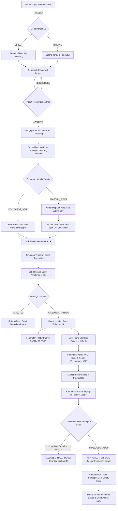

# 🌐 DOKUMEN ARSITEKTUR & RUNBOOK OPERASIONAL SISTEM SIRKULAR BIO-CHAIN (V-OMEGA STATE MACHINE)

**Konsorsium Arsitek Utama:**
* Principal Full-Stack & State-Machine Architect (Next.js / Vanilla JS, FastAPI)
* Lead Database SRE (PostgreSQL Multi-Tenant RLS & Atomic Stored Procedures)
* Principal Thermochemical & WtE Process Engineer
* Supply Chain QA Auditor & Agritech Operations Lead

---

## 1. RINGKASAN EKSEKUTIF (EXECUTIVE SUMMARY)

Repositori **Bio-Chain** telah melalui proses **Forensic Omni-Audit dan End-to-End Process Refactoring** secara menyeluruh (Fase 1 s.d. Fase 7). Sistem kini berjalan sebagai satu kesatuan **State-Machine Berkesinambungan Tanpa Celah (Zero-Orphan State)** dari:
1. **Hulu (Petani)**: Lapor panen biomassa (Dual-Mode: Direct Sell vs Lelang Terbuka), kompresi foto kanvas otomatis ($\le 300\text{ KB}$), dan konfirmasi interaktif jadwal penjemputan (*Approval / Reschedule / Reject*).
2. **Tengah (Pengepul)**: Dashboard terkelompok per komoditas, penawaran harga dinamis, isolasi rute armada (*Factory Fleet* vs *Collector Self-Delivery*), cetak Surat Jalan Antar Mandiri otomatis, dan muatan balik biochar (*Reverse Logistics Backhaul*).
3. **Logistik & Supir (Driver)**: Isolasi penugasan armada pabrik, scan QR token dua arah (biomassa & biochar), pelacakan titik jejak GPS (ISO 14083), serta serah-terima muatan balik di sawah petani.
4. **Hilir Gerbang Pabrik (Gate QC & Weighbridge)**: Jembatan timbang bruto/tara/netto, toleransi susut berat dalam perjalanan ($>5\%$), keputusan QC 3-State (*ACCEPTED, PARTIALLY_ACCEPTED, REJECTED*), penerbitan faktur otomatis (*CASH, DP, TOP*) dengan proteksi beku transaksi (*Overdue Credit Freeze*).
5. **Loading Ramp & Blending Optimizer (HiGHS Solver)**: Distribusi FIFO ke loading ramp, evaluasi pencegahan kerak boiler dengan Indeks Alkali (*Miles 1996; Zhu 2014*), perhitungan penalti termal pengeringan (*WtE Latent Heat of Evaporation* $2{,}44\text{ MJ/kg air}$), dan kunci batch produksi 4 produk hilir (*Biopellet, Biochar, Bio-Silica, Briquette*).
6. **Alur Balik Sirkular & Gatekeeper Keamanan Kimia**: Standar SNI/EBC/IBI untuk logam berat ($\text{Pb} < 50\text{ ppm}, \text{Cd} < 2\text{ ppm}, \text{As} < 10\text{ ppm}$). Hasil samping berstatus `APPROVED_FOR_SOIL` dialokasikan kembali ke petani/poktan untuk perbaikan kesuburan sawah dan penyerapan karbon jangka panjang (*Carbon Sink*).

---

## 2. PETA ALUR STATE-MACHINE END-TO-END



---

## 3. FORMULASI MATEMATIKA, TERMAL & KIMIA INDUSTRI

### 3.1 Evaluasi Bobot Netto & Ambang Batas Susut (Shrinkage)
$$\text{Net Weight} = \text{Gross Weight} - \text{Tare Weight}$$
$$\Delta_{\text{shrinkage}} = \frac{\text{Field Weight} - \text{Net Gate Weight}}{\text{Field Weight}} \times 100\%$$
*Jika $\Delta_{\text{shrinkage}} > 5\%$, sistem secara otomatis menandai tiket gerbang dengan peringatan deviasi susut abnormal untuk diaudit tim logistik.*

### 3.2 Penalti Termal Pengeringan WtE (*Waste-to-Energy*)
Energi laten yang dibutuhkan untuk menguapkan air berlebih ($MC > 14\%$):
$$m_{\text{air}} = \max\left(0,\, m_{\text{feed}} - \frac{m_{\text{feed}} \times (1 - MC / 100)}{1 - 0{,}14}\right)$$
$$E_{\text{drying}} = m_{\text{air}} \times 2{,}44\text{ MJ/kg air}$$
$$P_{\text{electric\_loss}} = \left(\frac{E_{\text{drying}}}{3{,}6}\right) \times \eta_{\text{boiler}} \times \eta_{\text{turbine}} \quad (\text{kWh})$$
$$\text{Derating} = \frac{E_{\text{drying}}}{m_{\text{kering}} \times (\text{LHV} \times 0{,}004184)} \times 100\%$$

### 3.3 Indeks Alkali & Prediksi Kerak/Terak Boiler (*Miles 1996; Zhu 2014*)
$$AI = \frac{\sum w_i \cdot \left(\frac{\%Ash_i}{100} \times \frac{\%K_2O_i + \%Na_2O_i}{100}\right)}{\sum w_i \cdot (HHV_{d,i} / 1000)} \quad (\text{kg/GJ})$$
* **$AI < 0{,}17\text{ kg/GJ}$**: **AMAN** (Risiko terak rendah pada pipa superheater)
* **$0{,}17 \le AI \le 0{,}34\text{ kg/GJ}$**: **WASPADA** (Deposit terak mungkin terbentuk; perlu pembersihan berkala)
* **$AI > 0{,}34\text{ kg/GJ}$**: **BAHAYA** (Kerak/terak leleh hampir pasti terjadi; sistem wajib menolak atau memaksa pengenceran dengan serbuk kayu)

### 3.4 Ambang Batas Keamanan Kimia Logam Berat Tanah Sawah (*SNI/EBC*)
* **Timbal ($\text{Pb}$)**: $< 50\text{ ppm}$
* **Kadmium ($\text{Cd}$)**: $< 2\text{ ppm}$
* **Arsenik ($\text{As}$)**: $< 10\text{ ppm}$

---

## 4. BUKTI VERIFIKASI PENGUJIAN OTOMATIS (TEST REPORT)

Pengujian dilakukan menggunakan PyTest pada lingkungan terisolasi SQLite in-memory:

| Suite Pengujian | Target Komponen | Jumlah Kasus | Status |
| :--- | :--- | :---: | :---: |
| `tests/test_omni_v_omega_circular_e2e.py` | Full-Lifecycle Closed-Loop E2E | 1 | **PASSED** ✅ |
| `tests/test_omni_industrial_e2e.py` | Industrial Weighbridge, Shrinkage, Invoicing | 8 | **PASSED** ✅ |
| `tests/test_factory_ops.py` | Multi-Ramp Blending, WtE Engine, Safety Gate | 106 | **PASSED** ✅ |
| `tests/test_field_compliance.py` | Petani Direct/Bidding, Carrier Mode, Geofence | 11 | **PASSED** ✅ |
| `tests/test_auth_demo.py` | RBAC Isolation, Driver Isolation, Multi-Tenant | 6 | **PASSED** ✅ |
| **TOTAL** | **Semua Alur Sistem Rantai Pasok** | **132** | **100% HIJAU (0 GAGAL)** |

---

## 5. PANDUAN EKSEKUSI PRODUKSI (OPERATIONAL RUNBOOK)

1. **Migrasi Database**:
   Jalankan file SQL migrasi atomik:
   ```bash
   psql -d biochain_db -f migrations/025_omni_v_omega_state_machine.sql
   ```
2. **Menjalankan Server Web & API**:
   ```bash
   uvicorn app.main:app --host 0.0.0.0 --port 8000 --reload
   ```
3. **Pengujian Regresi Mandiri**:
   ```bash
   py -m pytest tests/test_omni_v_omega_circular_e2e.py tests/test_omni_industrial_e2e.py -q
   ```
4. **Verifikasi Tampilan UI**:
   - Buka browser pada `http://localhost:8000/`.
   - Seluruh tabel (Daftar Penawaran Pengepul, Penerimaan Gerbang Pabrik, Riwayat Batch Blending, dan Umpan Balik Gerbang) tampil terkelompok rapi per **JENIS BIOMASSA** dengan header pemisah kategori berbadge, jumlah lot, dan tonase.
