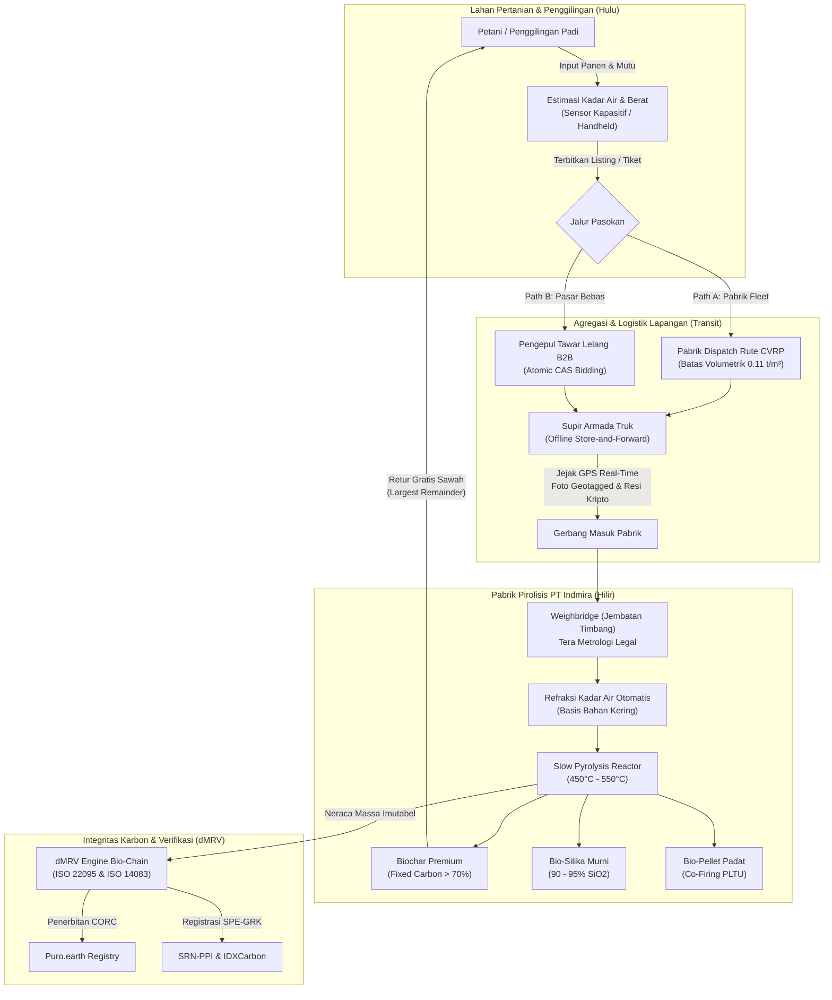

# 📖 ENTERPRISE USER MANUAL & SOP BIO-CHAIN v2
## Platform Rantai Pasok Cerdas Sekam Padi, dMRV Karbon & Manufaktur Sirkular

**Dokumen**: Panduan Pengoperasian Standar (Standard Operating Procedure) & Pedoman Pengguna Sistem  
**Klasifikasi**: Dokumen Operasional & Kepatuhan Audit Institusional  
**Penyusun**: Konsorsium Terintegrasi (*Climate-Tech Principal Architect, Senior Partner VC ESG, Lead Technical Writer, Automation QA Engineer*)  
**Mitra Industri Problem Owner**: PT Indmira Global Energi (Sleman, D.I. Yogyakarta)  
**Standar Kepatuhan**: Puro.earth Biochar Methodology v3.0, ISO 22095:2020 (Chain of Custody), ISO 14083:2023 (Logistics Emissions), SRN-PPI (Permen LHK 21/2022), Perpres 98/2021 & Perpres 110/2025.

---

## DAFTAR ISI
1. [BAB 1: ARSITEKTUR OPERASIONAL & RANTAI PASOK](#bab-1-arsitektur-operasional--rantai-pasok)
   - 1.1 Diagram Alur Rantai Pasok Holistik
   - 1.2 Model Dual-Path: Path A (Rute Terjadwal) vs Path B (B2B Lelang)
   - 1.3 Peran Lembaga Verifikator Karbon Independen (dMRV)
2. [BAB 2: PANDUAN ANTARMUKA & SOP 4 PERSONA](#bab-2-panduan-antarmuka--sop-4-persona)
   - 2.1 Persona 1: Petani / Penggilingan Padi (🌾)
   - 2.2 Persona 2: Pengepul Desa / Agregator (📦)
   - 2.3 Persona 3: Supir Armada Logistik (🚛)
   - 2.4 Persona 4: Operator & Manajemen Pabrik Pirolisis (🏭)
3. [BAB 3: MESIN REKOMENDASI DATA & LOGIKA KOMPUTASI](#bab-3-mesin-rekomendasi-data--logika-komputasi)
   - 3.1 Penentuan Harga Dinamis Berbasis Mutu (Netback Pricing Engine)
   - 3.2 Optimasi Pencocokan Campuran Feedstock (Linear Programming Solver HiGHS)
   - 3.3 Mitigasi Susut Bobot Transit & Deteksi Anomali
4. [BAB 4: INTEGRITAS DATA KARBON & PROTOKOL AUDIT](#bab-4-integritas-data-karbon--protokol-audit)
   - 4.1 Imutabilitas Audit Trail & Transisi Compare-and-Swap (CAS)
   - 4.2 Alokasi Retur Biochar Konservatif (Largest Remainder Method)
5. [BAB 5: PETUNJUK TROUBLESHOOTING & KONTINGENSI LAPANGAN](#bab-5-petunjuk-troubleshooting--kontingensi-lapangan)

---

## BAB 1: ARSITEKTUR OPERASIONAL & RANTAI PASOK

### 1.1 Diagram Alur Rantai Pasok Holistik



### 1.2 Model Dual-Path: Path A vs Path B

| Karakteristik | Path A (Rute Terpadu Armada Pabrik) | Path B (B2B Lelang & Delivery Request Pengepul) |
| :--- | :--- | :--- |
| **Inisiator Pasokan** | Pabrik (berdasarkan jadwal panen raya wilayah). | Petani atau Pengepul (berdasarkan ketersediaan stok fisik). |
| **Model Logistik** | Truk sewaan/milik pabrik diorkestrasi via CVRP volumetrik. | Armada mandiri milik pengepul desa / asosiasi logistik lokal. |
| **Penetapan Harga** | Harga acuan pabrik dikurangi ongkos angkut teroptimasi. | Mekanisme bursa penawaran terbuka (*dynamic spot bidding*). |
| **Target Volume** | Penggilingan padi mikro/kecil (500 kg – 3.000 kg). | Penggilingan skala menengah-besar / gudang sentral (>5.000 kg). |
| **Alur Pembayaran** | Pembayaran otomatis pasca-timbang gerbang (*direct settlement*). | Kontrak pasokan *delivery request* dengan termin pencairan cepat. |

### 1.3 Peran Lembaga Verifikator Karbon Independen (dMRV)
Platform menyediakan antarmuka khusus dengan hak akses baca aman (`role = auditor`):
- **TÜV NORD / DNV / SGS**: Memvalidasi kesesuaian neraca massa termodinamika (*mass balance closure*), suhu operasi reaktor ($\ge 450^\circ\text{C}$), dan rasio molar $H/C_{\text{org}} < 0,7$ sesuai metodologi **Puro.earth**.
- **Tim Validasi SRN-PPI (KLHK)**: Memverifikasi *baseline* pembakaran terbuka (*open-field burning avoidance*) dan pengurangan emisi jaringan listrik/batubara agar memenuhi kuota NDC Indonesia tanpa risiko *double counting*.

---

## BAB 2: PANDUAN ANTARMUKA & SOP 4 PERSONA

### 2.1 Persona 1: Petani / Penggilingan Padi (🌾)

#### SOP P-01: Registrasi Lahan & Titik Penggilingan
1. Masuk ke aplikasi Bio-Chain menggunakan kredensial terdaftar atau nomor ponsel terverifikasi OTP.
2. Navigasi ke menu **Pengaturan Profil Lahan**.
3. Sistem secara otomatis mendeteksi koordinat GPS tempat penggilingan (*geotagging accuracy* $\le 10\text{ meter}$).
4. Masukkan kapasitas harian penggilingan padi ($kg\text{ gabah/hari}$) dan luas hamparan sawah binaan ($ha$).

#### SOP P-02: Pelaporan Stok & Estimasi Kadar Air Lapangan
1. Buka tab **Lapor Panen / Stok Sekam** (`POST /api/v1/farmer/harvest`).
2. Masukkan taksiran volume sekam siap jual (dalam satuan karung atau $kg$).
3. **Pengukuran Kadar Air**:
   - *Metode Instrumen*: Gunakan probe kadar air tusuk (*capacitive grain moisture meter*), lakukan penusukan di 3 titik karung berbeda, ambil nilai rata-rata.
   - *Metode Sensorik Darurat (Jika tanpa alat)*: Genggam sekam erat-erat; bila sekam patah renyah dan tidak meninggalkan rasa lembap di telapak tangan, estimasi berada di kisaran 11–13%; bila liat dan lentur, masukkan estimasi $\ge 16\%$.
4. Pilih preferensi penjualan:
   - **Tunggu Penjemputan Pabrik (Path A)**: Sekam akan dimasukkan ke antrean rute truk terjadwal.
   - **Bursa Lelang Pengepul (Path B)**: Terbitkan listing dengan harga penawaran minimum (*floor price*).
5. Klik tombol **Terbitkan Stok**. Sistem menerbitkan resi digital berstempel waktu.

#### SOP P-03: Pemantauan Dompet Biochar Sirkular (*Biochar Wallet*)
1. Masuk ke menu **Dompet Biochar Saya** (`GET /api/v1/farmer/biochar-wallet`).
2. Setiap kali sekam selesai diproses di reaktor pirolisis pabrik, petani secara otomatis menerima hak retur biochar gratis (standar parameter: $5\%$ dari berat kering sekam yang diserahkan).
3. Halaman menampilkan:
   - **Saldo Tersedia ($kg$ biochar murni)**.
   - **Estimasi Manfaat Agronomi**: Proyeksi penghematan pupuk urea ($kg$) dan kenaikan hasil gabah panen berikutnya ($t\text{ GKP/ha}$).
   - **Klaim Tebus / Retur**: Tombol untuk mengajukan pengiriman biochar kembali ke sawah saat masa olah tanah tiba.

---

### 2.2 Persona 2: Pengepul Desa / Agregator (📦)

#### SOP C-01: Verifikasi Lapangan & Timbang Terima Pertama
1. Buka menu **Daftar Sekam Siap Ambil** (`GET /api/v1/collector/harvests/available`).
2. Pilih nomor tiket petani yang akan diverifikasi.
3. Saat tiba di lokasi petani:
   - Lakukan penimbangan aktual menggunakan timbangan gantung digital (*hanging crane scale*) terkalibrasi.
   - Lakukan uji kadar air ulang.
4. Masukkan data ke antarmuka **Verifikasi Mutu**:
   - `verified_kg`: Berat aktual timbangan.
   - `moisture_pct`: Kadar air hasil uji.
   - Unggah foto dokumentasi karung sekam di atas timbangan.
5. Tekan **Konfirmasi Timbang Terima**. Status panen beralih dari `READY` menjadi `VERIFIED`.

#### SOP C-02: Penawaran Lelang Terbuka (*Atomic Bidding B2B*)
1. Masuk ke menu **Bursa B2B Listing** (`GET /api/v1/collector/market`).
2. Pilih stok listing yang ditawarkan oleh petani.
3. Masukkan harga penawaran beli per $kg$ (`POST /api/v1/collector/bids`).
4. **Proteksi Konkurensi**:
   - Sistem mengeksekusi penawaran di bawah transaksi basis data atomik.
   - Jika petani menyetujui, status transaksi terkunci seketika (*exclusive lock*), mencegah pembatalan sepihak atau interferensi penawar lain (*anti-race condition*).

#### SOP C-03: Pengajuan Kuota Pabrik (*Delivery Request*)
1. Untuk pengepul yang mengumpulkan $>3.000\text{ kg}$ sekam di gudang transitnya:
2. Buka menu **Kirim ke Pabrik** (`POST /api/v1/collector/delivery-requests`).
3. Tentukan estimasi tanggal kedatangan, plat nomor truk, dan perkiraan total berat kirim.
4. Sistem mencocokkan kapasitas gerbang pabrik dan menerbitkan *Booking Gate Pass* berbarcode unik.

---

### 2.3 Persona 3: Supir Armada Logistik (🚛)

#### SOP D-01: Memulai Tugas Rute & Mode Offline-First
1. Buka aplikasi Bio-Chain Driver pada smartphone Android.
2. Pastikan akun telah terhubung; sebelum meninggalkan pangkalan ber-Wi-Fi, tekan **Sinkronkan Rute Hari Ini**. Seluruh titik henti (*stops*), rute jalan, dan manifest muatan tersimpan di penyimpanan lokal telepon (SQLite).
3. Tekan **Mulai Perjalanan (Start Route)** (`POST /api/v1/driver/routes/{id}/start`).
4. GPS perangkat akan merekam koordinat lintang-bujur di latar belakang secara otomatis interval 10 detik.

#### SOP D-02: Konfirmasi Serah-Terima Muatan di Penggilingan
1. Saat tiba di titik henti penggilingan padi:
2. Tekan tombol **Check-in di Lokasi**.
3. Masukkan jumlah karung atau berat sekam yang dinaikkan ke bak truk.
4. **Aturan Validasi Fisik**:
   - Wajib mengambil foto bak truk yang sedang dimuati dengan tanda air (*watermark*) koordinat dan waktu otomatis.
   - Petani menandatangani konfirmasi serah-terima pada layar sentuh ponsel supir.
5. Tekan **Konfirmasi Muat (Confirm Pickup)** (`POST /api/v1/driver/routes/{id}/pickup`).
6. *Catatan Konektivitas*: Jika di lokasi tidak ada sinyal seluler (blank spot), aplikasi tetap menyimpan transaksi dengan status *Pending Sync*. Nomor resi unik UUID v4 diterbitkan secara instan oleh memori internal perangkat.

#### SOP D-03: Penyelesaian Rute & Unggah Jejak Emisi (ISO 14083)
1. Setibanya di gerbang pabrik PT Indmira:
2. Hubungkan perangkat ke jaringan Wi-Fi gerbang pabrik atau sinyal seluler perkotaan.
3. Aplikasi secara otomatis melakukan *Store-and-Forward Sync*:
   - Mengunggah seluruh jejak koordinat GPS mentah (`POST /api/v1/driver/routes/{id}/track`).
   - Menyinkronkan seluruh resi penjemputan lokal.
4. Sistem membersihkan data jejak GPS (membuang lonjakan anomali) dan menghitung konsumsi bahan bakar serta emisi $CO_2\text{e}$ rute angkut (*Well-to-Wheel*).
5. Tekan **Selesaikan Rute (Complete Route)**.

---

### 2.4 Persona 4: Operator & Manajemen Pabrik Pirolisis (🏭)

#### SOP F-01: Operasional Jembatan Timbang (*Weighbridge*) & Refraksi
1. Truk pengangkut sekam berhenti di atas platform Jembatan Timbang Pabrik.
2. Operator memasukkan nomor rute / nomor tiket delivery request di layar **Penerimaan Bahan Baku** (`POST /api/v1/factory/receive`).
3. Sistem menarik data berat kotor (*Gross Weight*) dari indikator timbangan digital legal.
4. Truk membongkar sekam di gudang transit feedstock.
5. Truk kosong kembali menimbang berat kosong (*Tare Weight*). Berat bersih sekam terhitung otomatis:
   $$\text{Berat Diterima } (W_{\text{terima}}) = W_{\text{bruto}} - W_{\text{tarra}}$$
6. Operator mengambil sampel sekam secara acak (metode perempat/quartering) dan memasukkannya ke *Halogen Moisture Analyzer* cepat (durasi 3 menit).
7. Operator memasukkan kadar air laboratorium ($M_{\text{lab}}$). Sistem seketika mengkalkulasi **Refraksi Harga Otomatis**.

#### SOP F-02: Algoritma Refraksi Kadar Air Otomatis
Jika kadar air diterima ($M$) lebih tinggi dari kadar air acuan standar kontrak ($M_{\text{acuan}} = 12\%$):
- Rumus koreksi berat bahan kering murni (*Dry Basis Equivalence*):
  $$W_{\text{tagihan}} = W_{\text{terima}} \times \frac{100\% - M}{100\% - M_{\text{acuan}}}$$
- Penyesuaian harga final per $kg$:
  $$P_{\text{bayar}} = P_{\text{kontrak}} \times \left(1 - \frac{M - M_{\text{acuan}}}{100\% - M_{\text{acuan}}}\right)$$
- Sistem menerbitkan bukti timbang resmi (*Weight Certificate*) dengan rincian pemotongan refraksi transparan tanpa campur tangan subjektif manusia.

#### SOP F-03: Pencatatan Batch Konversi Pirolisis Multi-Produk
1. Setelah sekam dimasukkan ke dalam silo reaktor pirolisis:
2. Buka modul **Manufaktur Sirkular Pabrik** (`POST /api/v1/factory/batches`).
3. Pilih daftar ID panen (`harvest_ids`) yang dikonsumsi pada batch tersebut.
4. Masukkan parameter proses:
   - Suhu pirolisis rata-rata ($450^\circ\text{C} - 550^\circ\text{C}$).
   - Total biochar padat yang keluar dari pendingin (*cooling auger*) ($kg$).
   - Rute ekstraksi bio-silika yang dipilih:
     * *Rute Biochar*: Ekstraksi alkali dari sebagian biochar.
     * *Rute Abu Pembakaran*: Abu pembakaran boiler uap diekstraksi menjadi silika.
     * *Rute Sekam Langsung*: Pelindian asam langsung dan kalsinasi murni.
   - Total bio-silika yang diproduksi ($kg$).
   - Total sekam yang dialihkan ke lini bio-pellet ($kg$).
5. Tekan **Proses Batch**. Sistem seketika:
   - Mengunci status panen menjadi `CONVERTED`.
   - Mengkalkulasi *Mass Balance Closure* (penutupan neraca massa 1 input $\to$ 3 produk + 5 aliran *loss*).
   - Menjalankan algoritma *Largest Remainder* untuk mengalokasikan kredit biochar ke dompet petani masing-masing.

---

## BAB 3: MESIN REKOMENDASI DATA & LOGIKA KOMPUTASI

### 3.1 Penentuan Harga Dinamis Berbasis Mutu (Netback Pricing Engine)
Dikelola oleh [`app/engines/factory_econ.py`](file:///D:/IDE/bio-chain-prototype/app/engines/factory_econ.py), logika harga beli sekam dihitung dari nilai realisasi bersih (*netback value*) produk hilir:

$$\text{Nilai Bruto per } kg = \sum_{p \in \{\text{char, silika, pellet}\}} \left(Y_p \times P_p\right) \times (1 - K_{\text{kontaminan}})$$
Di mana:
- $Y_p$: Rendemen produk $p$ dari $1\text{ kg sekam}$.
- $P_p$: Harga jual pasar produk $p$.
- $K_{\text{kontaminan}}$: Persentase benda asing (tanah/batu/logam).

Tiga batas harga dihitung secara otomatis:
1. **Harga Lantai (Floor Price)**: $\text{Nilai Bruto} - \text{Biaya Variabel Produksi}$. (Batas operasional jangka pendek pabrik).
2. **Harga Plafon (Ceiling Price)**: $\text{Harga Lantai} - \text{Biaya Tetap per } kg$. (Batas impas penuh / *Break-Even Point*).
3. **Harga Target Rekomendasi**: $\text{Harga Plafon} - (\text{Margin Target} \times \text{Nilai Bruto})$.

### 3.2 Optimasi Pencocokan Campuran Feedstock (Linear Programming Solver HiGHS)
Dikelola oleh [`app/engines/blending.py`](file:///D:/IDE/bio-chain-prototype/app/engines/blending.py), sistem menyelesaikan optimasi pemrograman linier untuk memformulasi campuran feedstock termurah yang memenuhi spesifikasi reaktor:

$$\min \sum_{i=1}^n c_i \cdot x_i$$
Dengan kendala:
1. **Konservasi Massa**: $\sum_{i=1}^n x_i = 1$
2. **Batas Kadar Air Campuran**: $\sum_{i=1}^n M_i \cdot x_i \le M_{\text{maks}}$ (maksimal 14% agar efisiensi pirolisis optimal)
3. **Batas Kadar Abu**: $\sum_{i=1}^n A_i \cdot x_i \le A_{\text{maks}}$
4. **Batas Minimum Karbon Tertambat**: $\sum_{i=1}^n FC_i \cdot x_i \ge FC_{\text{min}}$ (menjamin kualitas biochar $C > 70\%$)
5. **Ketersediaan Stok**: $0 \le x_i \le \frac{\text{Stok}_i}{\text{Total Kebutuhan Batch}}$

Solver HiGHS dieksekusi secara terisolasi melalui thread pool CPU-bound (`concurrency.py`), mencegah pemblokiran *event loop* asynchronous server.

### 3.3 Mitigasi Susut Bobot Transit & Deteksi Anomali
Selama perjalanan dari penggilingan ke pabrik, sekam padi rentan mengalami kehilangan berat akibat penguapan air alami atau ceceran tiupan angin. Sistem menghitung:

$$\text{Susut Bobot } (\%) = \frac{W_{\text{pengepul}} - W_{\text{pabrik}}}{W_{\text{pengepul}}} \times 100\%$$

- **Ambang Batas Toleransi Normal**: $\le 3,0\%$ (diatur pada parameter `sirkular.shrinkage_tolerance_pct`).
- **Prosedur Anomali**:
  * Bila susut berada di antara $3,1\% - 7,0\%$: Sistem memberikan peringatan kuning dan mencatat potensi penguapan akibat terik panas ekstrem di jalan.
  * Bila susut $> 7,0\%$: Transaksi otomatis ditandai bendera merah (`discrepancy_flag = TRUE`). Auditor internal diwajibkan memeriksa rekaman GPS supir (apakah ada perhentian tak wajar di luar rute) dan integritas terpal penutup bak truk sebelum pembayaran *settlement* disetujui.

---

## BAB 4: INTEGRITAS DATA KARBON & PROTOKOL AUDIT

### 4.1 Imutabilitas Audit Trail & Transisi Compare-and-Swap (CAS)
Untuk memenuhi klausul integritas data standar investasi global:
1. **Append-Only Event Ledger**:
   Setiap perubahan penguasaan fisik dicatat dalam tabel `custody_events`. Data yang sudah masuk dilarang keras diubah atau dihapus (*PostgreSQL immutability trigger*).
2. **Compare-and-Swap Concurrency Guard**:
   Pembaruan status panen wajib memenuhi status prasyarat:
   ```sql
   UPDATE harvests 
   SET status = 'delivered', received_kg = 2450.0 
   WHERE id = 101 AND status = 'collected';
   ```
   Bila baris tidak ditemukan atau status telah berubah lebih dulu oleh proses lain, pembaruan dibatalkan seketika dengan pesan kesalahan `TransitionConflict`.

### 4.2 Alokasi Retur Biochar Konservatif (Largest Remainder Method)
Dalam satu batch pirolisis yang menggabungkan sekam dari beberapa petani, pembagian biochar retur dihitung hingga ketelitian satuan gram menggunakan metode kuota *Hare-Niemeyer*:
1. Hitung alokasi kuota eksak untuk petani $i$:
   $$q_i = \text{Total Biochar Dialokasikan (gram)} \times \frac{\text{Berat Sekam Petani } i}{\text{Total Sekam Batch}}$$
2. Berikan bagian bulat $\lfloor q_i \rfloor$ gram ke masing-masing petani.
3. Urutkan petani berdasarkan sisa desimal terbesar $(q_i - \lfloor q_i \rfloor)$.
4. Bagikan sisa gram yang belum terbagi satu demi satu kepada petani teratas hingga tidak ada sisa gram yang tersisa.
5. **Invarian Terverifikasi**: $\sum \text{Alokasi Dompet Petani} \equiv \text{Total Biochar Dialokasikan}$ (konservasi massa absolut 100%).

---

## BAB 5: PETUNJUK TROUBLESHOOTING & KONTINGENSI LAPANGAN

| Gejala Kendala | Kemungkinan Penyebab | Tindakan Solutif Segera |
| :--- | :--- | :--- |
| Aplikasi driver tidak menampilkan rute baru saat di sawah. | Blank spot sinyal seluler; rute belum tersinkron sebelum berangkat. | Hubungkan supir ke hotspot seluler sejenak di jalan raya, lalu tekan tombol "Paksa Sinkron Offline". Data rute akan tersimpan offline permanen. |
| Muncul galat *TransitionConflict (Status ≠ collected)* saat pabrik timbang terima. | Supir lupa menekan tombol "Konfirmasi Muat" di penggilingan petani. | Minta supir membuka aplikasi dan menekan konfirmasi serah-terima muat. Pabrik kemudian dapat melanjutkan timbang terima. |
| Refraksi kadar air memotong harga terlalu tinggi (>15%). | Kadar air sekam lapangan basah kuyup ($>22\%$). | Sekam dialihkan ke lantai penjemuran pabrik sebelum digiling; harga disesuaikan berdasarkan kadar air setelah dijemur. |
| Pengepul tidak bisa mengajukan bid lelang. | Saldo deposit atau kuota lelang harian terlampaui; listing telah ditutup penawar lain. | Refresh halaman bursa; periksa apakah listing sudah dimenangkan pihak lain atau status listing sudah beralih. |

---

*Buku Panduan Pengguna ini disahkan oleh Konsorsium Terintegrasi untuk menjadi acuan baku seluruh pelatihan lapangan, audit ISO, serta operasional harian Bio-Chain.*
