# Manual Book Visual Bio-Chain

Panduan penggunaan bergambar: Petani → Pengepul → Driver → Pabrik → sirkular abu/biochar.

*Dibangun 19-10-2026 · screenshot asli aplikasi (`scripts/capture_annotated_manual.mts`).*

# Bab 1 — Ekosistem Sirkular Bio-Chain & Tata Kelola Standar Internasional

Bio-Chain adalah aplikasi web (PWA, bisa dipasang di ponsel dan tetap mencatat saat sinyal hilang) yang
menghubungkan **petani/penggilingan padi → pengepul → armada truk → pabrik pengolahan**, lalu
mengembalikan **abu dan biochar** ke sawah petani. Bab ini memberi gambaran utuh: siapa melakukan apa,
di mana data dicatat, dan aturan yang dipakai sistem untuk keamanan, ketertelusuran, harga, dan rute.

## 1.1 Diagram Arsitektur Sirkular

Diagram di bawah meringkas alur fisik barang (panah tebal) dan titik-titik pencatatan digital.
Simbol **🔳 QR/Custody** menandai tempat kode dipindai atau serah-terima dicatat; simbol **💰 Bayar**
menandai tempat uang berpindah tangan. Referensi lengkap (±150 simpul) ada di berkas
`GLOBAL_BIOCHAIN_FLOW.mmd` di akar repositori.

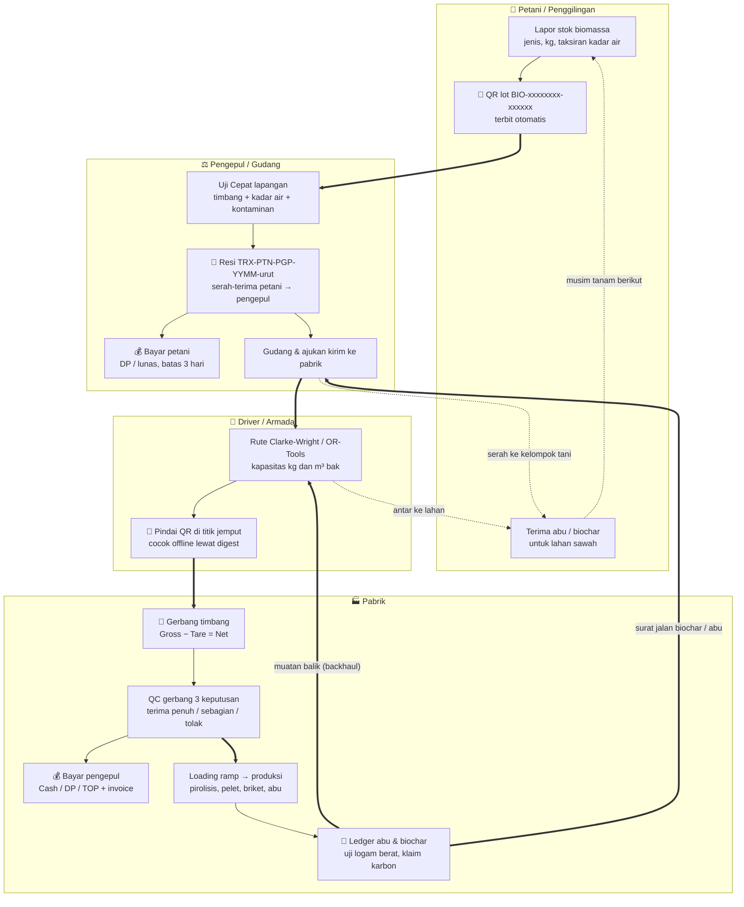

**Cara membaca:** satu lot biomassa memperoleh QR saat petani melapor. Kode itu ikut ke setiap
serah-terima (pengepul, driver, gerbang pabrik, batch produksi) dan akhirnya ke surat jalan biochar
yang kembali ke petani — sehingga satu karung biochar bisa ditelusuri balik ke sawah asalnya.

## 1.2 Empat Persona Pengguna

| Persona | Perangkat utama | Tugas utama di aplikasi | Bab rujukan |
|:---|:---|:---|:---|
| **Petani / Penggilingan** | Ponsel (layar 390 px, bisa offline) | Lapor stok & taksiran mutu, pilih jual langsung atau lelang, lacak pembayaran & kuitansi, minta abu/biochar, lacak QR | Bab 3 |
| **Pengepul / Agregator** | Desktop atau tablet di gudang | Dashboard penawaran (langsung/lelang/diantar), Uji Cepat & timbang, terbitkan resi TRX, bayar petani, susun rute, ajukan kirim ke pabrik, atur kontrak & margin | Bab 4 |
| **Driver / Armada** | Ponsel di kabin truk | Daftar job & utilisasi bak, navigasi titik jemput, pindai QR (juga tanpa sinyal), laporkan gagal jemput, antar muatan balik biochar | Bab 5 |
| **Pabrik Pengolahan** | Desktop di pos gerbang & kantor produksi | Gerbang timbang & QC 3 keputusan, pembayaran pengepul, loading ramp & blending, solver HiGHS, ledger abu, klaim removal karbon | Bab 6 |

Selain empat persona lapangan, sistem mengenal peran **Admin** (pengelola akun & parameter) dan
**Auditor** (hanya-baca: rantai custody, neraca massa, keputusan klaim karbon) — lihat
`app/models/user.py` (`UserRole`).

> **Catatan driver:** driver **tidak** menginput slip jembatan timbang. Penimbangan resmi dilakukan
> di gerbang pabrik (Bab 6.1); driver hanya memindai QR dan mengonfirmasi muat/antar.

## 1.3 Keamanan Data — Kontrol yang Selaras dengan ISO/IEC 27001

> **Penting:** Bio-Chain **belum tersertifikasi ISO/IEC 27001**. Yang tersedia adalah sejumlah
> kontrol keamanan yang *selaras* dengan prinsip standar tersebut. Sertifikasi memerlukan audit
> sistem manajemen (ISMS) oleh lembaga sertifikasi, yang belum dilakukan.

| Kontrol | Penerapan nyata di aplikasi | Lokasi kode |
|:---|:---|:---|
| **Kontrol akses berbasis peran (RBAC)** | Setiap alamat API dipetakan ke peran yang boleh memakainya (mis. `/api/v1/collector/` hanya Pengepul, `/api/v1/auditor/` hanya Auditor/Admin). Ditegakkan dua lapis: middleware kebijakan rute + dependensi `require_role` di tiap endpoint. | `app/security/policy.py` (`ROUTE_POLICY`), `app/dependencies.py` (`require_role`) |
| **Autentikasi token JWT** | Token berisi id, peran, dan versi token; kedaluwarsa otomatis (`JWT_EXPIRE_MINUTES`). Token lama langsung ditolak bila peran diubah admin atau password diganti (HP hilang/dipinjam). Akun hasil reset wajib ganti password dulu. | `app/dependencies.py` (`create_access_token`, `get_current_user`) |
| **Penyimpanan password** | Password disimpan sebagai hash PBKDF2-SHA256 bergaram, tidak pernah dikembalikan di respons API. | `app/routers/auth.py` |
| **Perlindungan permintaan lintas situs (CSRF)** | Token dikirim lewat header `Authorization: Bearer` oleh pembungkus `api()` di `app/static/app.js`, **bukan** cookie — sehingga situs lain tidak dapat menumpang sesi pengguna. Tidak ada token CSRF terpisah. | `app/static/app.js` (`api()`), `app/dependencies.py` |
| **Header keamanan & CSP** | Content-Security-Policy tanpa `unsafe-inline` untuk skrip (hash dihitung otomatis dari `index.html`). | `app/security/headers.py` |
| **Pembatasan laju (anti brute force)** | Batas permintaan per IP (`RATE_LIMIT_REQUESTS` per `RATE_LIMIT_WINDOW_SECONDS`) dan batas percobaan login (`LOGIN_RATE_LIMIT`). | `app/middleware/rate_limiter.py`, `app/config.py` |
| **Isolasi baris data (RLS)** | Pada PostgreSQL, identitas pengguna diikat ke sesi basis data sehingga kueri hanya melihat baris yang berhak. | `app/security/rls.py` |
| **Jejak audit (append-only)** | Setiap perubahan parameter asumsi dicatat: siapa, nilai lama → baru, alasan (`parameter_changes`). Setiap serah-terima lot tercatat sebagai `custody_events`. Persetujuan data dicatat append-only (`consents`). | `app/models/params.py`, `app/models/ledger.py`, `app/models/compliance.py` |
| **Masking data pribadi (UU 27/2022 PDP)** | Nomor HP petani disamarkan di daftar lintas-pengguna (mis. `0812****5678`); nomor lengkap hanya lewat aksi "hubungi". | `app/services/privacy.py` (`mask_phone`), `app/routers/collector.py` |
| **Hak subjek data — menu "Data saya"** | Pengguna dapat mengunduh seluruh datanya (JSON/.docx), mengatur persetujuan (GPS, foto bukti), dan meminta hapus akun. Penghapusan = **anonimisasi**: identitas dihapus, catatan transaksi tetap untuk kewajiban audit/pajak tetapi tidak lagi terhubung ke orang. | `app/services/privacy.py` (`export_data`, `anonymize`), `app/routers/me.py` |
| **QR bertanda tangan** | QR lot memuat tag HMAC-SHA256 kunci server, sehingga QR palsu/salah ketik langsung dikenali. | `app/services/qr_sign.py` |

## 1.4 Ketertelusuran ISO 22095 (Chain of Custody)

ISO 22095:2020 menetapkan kerangka umum *chain of custody*: setiap perpindahan kepemilikan atau
penguasaan barang harus terdokumentasi sehingga asal produk dapat dibuktikan. Bio-Chain menerapkan
model ini dengan **tiga lapis bukti** (aplikasi belum diaudit pihak ketiga terhadap ISO 22095).

**1) QR lot asal — `BIO-XXXXXXXX-TTTTTT`.** Terbit saat petani melapor stok. Delapan karakter heksa
acak + enam karakter tanda tangan HMAC (`app/services/qr_sign.py`). Rute driver hanya membawa *digest*
satu arah per titik, sehingga ponsel supir dapat mencocokkan QR **tanpa sinyal** tanpa pernah
mengetahui kodenya. QR lama format `BIO-XXXXXXXX` tetap diterima namun ditandai untuk auditor
(parameter `logistik.qr_legacy_policy`).

**2) Resi serah-terima — `TRX-<pengirim>-<penerima>-<YYMM>-<urut>`.** Dibuat oleh
`app/services/trx_code.py` saat pengepul menyelesaikan uji mutu & timbang. Kode peran: `PTN` petani,
`PGP` pengepul, `DRV` driver, `PBK` pabrik + nomor akun 4 digit; `YYMM` = tahun-bulan WIB; nomor urut
5 digit di-reset tiap bulan per pasangan pengirim–penerima. Contoh `TRX-PTN0006-PGP0003-2610-00183` =
serah-terima ke-183 dari Petani #6 ke Pengepul #3 pada Oktober 2026. Nomor urut diambil dengan satu
perintah UPSERT atomik sehingga dua serah-terima serentak tidak pernah mendapat nomor yang sama.

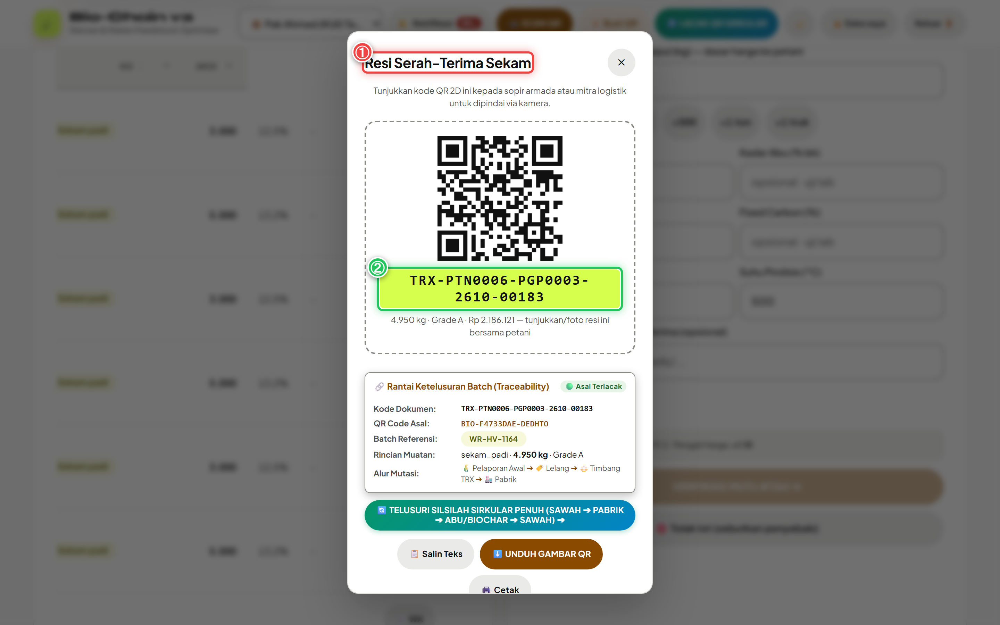

*Gambar 1.1 — Resi Serah-Terima Sekam: kode `TRX-PTN0006-PGP0003-2610-00183`, ringkasan "4.950 kg ·
Grade A · Rp 2.186.121", serta kotak "Rantai Ketelusuran Batch" yang menautkan QR asal
`BIO-F4733DAE-DEDHTO` dan batch referensi `WR-HV-1164`, serta alur mutasi
Pelaporan Awal → Lelang → Timbang TRX → Pabrik.*

**3) Ledger custody & hash sirkular.** Setiap serah-terima ditulis sebagai baris `custody_events`
dengan tahap `farmer_report → collector_weigh → driver_pickup → factory_receive → conversion`
(`app/models/ledger.py`, `app/services/custody.py`; penolakan dicatat sebagai `collector_reject` /
`factory_reject`). Layanan `app/services/circular_traceability.py` merangkai **6 tahap** (sawah →
pengepul → driver → gerbang pabrik → pengolahan → muatan balik ke sawah) lalu menghitung **sidik
SHA-256** atas gabungan kode-kode tiap tahap (QR asal, TRX pengepul/driver/pabrik, batch konversi,
surat jalan muatan balik, kg biochar). Bila satu kode diubah, sidik ikut berubah.

Modal **"Lacak QR Sirkular"** (tombol teal di header, terbuka untuk semua peran — endpoint
`/api/v1/traceability` sengaja publik agar pembeli/auditor bisa memverifikasi) menampilkan rantai itu:

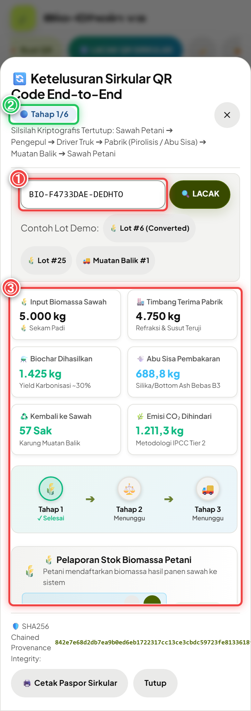

*Gambar 1.2 — Modal "Ketelusuran Sirkular QR Code End-to-End": ① kode lot `BIO-F4733DAE-DEDHTO`
diketik lalu tombol LACAK; ② lencana tahap saat ini ("Tahap 1/6"); ③ ringkasan neraca lot — input
5.000 kg sekam, timbang terima pabrik 4.750 kg, biochar 1.425 kg, abu sisa 688,8 kg, 57 sak kembali
ke sawah, 1.211,3 kg CO₂ dihindari — beserta linimasa tahap (Tahap 1 Selesai, Tahap 2–3 Menunggu) dan
kartu "Pelaporan Stok Biomassa Petani". Di bawahnya tampil baris "SHA256 Chained Provenance Integrity".*

> **Catatan jujur:** sidik SHA-256 dihitung ulang setiap kali dilacak dari data yang tersimpan; ini
> bukan blockchain publik. Integritasnya bergantung pada jejak append-only dan kontrol akses di 1.3.
> Klaim karbon memakai mekanisme serupa: snapshot hasil hitung dibekukan dengan SHA-256 saat diajukan
> (`app/services/carbon_claims.py`).

## 1.5 Keadilan Ekonomi: Margin Proporsional & Kepastian Bayar

### Margin pengepul yang terbuka

Pengepul menanggung biaya jemput, gudang, dan risiko susut, sehingga berhak atas margin — tetapi
margin itu dibuat **transparan**, bukan disembunyikan dalam timbangan.

- **Modul Kontrak & Harga Jual Multi-Biomassa ke Pabrik** menampilkan per komoditas: harga beli
  petani, harga jual pabrik, dan margin (Rp/kg) = harga jual − harga beli. Tombol **Simulasi Margin
  Truk** menghitung proyeksi satu ritase: nilai jual − harga beli − (km × biaya/km).
- **Penasihat tawaran lelang** (`app/routers/collector_bidding.py` → `trade.bid_advice`) menghitung
  `tawaran_maks = harga_jual − biaya_logistik_marginal/kg − margin/kg`. Biaya logistik marginal diambil
  dari selisih km rute dengan dan tanpa lot tersebut (solver rute). Margin bisa diisi Rp/kg
  (default `pasar.default_margin_per_kg` = Rp30/kg) atau **persen harga jual**
  (default `pasar.default_margin_pct` = 5 %) — inilah margin *proporsional*: makin tinggi harga jual,
  margin rupiahnya ikut naik secara sebanding, tidak dipatok sepihak.
- Harga jual default ke pabrik: `pasar.default_resale_price_per_kg` = Rp560/kg (`app/params.py`).

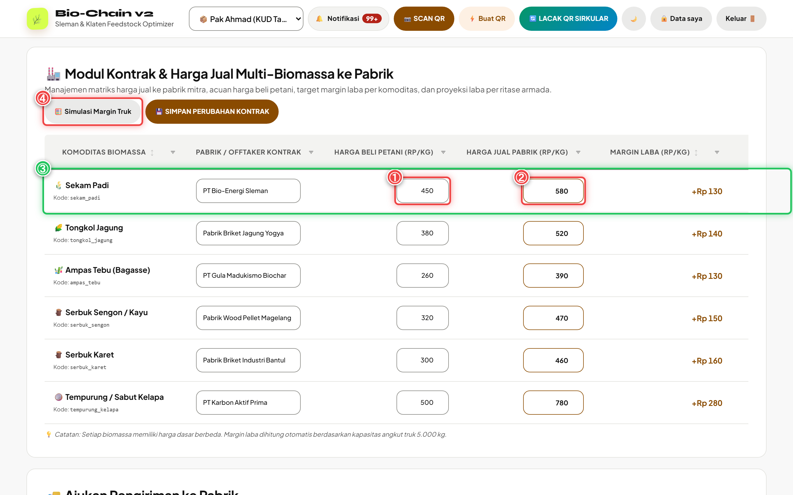

*Gambar 1.3 — Baris Sekam Padi: harga beli petani Rp450/kg, harga jual ke PT Bio-Energi Sleman
Rp580/kg, margin +Rp130/kg; tombol "Simulasi Margin Truk" di kiri atas.*

> **⚠️ Keterbatasan saat ini:** tabel Modul Kontrak disimpan di **penyimpanan browser** perangkat
> pengepul (`localStorage`, kunci `biochain_factory_pricing_v1` di `app/static/app.js`), belum di
> server. Artinya nilai kontrak tidak tersinkron antarperangkat dan belum masuk jejak audit. Harga
> yang benar-benar dibayarkan ke petani tetap dihitung server dari harga dasar komoditas (Bab 2.3).

### Kepastian bayar petani

- Lot yang sudah diverifikasi pengepul wajib dibayar **maksimal 3 hari** (parameter
  `pasar.farmer_payment_due_days`, default 3, rentang 0–60) — lebih ketat dari target umum ≤ 14 hari.
  Lewat batas, lot ditandai **"terlambat"** di menu Pembayaran petani (`app/services/payments.py`,
  `farmer_overview`: `late = hari_menunggu > due_days`).
- Petani melihat tiga keranjang: **dibayar** · **menunggu bayar** (dengan penanda terlambat) ·
  **belum ditimbang**; setiap pembayaran menerbitkan kuitansi.
- **Uang muka (DP)** maksimal `pasar.dp_max_pct` = 30 % perkiraan nilai lot; dipotong otomatis saat
  pelunasan, dan **hangus untuk petani** (tidak perlu dikembalikan) bila pengepul membatalkan sepihak.
- Pemotongan PPh 22 (bila parameter `pajak.pph22_farmer_pct` diisi) ditampilkan terpisah dari nilai kotor.

## 1.6 Optimasi Algoritma (Ringkas)

| Masalah | Algoritma | Lokasi | Keterangan |
|:---|:---|:---|:---|
| Rute jemput pengepul (CVRP) | **Clarke-Wright savings** + local search (relocate, swap, 2-opt) + iterated local search; **eksak Held-Karp** bila ≤ 10 titik (mode `auto`) | `app/engines/routing.py` | Sekam sangat ringan (±120 kg/m³) sehingga bak penuh *volume* sebelum *tonase*: kapasitas dihitung dalam m³ dari kg ÷ densitas curah. |
| Alokasi armada multi-truk & rute hijau | **Google OR-Tools** (PATH_CHEAPEST_ARC + Guided Local Search) | `app/engines/routing_ortools.py` | Dua dimensi kapasitas: **m³ bak dan kg muatan**; fungsi objektif gram CO₂e. Bisa dibandingkan dengan Clarke-Wright di modal Optimasi Rute (Bab 4.2). |
| Blend bahan bakar biaya terendah (Prototipe 1) | **Program linier HiGHS** (via SciPy) | `app/engines/fuel_blend.py` | Minimalkan biaya dengan batas LHV, abu, Cl, S, dan indeks alkali. |
| Optimasi produk akhir (Prototipe 4) & blending lab | **HiGHS** | `app/engines/product_optimization.py`, `app/engines/blending.py` | Memilih jalur produk (biochar, pelet, briket, silika) per bahan baku. |
| Kartu "Mesin Rekomendasi Blending Multi-Ramp" | **Heuristik urut-prioritas** (bukan HiGHS) | `app/routers/factory_production.py` | Mengurutkan ramp sesuai target produk lalu mengalokasikan stok. |

**Angka benchmark nyata** (sumber: `docs/benchmark_results.md`, dijalankan 5 Okt 2026, Windows 11,
Python 3.14, panggilan engine langsung, ambang SLO 500 ms pada p95):

| Engine | Skenario | p50 | p95 |
|:---|:---|:---:|:---:|
| Routing Clarke-Wright + local search | 50 titik, bak 30 m³ | 249,89 ms | 250,18 ms |
| Routing Clarke-Wright + local search | 1.000 titik, bak 300 m³ | 273,96 ms | 279,30 ms |
| Blending HiGHS LP | 4 bahan, target 100 ton | 1,84 ms | 1,89 ms |
| Quality scorer | 10.000 sampel berturut-turut | 131,65 ms | 133,09 ms |

Waktu routing ±250 ms sebagian besar adalah **anggaran waktu** pencarian yang memang dipakai habis
(`logistik.time_budget_ms`), bukan batas kemampuan. Benchmark tersebut tidak memuat OR-Tools; perbandingan
Clarke-Wright vs OR-Tools ditampilkan langsung di modal rute (Bab 4.2).

---

# Bab 2 — Protokol Uji Mutu 2 Tahap & Skema Grade Harga Insentif

Mutu biomassa menentukan harga yang diterima petani. Bio-Chain memakai **dua tahap uji**:
**Tahap 1 Uji Cepat** di lapangan (setiap lot, menentukan harga hari itu) dan **Tahap 2 Uji Lab
Proksimat** (berkala/sampel, untuk kontrak, gerbang pabrik, dan klaim karbon).

## 2.1 Tahap 1 — Uji Cepat Lapangan

**Tujuan Proses & Standar Terkait:** menetapkan berat bayar dan grade lot di tempat, sebelum
biomassa berpindah tangan. Ini adalah *prosedur lapangan* yang memakai form **Uji Mutu** pengepul;
aplikasi tidak memiliki penghitung waktu atau label "15 menit". Pengukuran kadar air mengacu pada
moisture meter yang dikalibrasi terhadap metode oven 105 °C (ISO 18134-2, dirujuk di
`app/engines/refraction.py`).

**Langkah prosedur yang disarankan:**

1. **Sampling.** Ambil minimal 5 titik dari tumpukan/karung (atas, tengah, bawah, dua sisi), campur
   menjadi satu sampel komposit ±1 kg. Jangan hanya mengambil dari permukaan yang sudah kering dijemur.
2. **Timbang lot.** Timbang seluruh lot di timbangan gudang; isi kolom **Berat Timbangan Pengepul (kg)**.
   Tombol −50/+50/+100/+500/+1 ton/+1 truk membantu koreksi cepat.
3. **Kadar air (wajib).** Ukur sampel dengan moisture meter minimal 3 kali, catat rata-ratanya di
   kolom **Kadar Air (% bb)**. Satuan % basis basah.
4. **Densitas ruah (opsional, prosedur manual).** Isi ember bervolume diketahui (mis. 20 L) tanpa
   dipadatkan, timbang, lalu hitung kg/m³ = kg ÷ volume (m³). Nilai acuan sekam di master komoditas
   = 120 kg/m³ dan dipakai untuk menghitung muatan bak truk (m³).
   *Form Uji Mutu belum memiliki kolom densitas ruah*; catat di foto bukti/keterangan bila perlu.
5. **Benda asing / kontaminan.** Pisahkan batu, tanah, plastik, dedak dari sampel, timbang, dan isi
   **Kontaminan (%)** = berat benda asing ÷ berat sampel × 100.
6. **Proksimat (opsional).** Kolom Kadar Abu, Volatile Matter, Fixed Carbon diisi hanya bila ada hasil
   uji lab/NIR. Bila kosong, grade dihitung dari kadar air & kontaminan saja dan sistem menampilkan
   peringatan "Uji proksimat tidak diukur" (`app/engines/quality.py`).
7. **Foto & verifikasi.** Lampirkan foto bukti (opsional), klik **Verifikasi Mutu** → sistem menghitung
   grade dan harga final, lalu menerbitkan resi TRX (Gambar 1.1).

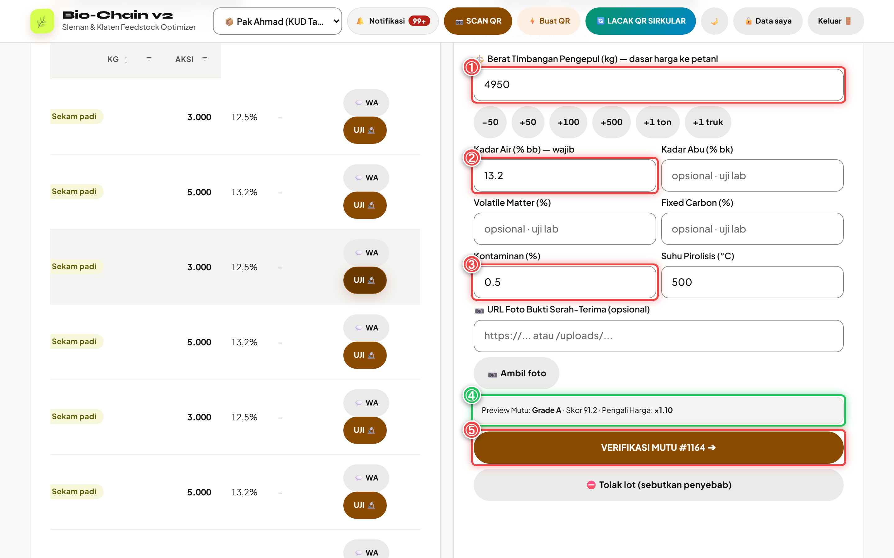

**Panduan Aksi Berdasarkan Nomor pada Gambar:**
- **① Berat Timbangan Pengepul (kg):** berat aktual lot, contoh **4950**.
- **② Kadar Air (% bb) — wajib:** hasil moisture meter, contoh **13.2**.
- **③ Kontaminan (%):** persentase benda asing, contoh **0.5**. Kolom Kadar Abu, VM, FC dibiarkan
  "opsional · uji lab"; Suhu Pirolisis 500 °C (default).
- **④ Preview Mutu:** kotak ringkasan "Grade A · Skor 91.2 · Pengali Harga: ×1.10".
- **⑤ VERIFIKASI MUTU #1164:** menyimpan hasil uji, mengubah status lot menjadi *terverifikasi*,
  mencatat custody `collector_weigh`, dan membuka resi serah-terima.

> **⚠️ Catatan untuk tim produk:** teks pada kotak ④ saat ini adalah **contoh statis** di
> `app/static/app.js` (tidak dihitung ulang saat input berubah). Grade dan harga yang sah adalah yang
> dihitung server saat tombol ⑤ ditekan dan tampil di resi. Untuk data pada gambar (MC 13,2 %,
> kontaminan 0,5 %) server dengan parameter default menghasilkan skor ±88,5 → **Grade A** (lihat 2.3).

> **🔧 Di Balik Layar (Sistem):** endpoint `POST /api/v1/collector/verify` (`app/routers/collector.py`)
> memanggil `score_sample()` di `app/engines/quality.py` untuk sekam padi, atau `_biomass_grade()`
> (acuan master komoditas) untuk biomassa lain; harga dihitung `farmgate_price()` dan resi oleh
> `app/services/trx_code.py`. Lot di atas batas tolak hanya bisa dibeli bila pengepul mencentang
> "beli untuk dikeringkan" (harga basis kering, risiko ditanggung pengepul).

**Sisi petani — taksiran sebelum dijemput.** Petani dapat mengisi taksiran kadar air dan grade di
form lapor stok. Taksiran ini **tidak mengubah harga**; harga final tetap dari timbangan & uji pengepul.

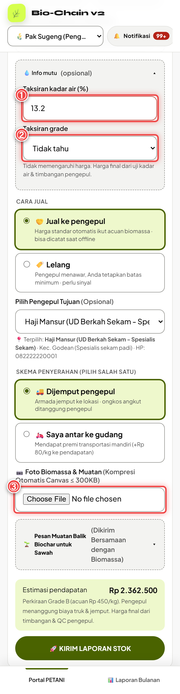

**Panduan Aksi Berdasarkan Nomor pada Gambar:**
- **① Taksiran kadar air (%):** contoh **13.2**.
- **② Taksiran grade:** pilihan grade atau "Tidak tahu". Di bawahnya tertulis "Tidak memengaruhi harga.
  Harga final dari uji kadar air & timbangan pengepul."
- **③ Foto Biomassa & Muatan:** tombol pilih berkas foto (dikompresi otomatis ≤ 300 KB).
  Kotak **Estimasi pendapatan** di bawahnya menampilkan **Rp 2.362.500** — "Perkiraan Grade B (acuan
  Rp 450/kg)" untuk 5.000 kg dengan skema Dijemput pengepul (5.000 × 450 × 1,05).

> **🔧 Di Balik Layar (Sistem):** fungsi `gradeFrom()` di `app/static/app.js` menurunkan grade dari
> taksiran kadar air (≤ 12 → A, ≤ 15 → B, ≤ 18 → C, > 18 → D) bila petani memilih "Tidak tahu", lalu
> memperkirakan pendapatan = kg × harga acuan × `harga_mutu.mult_<grade>`. Untuk D ditampilkan
> "Berisiko ditolak" (tidak ada pengali D).

## 2.2 Tahap 2 — Uji Lab Proksimat

**Tujuan Proses & Standar Terkait:** memverifikasi mutu bahan secara laboratorium untuk lot besar,
kontrak, penerimaan pabrik, produk biochar/abu ke lahan, dan klaim removal karbon. Uji sebaiknya di
laboratorium terakreditasi **KAN (ISO/IEC 17025)**.

**Parameter yang diuji:**

| Parameter | Satuan | Kegunaan di Bio-Chain | Kolom tersedia di |
|:---|:---|:---|:---|
| Kadar abu | % basis kering | Skor mutu (ideal 14–20 % untuk sekam), prediksi abu & SiO₂ di biochar | Form Uji Mutu pengepul (opsional), gerbang pabrik |
| Nilai kalor bawah (LHV) | kcal/kg | Penerimaan bahan bakar & blending | Gerbang pabrik |
| Volatile matter (VM) | % bk | Cek konsistensi proksimat (Abu + VM + FC ≈ 100 %) | Form Uji Mutu (opsional) |
| Fixed carbon (FC) | % bk | Skor mutu (ideal ≥ 17 %, skor 0 pada ≤ 8 %) | Form Uji Mutu (opsional) |
| Logam berat Pb, Cd, As (+ Hg, Cr, Ni untuk abu) | mg/kg (ppm) | Kelayakan biochar/abu ke lahan sawah | Uji keamanan by-product, ledger abu |
| C-organik & rasio H/C-org | % bk; mol/mol | Klaim removal karbon biochar | Form Klaim Removal Karbon |

> **⚠️ Belum tersedia di aplikasi:** jadwal **uji lab proksimat bulanan**, pengingat otomatis, dan
> pencatatan **kalibrasi bulanan moisture meter** (alat, tanggal, selisih terhadap oven 105 °C)
> **belum ada**. Sampai fitur ini dibuat, lakukan secara manual: kirim satu sampel komposit per
> pengepul per bulan ke lab, dan kalibrasi moisture meter terhadap uji oven setiap bulan; simpan
> berkasnya di luar aplikasi.

**Di mana data lab sudah bisa dimasukkan:**

1. **Form Uji Mutu pengepul** — kolom Kadar Abu, VM, FC (opsional; lihat Gambar 2.1 ②–③).
2. **Gerbang pabrik** — blok "Pengujian Mutu Sampel (Lab Lapangan)": Kadar Air, Kadar Abu, LHV,
   Kotoran, lalu keputusan QC 3 status.

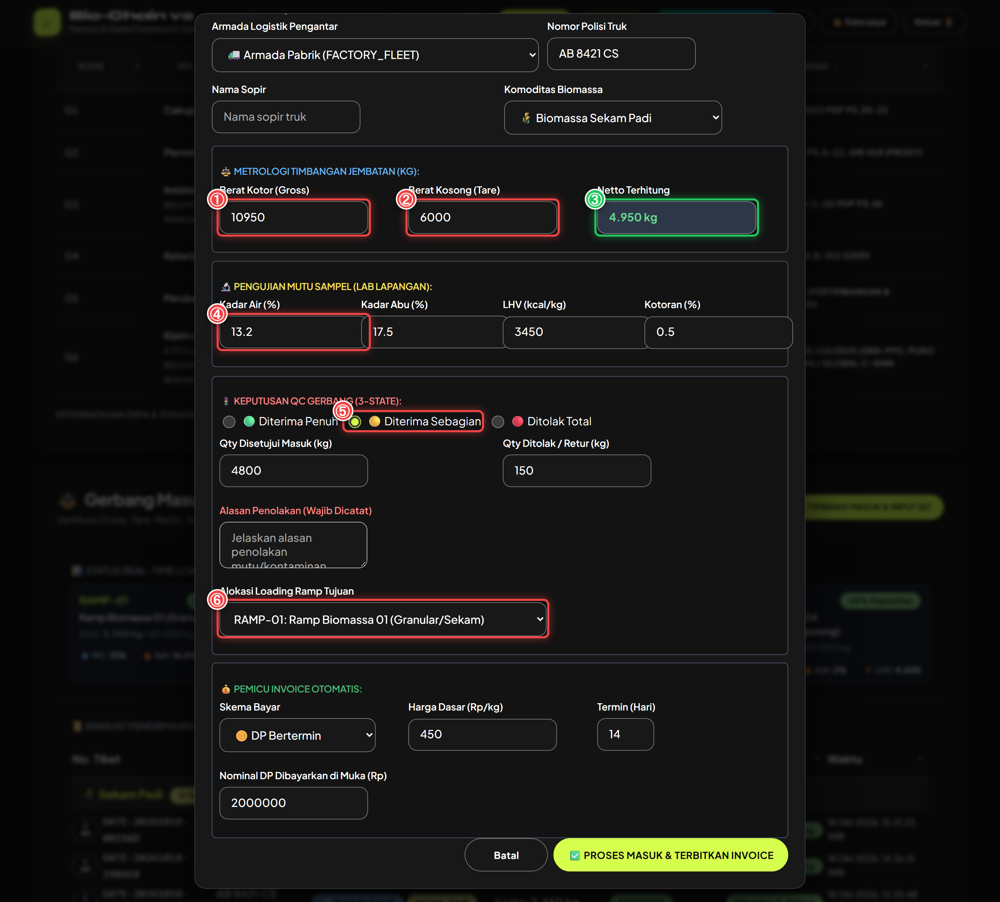

*Gambar 2.3 — Truk AB 8421 CS (Armada Pabrik), sekam padi: ① Berat Kotor (Gross) 10.950 kg,
② Berat Kosong (Tare) 6.000 kg, ③ Netto Terhitung **4.950 kg**; blok uji lab lapangan ④ Kadar Air
13,2 %, Kadar Abu 17,5 %, LHV 3.450 kcal/kg, Kotoran 0,5 %; ⑤ keputusan QC "Diterima Sebagian"
(4.800 kg masuk, 150 kg retur); ⑥ ramp tujuan RAMP-01 (Granular/Sekam). Blok "Pemicu Invoice
Otomatis": DP Bertermin, harga dasar Rp450/kg, termin 14 hari, DP Rp2.000.000. Rincian di Bab 6.1.*

3. **Uji keamanan by-product biochar** — Pb, Cd, As + **nomor sertifikat lab KAN/ISO 17025** (wajib,
   `SafetyTestRequest.lab_cert_no` di `app/routers/factory_production.py`).
4. **Ledger abu** — Pb, Cd, As, Hg, Cr, Ni, nama lab, nomor laporan, tautan laporan (`app/models/biomass.py`).
5. **Klaim Removal Karbon** — C-organik lab, rasio H/C-org, nama laboratorium, nomor laporan, unggah
   foto/scan laporan.

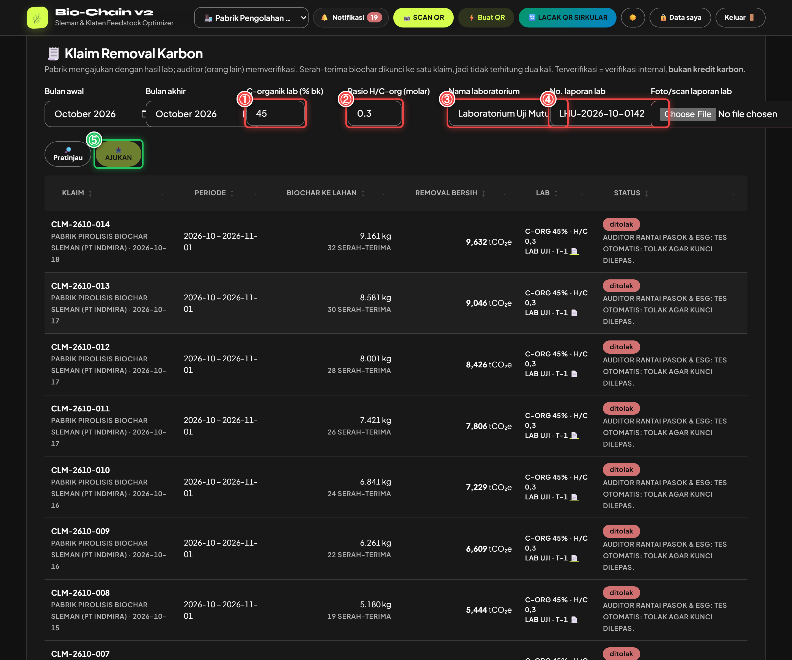

*Gambar 2.4 — ① C-organik lab **45** % bk, ② Rasio H/C-org **0,3** (di bawah batas 0,7),
③ Nama laboratorium ("Laboratorium Uji Mutu…"), ④ No. laporan lab **LHU-2026-10-0142**, lalu
⑤ tombol AJUKAN (Pratinjau di sebelahnya untuk menghitung tanpa menyimpan). Rincian di Bab 6.4.*

> **🔧 Di Balik Layar (Sistem):** `app/services/carbon_claims.py` mengganti parameter fraksi C
> (`karbon.biochar_c_org_fraction`, default 0,49) dengan C-organik hasil lab, dan **menolak pengajuan**
> bila H/C-org > `karbon.h_corg_max` (0,7). Status "terverifikasi" = verifikasi internal oleh auditor,
> **bukan** kredit karbon bersertifikat.

## 2.3 Penentuan Grade & Harga

### Tabel grade biomassa

Bio-Chain memakai grade **A/B/C/D** (bukan "A1"). Ada dua lapis: **taksiran petani** (dari kadar air
saja) dan **grade resmi pengepul** (dari skor mutu).

| Grade | Taksiran petani (`gradeFrom`, `app.js`) | Grade resmi sekam padi (`quality.py`) | Pengali harga (`app/params.py`) |
|:---:|:---|:---|:---:|
| **A** | Kadar air ≤ 12 % | Skor ≥ 80 (`harga_mutu.grade_A_min`) | `harga_mutu.mult_A` = **1,15** |
| **B** | 12 % < KA ≤ 15 % | 60 ≤ skor < 80 (`harga_mutu.grade_B_min`) | `harga_mutu.mult_B` = **1,05** |
| **C** | 15 % < KA ≤ 18 % | Skor < 60 | `harga_mutu.mult_C` = **1,00** |
| **D / TOLAK** | KA > 18 % → "Berisiko ditolak" | **TOLAK** bila KA > 25 % (`harga_mutu.moisture_reject`) **atau** kontaminan > 10 % (`harga_mutu.contamination_reject`) | 0 (tidak dibeli, kecuali "beli untuk dikeringkan") |

> Tidak ada parameter `harga_mutu.mult_D` di kode. Grade "D" hanya muncul pada taksiran petani;
> server memakai status **TOLAK**.

**Skor mutu sekam** (`score_sample()` di `app/engines/quality.py`) = rata-rata berbobot komponen yang
terukur (bobot dinormalisasi atas komponen yang diisi):

| Komponen | Skor 100 bila | Skor 0 bila | Bobot |
|:---|:---|:---|:---:|
| Kadar air | ≤ 10 % (`moisture_best`) | ≥ 25 % (`moisture_reject`) | 0,35 |
| Kontaminan | ≤ 1 % (`contamination_best`) | ≥ 10 % (`contamination_reject`) | 0,30 |
| Kadar abu (opsional) | 14–20 % (`ash_ideal_min/max`); −10 poin per 1 % di luar rentang | — | 0,15 |
| Fixed carbon (opsional) | ≥ 17 % (`fc_best`) | ≤ 8 % (`fc_worst`) | 0,20 |

Skor di antara batas dihitung linear: `skor = 100 × (batas_buruk − nilai) ÷ (batas_buruk − batas_ideal)`.

**Biomassa selain sekam** (tongkol jagung, ampas tebu, tempurung, serbuk kayu) dinilai dari acuan
master komoditas (`_biomass_grade()` di `app/routers/collector.py`): A bila KA ≤ KA acuan dan kontaminan
≤ toleransi; B bila KA ≤ titik tengah acuan–tolak dan kontaminan ≤ toleransi + 3 %; selain itu C;
TOLAK bila KA > KA tolak atau kontaminan > 20 %. Grade di sini hanya informasi — harga tetap basis kering.

### Rumus harga beli dari petani

Metode default `harga_mutu.pricing_method = basis_kering` (`farmgate_price()` di `app/engines/quality.py`):

```
harga/kg  = harga_dasar × (1 − KA) ÷ (1 − KA_acuan)        KA_acuan = harga_mutu.reference_moisture_pct = 12 %
kg_bayar  = kg_timbang × (1 − kontaminan)
total     = kg_bayar × harga/kg                           (TOLAK → 0)
```

Pada metode ini **pengali grade tidak dipakai**: setiap 1 % air sudah dihargai sesuai bahan keringnya,
sehingga tidak ada "tebing harga" di batas grade. Metode lama `pengali_grade`
(`total = kg × harga_dasar × pengali`) masih bisa dipilih pabrik di menu Parameter. Lot dengan KA >
15 % (`harga_mutu.moisture_mold_risk_pct`) ditandai **risiko jamur**: angkut ≤ 48 jam atau keringkan.

### Rumus refraksi multi-komoditas

Untuk pratinjau refraksi multi-biomassa (`app/engines/refraction.py`, dipanggil dari
`app/routers/multibiomass.py` dan `app/services/biomass.py`):

```
kg_bayar = kg_timbang × (1 − max(0, kontaminan − toleransi)) × (1 − KA) ÷ (1 − KA_acuan)
```

Faktor kadar air dibatasi maksimal 1 (tidak ada bonus lebih kering, kecuali diaktifkan per transaksi).
Di atas KA tolak, lot ditolak kecuali opsi eksplisit "terima basah". Acuan sekam padi di master
(`app/biomass_seed.py`): **KA acuan 12 %, KA tolak 20 %, toleransi kontaminan 2 %**.

### Contoh hitung — 5.000 kg sekam, KA 13,2 %, kontaminan 0,5 %

Harga dasar dari parameter default: `harga_mutu.base_price_per_kg` = **Rp400/kg** (`app/config.py`
`BASE_PRICE_PER_KG`), tanpa data proksimat lab.

| Langkah | Perhitungan | Hasil |
|:---|:---|:---:|
| Skor kadar air | 100 × (25 − 13,2) ÷ (25 − 10) | 78,7 |
| Skor kontaminan | 0,5 % ≤ 1 % (ideal) | 100 |
| Skor komposit | (78,7 × 0,35 + 100 × 0,30) ÷ 0,65 | **88,5 → Grade A** |
| Harga per kg (basis kering) | 400 × (1 − 0,132) ÷ (1 − 0,12) = 400 × 0,98636 | **Rp394,55/kg** |
| Kg dibayar | 5.000 × (1 − 0,005) | 4.975 kg |
| **Total diterima petani** | 4.975 × 394,55 | **Rp1.962.886** |
| *Pembanding: metode `pengali_grade`* | 5.000 × 400 × 1,15 | Rp2.300.000 |
| *Pembanding: refraksi multi-komoditas* | 5.000 × (1 − 0) × 0,98636 = 4.931,8 kg × Rp400 | Rp1.972.727 |

Pada jalur refraksi, kontaminan 0,5 % tidak dipotong karena masih di bawah toleransi 2 %; pada jalur
verifikasi sekam, seluruh kontaminan dipotong dari berat bayar.

> **Cocokkan dengan resi:** Gambar 1.1 menunjukkan 4.950 kg · Grade A · **Rp2.186.121**. Angka itu
> memakai harga dasar aktif **Rp450/kg** pada data demo: 4.950 × 0,995 = 4.925,25 kg × (450 × 0,868 ÷
> 0,88 = Rp443,86/kg) = Rp2.186.121. Rumusnya sama; hanya harga dasarnya berbeda.

## 2.4 Standar Produk Akhir

Grade A/B/C/D berlaku untuk **bahan baku biomassa**. Untuk **produk** pabrik dipakai standar berikut;
batas di tabel adalah yang benar-benar diperiksa kode.

| Produk | Standar acuan | Batas yang diperiksa di kode | Lokasi |
|:---|:---|:---|:---|
| **Bio-pelet** | ISO 17225-2 (kayu) / ISO 17225-6 (non-kayu) | Abu produk ≤ 1,2 % → Kelas A1/A2; ≤ 6 % → ISO 17225-6 Kelas A non-kayu; ≤ 10 % → hanya Kelas B; > 10 % → wajib blending. Indeks alkali > 0,34 kg/GJ → risiko kerak. | `app/engines/product_optimization.py` |
| **Biochar** (pembenah tanah & karbon) | European Biochar Certificate (EBC) / IBI; metodologi Puro.earth 2025 | **H/C-org ≤ 0,7** (`karbon.h_corg_max`) — di atasnya klaim ditolak. C-org: hasil lab menggantikan default 0,49 (`karbon.biochar_c_org_fraction`); tidak ada ambang minimum C-org di kode (C-org > 75 % dicatat sebagai keunggulan). Logam berat lolos bila **Pb < 50, Cd < 2, As < 10 ppm**. | `app/services/carbon_claims.py`, `app/params.py`, `app/routers/factory_production.py` |
| **Abu ke lahan** | Kepmentan No. 261/KPTS/SR.310/M/4/2019 | As ≤ 10, Hg ≤ 1, Pb ≤ 50, Cd ≤ 2, Cr ≤ 180, Ni ≤ 50 mg/kg (`abu.limit_*_ppm`); lulus hanya bila semua logam terukur ≤ batas. | `app/params.py`, `app/models/biomass.py` |
| **Briket / arang** | SNI 01-6235-2000 | Abu briket maks **8 %**; sekam dinilai tidak cocok untuk briket komersial (arang rapuh, abu tinggi). | `app/engines/product_optimization.py` |
| **Silika (dari abu sekam)** | SNI 15-0086-1987 / ASTM D1993 | Dinilai dari skor ekonomis jalur silika. | `app/engines/product_optimization.py` |

> **Catatan:** ISO 17225 hanya dipakai untuk spesifikasi **produk bio-pelet**, bukan untuk grade bahan
> baku sekam. Penilaian kesesuaian di atas adalah penyaring awal di aplikasi; sertifikasi produk tetap
> memerlukan uji lab terakreditasi dan audit lembaga standar terkait.

# Bab 3 — Panduan Langkah demi Langkah Modul Petani / Penggilingan Padi

Bab ini memandu petani dan operator penggilingan padi memakai Bio-Chain di HP: masuk ke aplikasi, melaporkan stok
biomassa (contoh: **Sekam Padi 5.000 kg**, taksiran kadar air **13,2 %**), memilih cara jual dan cara serah, memesan
biochar untuk sawah, lalu memantau mutu, ketertelusuran, dan pembayaran. Semua layar di bab ini diambil dari tampilan HP
(lebar 390 px).

---

## 3.1 Login Aman & Dashboard Utama

### Layar 3.1a — Masuk Akun & Pilih Peran

**Tujuan Proses & Standar Terkait:** Memastikan hanya pemilik akun yang masuk, dan masuk ke gerbang peran yang benar
(Petani). Ini adalah kontrol keamanan yang *selaras* dengan ISO 27001 (kontrol akses berbasis peran/RBAC, kata sandi
ter-hash, token JWT + CSRF). Aplikasi **tidak** tersertifikasi ISO 27001.

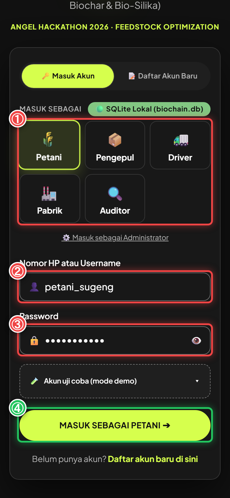

**Panduan Aksi Berdasarkan Nomor pada Gambar:**
- **① Masuk Sebagai (kartu peran):** ketuk kartu **Petani** (kartu terpilih menyala hijau). Kartu lain — Pengepul,
  Driver, Pabrik, Auditor — untuk peran lain.
- **② Nomor HP atau Username:** ketik nomor HP atau username Anda, contoh `petani_sugeng`.
- **③ Password:** ketik kata sandi. Ketuk ikon mata 👁 untuk melihat ketikan bila ragu salah ketik.
- **④ MASUK SEBAGAI PETANI ➔:** ketuk tombol hijau. Bila berhasil, dashboard Portal Petani terbuka. Bila akun Anda
  bukan akun petani, muncul pesan "Akun ini bukan akun petani. Silakan pilih gerbang yang sesuai."

Belum punya akun? Ketuk **Daftar akun baru di sini**. Kotak "Akun uji coba (mode demo)" hanya muncul di server demo dan
hilang di server produksi.

> **🔧 Di Balik Layar (Sistem):** Form mengirim `POST /api/v1/auth/login` dengan `identifier`, `password`, dan
> `expected_role` (peran dari kartu ①). `app/routers/auth.py` mencocokkan kata sandi dengan hash **PBKDF2-HMAC-SHA256
> 600.000 iterasi**, menolak bila peran akun ≠ `expected_role`, lalu menerbitkan token JWT. Percobaan login dibatasi
> `LOGIN_RATE_LIMIT` = 10 per IP per jendela waktu (`app/middleware/rate_limiter.py`, anti tebak-tebakan kata sandi).
> Respons tidak pernah memuat hash kata sandi.

### Layar 3.1b — Dashboard Utama Petani

**Tujuan Proses & Standar Terkait:** Ringkasan cepat kinerja pasok Anda: jumlah laporan, tonase terkirim, poin XP, dan
saldo biochar yang bisa diambil.

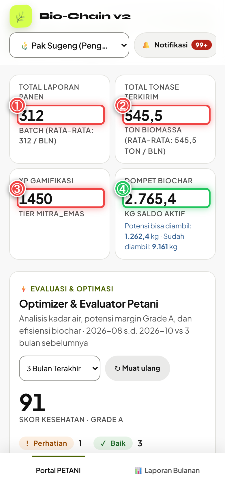

**Panduan Aksi Berdasarkan Nomor pada Gambar:**
- **① Total Laporan Panen:** jumlah batch yang sudah Anda laporkan, contoh **312** batch (rata-rata 312 / bln).
- **② Total Tonase Terkirim:** ton biomassa yang sudah terkirim, contoh **545,5** ton (rata-rata 545,5 ton / bln).
- **③ XP Gamifikasi:** poin keaktifan dan mutu pasok, contoh **1450** dengan tingkat **Mitra Emas** ("TIER MITRA_EMAS").
- **④ Dompet Biochar (hasil):** saldo biochar milik Anda, contoh **2.765,4 kg** saldo aktif — "Potensi bisa diambil:
  1.262,4 kg · Sudah diambil: 9.161 kg".
- Di bawahnya ada kartu **Optimizer & Evaluator Petani** (analisis kadar air, potensi margin Grade A, efisiensi
  biochar, periode 2026-08 s.d. 2026-10 dibanding 3 bulan sebelumnya) dengan pilihan periode "3 Bulan Terakhir",
  tombol **↻ Muat ulang**, dan **Skor Kesehatan** (contoh **91 · Grade A**, 1 butir "Perhatian", 3 butir "Baik").
- Di bagian atas: pemilih persona/akun dan tombol **🔔 Notifikasi**. Pelacakan QR dibahas di Layar 3.5c.

> **🔧 Di Balik Layar (Sistem):** Angka kartu dimuat dari `GET /api/v1/farmer/harvests`, `/farmer/wallet`, dan
> `/farmer/incentive` (`app/routers/farmer.py`). XP dihitung per ton sesuai grade dengan parameter
> `insentif.xp_grade_A/B/C` (`app/params.py`). Kartu Optimizer memakai modul evaluasi AI per peran
> (`initAIEvaluationCard("petani")` di `app/static/app.js`).

---

## 3.2 Form Lapor Biomassa

### Layar 3.2a — Jenis Biomassa, Jumlah, dan Lokasi Penggilingan

**Tujuan Proses & Standar Terkait:** Mencatat stok biomassa yang siap dijual sebagai batch baru dengan kode QR unik,
titik awal rantai ketertelusuran (*chain of custody*).

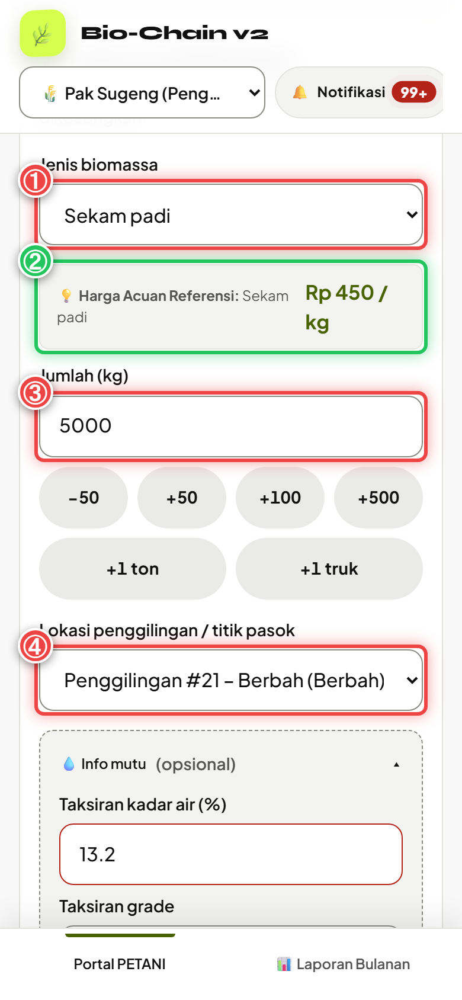

**Panduan Aksi Berdasarkan Nomor pada Gambar:**
- **① Jenis biomassa:** pilih komoditas, contoh **Sekam padi**.
- **② Harga Acuan Referensi (hasil otomatis):** kotak hijau langsung menampilkan harga acuan komoditas yang dipilih,
  contoh **Rp 450 / kg** untuk sekam padi. Harga ini berubah otomatis bila jenis biomassa diganti.
- **③ Jumlah (kg):** ketik berat, contoh `5000`. Bisa juga memakai tombol cepat **−50, +50, +100, +500, +1 ton,
  +1 truk**.
- **④ Lokasi penggilingan / titik pasok:** pilih penggilingan asal, contoh **Penggilingan #21 – Berbah (Berbah)**.

Di bawahnya ada bagian lipat **💧 Info mutu (opsional)** — lihat Layar 3.2b.

> **🔧 Di Balik Layar (Sistem):** Daftar komoditas & harga acuan diambil dari master biomassa (`biomassList()` →
> harga dasar per komoditas); daftar penggilingan dari `GET /api/v1/farmer/mills`. Jumlah wajib > 0 dan maksimal
> 100.000 kg per laporan (validasi di `doSubmitLapor`, `app/static/app.js`). Bila penggilingan tidak terdaftar,
> server memakai penggilingan aktif pertama (`report_harvest`, `app/routers/farmer.py`).

### Layar 3.2b — Estimasi Mutu (Kadar Air & Grade) dan Foto

**Tujuan Proses & Standar Terkait:** Memberi taksiran mutu awal agar estimasi pendapatan lebih tepat. Taksiran ini
**tidak menentukan harga final** — harga final dari uji kadar air dan timbangan pengepul.


**Panduan Aksi Berdasarkan Nomor pada Gambar:**
- **① Taksiran kadar air (%):** ketik hasil perkiraan/alat ukur Anda, contoh `13.2`.
- **② Taksiran grade:** pilih A/B/C/D bila tahu, atau biarkan **Tidak tahu** — sistem menebak grade dari kadar air.
  Catatan di bawahnya: "Tidak memengaruhi harga. Harga final dari uji kadar air & timbangan pengepul."
- **③ Foto Biomassa & Muatan (Kompresi Otomatis Canvas ≤ 300KB):** ketuk **Choose File / 📷 Ambil foto** untuk memotret
  tumpukan biomassa. Foto otomatis diperkecil sebelum diunggah.

Gambar ini juga memperlihatkan bagian form berikutnya: **Cara Jual** (Jual ke pengepul dipilih), **Pilih Pengepul
Tujuan** yang otomatis terisi pengepul spesialis sekam — "Terpilih: Haji Mansur (UD Berkah Sekam – Spesialis Sekam) ·
Kec. Godean" — skema **Dijemput pengepul**, kotak **Estimasi pendapatan Rp 2.362.500** ("Perkiraan Grade B (acuan
Rp 450/kg)"), dan tombol **🚀 KIRIM LAPORAN STOK**. Semua bagian ini dijelaskan di 3.3.

Bila tidak tahu grade, aturan tebakan dari kadar air (MC) adalah:

| Kadar air (MC) | Grade taksiran | Pengali harga (parameter) |
|:---|:---:|:---|
| ≤ 12 % | A | `harga_mutu.mult_A` = ×1,15 |
| > 12 – 15 % | B | `harga_mutu.mult_B` = ×1,05 |
| > 15 – 18 % | C | `harga_mutu.mult_C` = ×1,00 |
| > 18 % | D | "Berisiko ditolak" — jemur dulu bila bisa |

Contoh: MC 13,2 % → Grade **B**.

> **🔧 Di Balik Layar (Sistem):** Fungsi `gradeFrom()` di `app/static/app.js` memakai ambang MC ≤12→A, ≤15→B, ≤18→C,
> >18→D. Foto dikompres oleh `BiochainImage.compress()` (`app/static/ui-enhance.js`): gambar digambar ulang lewat
> canvas dengan sisi terpanjang 1600→1280→1024→800→640 px dan mutu JPEG 0,75→0,62→0,5→0,4 sampai ukurannya
> **≤ 300 KB** (`MAX_PHOTO_BYTES = 300 * 1024`). Proses ini juga membuang metadata EXIF (lokasi rumah, info HP). Foto
> lalu diunggah ke `POST /api/v1/uploads`; bila tidak ada sinyal, foto disimpan di HP dan ikut terkirim bersama
> laporannya. Grade resmi kemudian ditetapkan pengepul dari uji mutu (`app/engines/quality.py`, skor minimum
> `harga_mutu.grade_A_min` = 80, `grade_B_min` = 60).

---

## 3.3 Mode Transaksi & Opsi Pengiriman

Petani memilih dua hal:

| Pilihan | Opsi | Arti |
|:---|:---|:---|
| **Cara jual** | 🤝 **Jual ke pengepul** (Jual Langsung) | Harga ikut acuan biomassa × pengali grade; bisa dicatat saat offline. |
| | 🏷️ **Lelang** (Bursa Lelang) | Pengepul menawar; Anda menetapkan batas harga minimum; perlu sinyal. |
| **Skema penyerahan** | 🚚 **Dijemput pengepul** | Armada menjemput ke lokasi; ongkos angkut ditanggung pengepul. |
| | 🛵 **Saya antar ke gudang** (Diantar Mandiri) | Anda mengantar sendiri; dapat **premi transportasi +Rp 80/kg**. |

### Layar 3.3a — Jual Langsung + Dijemput Pengepul

**Tujuan Proses & Standar Terkait:** Menjual langsung ke pengepul mitra dengan harga acuan, biomassa dijemput armada.

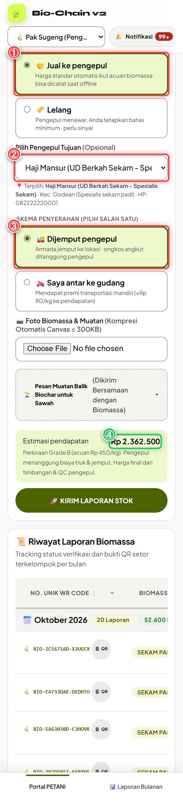

**Panduan Aksi Berdasarkan Nomor pada Gambar:**
- **① Jual ke pengepul:** ketuk kartu ini (kartu terpilih berwarna hijau muda dengan tanda radio terisi).
- **② Pilih Pengepul Tujuan (Opsional):** sistem otomatis memilih pengepul spesialis komoditas Anda, contoh **Haji
  Mansur (UD Berkah Sekam – Spesialis Sekam)**. Keterangan di bawahnya: "Terpilih: … · Kec. Godean (Spesialis sekam
  padi) · HP: 082222220001". Ganti bila punya langganan lain, atau pilih "Bebas / Pengepul Terdekat (Otomatis)".
- **③ Dijemput pengepul:** ketuk kartu skema penyerahan ini ("Armada jemput ke lokasi · ongkos angkut ditanggung
  pengepul").
- **④ Estimasi pendapatan (hasil):** kotak hijau menampilkan **Rp 2.362.500** — "Perkiraan Grade B (acuan Rp 450/kg).
  Pengepul menanggung biaya truk & jemput. Harga final dari timbangan & QC pengepul." Hitungannya: 5.000 kg × Rp 450 ×
  1,05 (pengali Grade B). Lalu ketuk **🚀 KIRIM LAPORAN STOK**; muncul jendela "Laporan Sekam padi Berhasil!" berisi
  kode QR batch, dan lot baru tampil di kartu **Riwayat Laporan Biomassa** di bawahnya.

> **🔧 Di Balik Layar (Sistem):** `updateEarning()` (`app/static/app.js`) menghitung
> `estimasi = jumlah × harga_acuan × harga_mutu.mult_<grade>`. Bila grade tidak diketahui, ditampilkan rentang
> Grade C–A (`mult_C` s/d `mult_A`). Payload ke `POST /api/v1/farmer/harvest` memuat `transaction_mode: "DIRECT"`,
> `logistics_mode: "PICKUP"`, `delivery_scheme: "jemput"`, dan `collector_id`. Server membuat batch status
> `REPORTED` dengan kode QR baru (`new_qr_code`), yang masuk antrean uji mutu pengepul.

### Layar 3.3b — Bursa Lelang + Saya Antar ke Gudang

**Tujuan Proses & Standar Terkait:** Membuka stok untuk ditawar banyak pengepul dengan batas harga minimum, dan
mengantar sendiri ke gudang untuk mendapat premi.

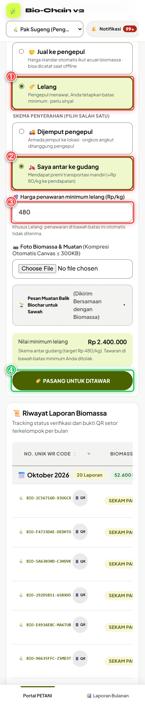

**Panduan Aksi Berdasarkan Nomor pada Gambar:**
- **① Lelang:** ketuk kartu ini. Kolom "Pilih Pengepul Tujuan" otomatis disembunyikan karena lelang terbuka untuk
  semua pengepul.
- **② Saya antar ke gudang:** ketuk kartu ini — "Mendapat premi transportasi mandiri (+Rp 80/kg ke pendapatan)".
- **③ Harga penawaran minimum lelang (Rp/kg):** ketik batas bawah, contoh `480`. Tawaran di bawah batas ini otomatis
  tidak diterima. (Bila dikosongkan, sistem mengisi harga acuan + premi antar = 450 + 80 = Rp 530/kg.)
- **④ PASANG UNTUK DITAWAR:** pada mode lelang tombol kirim berubah menjadi tombol ini. Sebelum mengetuk, periksa kotak
  hasil di atasnya: **Nilai minimum lelang Rp 2.400.000** (5.000 kg × Rp 480) — "Skema antar gudang (target Rp 480/kg).
  Tawaran di bawah batas minimum Anda ditolak." Setelah diketuk, stok muncul di kartu Stok Lelang (Layar 3.3c).

> **🔧 Di Balik Layar (Sistem):** Pada mode lelang `updateEarning()` mengaktifkan kolom `f-ask-price` dan menghitung
> `nilai_minimum = jumlah × harga_minimum`. Premi antar mandiri adalah konstanta `premiAntar = 80` (Rp/kg) di
> `app/static/app.js`: harga efektif skema antar = harga acuan + 80. Payload memuat `transaction_mode: "BIDDING"`,
> `logistics_mode: "DELIVER_SELF"`, `floor_price: 480`, `collector_id: null`. Lelang membutuhkan sinyal karena
> pengepul harus bisa melihat dan menawar stok secara langsung.

### Layar 3.3c — Stok Lelang & Tawaran Masuk

**Tujuan Proses & Standar Terkait:** Memantau stok yang sedang dilelang, membandingkan tawaran pengepul berdasarkan
**nilai bersih** (harga − ongkos antar Anda), lalu memilih tawaran.

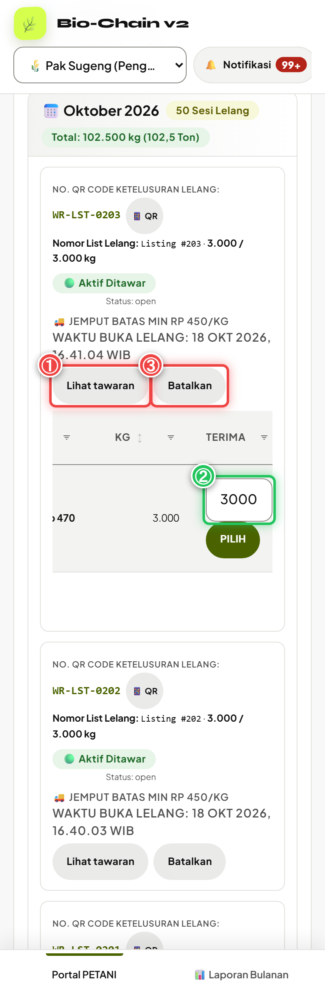

Kartu **Stok Lelang & Tawaran Masuk** mengelompokkan lelang per bulan (contoh "Oktober 2026 · 50 Sesi Lelang · Total:
102.500 kg (102,5 Ton)"). Tiap lelang menampilkan kode QR lelang (contoh `WR-LST-0203`), nomor list (Listing #203 ·
3.000 / 3.000 kg), status **Aktif Ditawar** (status: open), skema ("Jemput batas min Rp 450/kg"), dan waktu buka lelang
(18 Okt 2026, 16.41.04 WIB).

**Panduan Aksi Berdasarkan Nomor pada Gambar:**
- **① Lihat tawaran:** ketuk untuk membuka tabel tawaran pengepul di bawah kartu (kolom Pengepul, Skema & Jadwal,
  harga/kg, nilai bersih/kg, KG, Terima). Contoh: satu tawaran **Rp 470/kg** untuk **3.000 kg**. Geser tabel ke kanan bila
  kolom terpotong.
- **② Terima tawaran:** di kolom **Terima**, isi jumlah yang ingin dijual (contoh `3000`; boleh lebih kecil untuk
  menjual sebagian) lalu ketuk **PILIH**. Muncul jendela "Kontrak Lelang" berisi QR yang ditunjukkan saat serah terima.
- **③ Batalkan:** ketuk untuk menarik lelang yang masih terbuka.

> **🔧 Di Balik Layar (Sistem):** Tawaran dimuat dari `GET /api/v1/farmer/listings/{id}/bids`; nilai bersih per kg
> untuk skema antar dikurangi ongkos antar petani (`trade.bids_for_farmer`). Memilih tawaran memanggil
> `POST /api/v1/farmer/listings/{id}/accept` — **atomik**: stok tidak pernah terjual melebihi sisa, dan penerimaan
> sebagian diperbolehkan. Pembatalan: `POST /api/v1/farmer/listings/{id}/cancel`.

**Konfirmasi jadwal jemput (tanpa screenshot khusus).** Setelah pengepul mengusulkan tanggal penjemputan, di tabel
tawaran kolom Skema & Jadwal muncul label **Rencana: \<tanggal\>** dengan dua tombol:
- **✓ Setujui** — jadwal dikunci; label berubah menjadi "✓ Jadwal: \<tanggal\>".
- **📅 Ubah** — membuka jendela "Ajukan Penyesuaian Jadwal Jemput": isi **Tanggal Penjemputan Baru** dan **Catatan
  untuk Pengepul** (contoh "Panen baru selesai sore, mohon ambil pagi hari."), lalu **Kirim Permintaan**. Label berubah
  menjadi "📅 Diajukan: \<tanggal\>".

> **🔧 Di Balik Layar (Sistem):** Kedua tombol memanggil `POST /api/v1/farmer/bids/{bid_id}/schedule-respond` dengan
> `action` = `APPROVED` atau `RESCHEDULE_REQUESTED` (+ `reschedule_date`, `reschedule_note`); server memeriksa bahwa
> petani adalah pemilik lelang (403 bila bukan) dan menyimpan `farmer_schedule_status` serta `pickup_date` baru.
> Ada pula endpoint setara `POST /api/v1/farmer/schedule/confirm` (`decision` = `APPROVE`/`RESCHEDULE`, dengan
> penguncian baris `with_for_update`) untuk integrasi; tampilan HP saat ini memakai `schedule-respond`.

---

## 3.4 Permintaan Abu/Biochar Sirkular & Alokasi

### Layar 3.4a — Pesan Muatan Balik Biochar untuk Sawah

**Tujuan Proses & Standar Terkait:** Memesan biochar (arang hayati hasil pirolisis) untuk pembenah tanah sawah, yang
dibawa truk yang sama saat menjemput biomassa — hemat ongkos dan tanpa perjalanan kosong (*zero empty trips*).

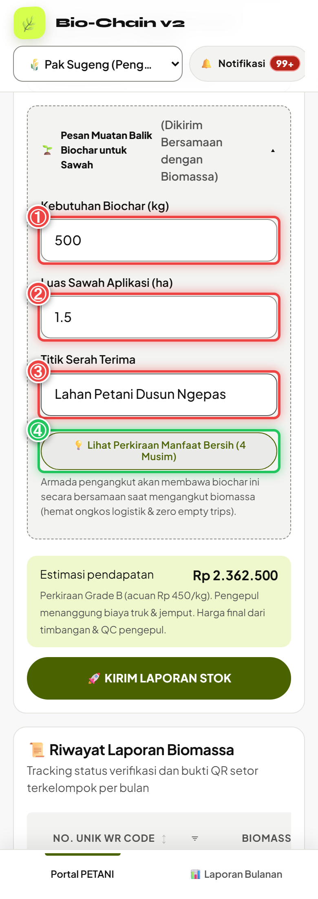

**Panduan Aksi Berdasarkan Nomor pada Gambar:**
- **① Kebutuhan Biochar (kg):** ketik jumlah, contoh `500`.
- **② Luas Sawah Aplikasi (ha):** ketik luas lahan, contoh `1.5`.
- **③ Titik Serah Terima:** ketik lokasi penurunan, contoh "Lahan Petani Dusun Ngepas".
- **④ 💡 Lihat Perkiraan Manfaat Bersih (4 Musim):** ketuk untuk melihat perkiraan tambahan panen, hemat pupuk, biaya
  tebar, dan manfaat bersih selama 4 musim. Ini **perkiraan**, bukan janji panen.

Pesanan ikut terkirim saat Anda mengetuk **🚀 KIRIM LAPORAN STOK** (terlihat di bawah gambar, bersama Estimasi
pendapatan Rp 2.362.500 untuk Jual ke pengepul).

> **🔧 Di Balik Layar (Sistem):** Tombol ④ memanggil `GET /api/v1/farmer/biochar/estimate?kg=500&land_area_ha=1.5`
> → `app/engines/biochar_field.py`. Rumus (parameter `biochar_sawah.*`): dosis `r = kg/1000/luas` (dibatasi `r_cap`);
> kenaikan hasil `f(r) = R_maks·(1 − e^(−k·r))`; efek sisa N musim `M = (1 − dᴺ)/(1 − d)`;
> manfaat bersih = tambahan pendapatan gabah + hemat pupuk − ongkos tebar. Saat laporan dikirim, kolom
> `biochar_request_kg`, `biochar_land_area_ha`, `biochar_delivery_point` membuat permintaan muatan balik yang
> diteruskan ke pengepul/driver (`report_harvest`, `app/routers/farmer.py`).

### Layar 3.4b — Alokasi Abu & Evaluasi Mutu Biochar

**Tujuan Proses & Standar Terkait:** Menampilkan abu boiler yang dialokasikan ke kelompok tani Anda — hanya abu yang
lolos uji logam berat (Pb, Cd, As ≤ ambang aman, mengacu Kepmentan 261/2019) — dan mencatat ulasan mutu biochar setelah
diaplikasikan di sawah.

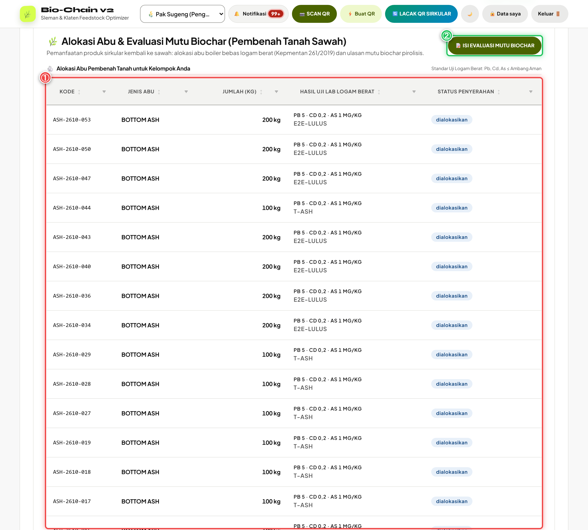

**Panduan Aksi Berdasarkan Nomor pada Gambar:**
- **① Tabel Alokasi Abu Pembenah Tanah untuk Kelompok Anda:** tiap baris berisi **Kode** (contoh `ASH-2610-053`),
  **Jenis Abu** (BOTTOM ASH), **Jumlah** (contoh 200 kg atau 100 kg), **Hasil Uji Lab Logam Berat** (contoh "Pb 5 · Cd 0,2
  · As 1 mg/kg" + nomor laporan lab, mis. "E2E-LULUS" atau "T-ASH"), dan **Status Penyerahan** (contoh *dialokasikan*;
  menjadi *diserahkan* setelah abu diterima kelompok).
- **② 📝 ISI EVALUASI MUTU BIOCHAR:** ketuk untuk mengisi ulasan: kode batch, skor 1–5 untuk **Ukuran Mesh**,
  **Kematangan Pirolisis**, **Kadar Kelembapan**, **Dampak Kesuburan Tanah**, plus catatan dampak di lahan.
- **Tabel Evaluasi & Ulasan Mutu Biochar Lapangan** ada di bawah tabel abu (gulir ke bawah; tidak terlihat di gambar):
  riwayat ulasan dengan skor total "⭐ x / 5.0".

Tabel ini lebar; paling nyaman dilihat di tablet/desktop atau dengan HP dimiringkan (gambar diambil dari tampilan
desktop).

> **🔧 Di Balik Layar (Sistem):** Data abu dari `GET /api/v1/farmer/ash` (`app/routers/multibiomass.py`, hanya untuk
> ketua kelompok tani yang menerima alokasi). Ulasan disimpan via `POST /api/v1/farmer/biochar-evaluations` dan
> ditampilkan dari `GET` endpoint yang sama (`app/static/field-ops.js`, `openBiocharEvaluationModal` &
> `loadBiocharEvaluations`). Spesifikasi mutu biochar produk (H/Corg, logam berat) mengacu EBC/IBI dan dikelola di
> sisi pabrik (Bab 6).

---

## 3.5 Ketertelusuran, Hasil Uji Mutu & Grade, Pelacakan Pembayaran

### Layar 3.5a — Riwayat Laporan, Grade & QR

**Tujuan Proses & Standar Terkait:** Melihat semua batch yang pernah dilaporkan beserta kode unik QR-nya, sebagai bukti
asal-usul biomassa.

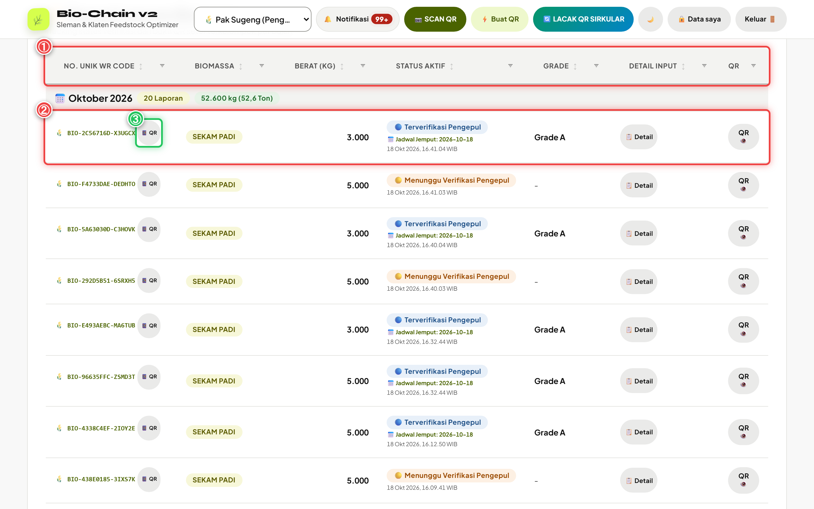

**Panduan Aksi Berdasarkan Nomor pada Gambar:**
- **① Judul kolom tabel:** No. Unik WR Code, Biomassa, Berat (kg), Status Aktif, Grade, Detail Input, QR. Ketuk ↕
  untuk mengurutkan, ikon saring untuk menyaring. Laporan dikelompokkan per bulan, contoh "Oktober 2026 · 20 Laporan ·
  52.600 kg (52,6 Ton)".
- **② Satu baris laporan:** contoh `BIO-2C56716D-X3UGCX` · SEKAM PADI · 3.000 kg · **Terverifikasi Pengepul** dengan
  "Jadwal Jemput: 2026-10-18" · **Grade A** · tombol **Detail**. Lot yang belum diuji berstatus **Menunggu Verifikasi
  Pengepul** dan kolom Grade masih "–".
- **③ 📱 QR:** ketuk untuk menampilkan kode QR batch untuk ditunjukkan ke pengepul atau driver saat serah terima.

Tabel ini lebar; paling nyaman dilihat di tablet/desktop atau dengan HP dimiringkan (gambar diambil dari tampilan
desktop). Di HP, geser tabel ke kanan.

> **🔧 Di Balik Layar (Sistem):** Data dari `GET /api/v1/farmer/harvests`. Kode QR batch dibuat sekali saat laporan
> dikirim dan disimpan sebagai `origin_qr_code`, sehingga tetap bisa dilacak walau batch kemudian berpindah tangan.

### Layar 3.5b — Hasil Uji Mutu: Deviasi & Refraksi

**Tujuan Proses & Standar Terkait:** Transparansi: membandingkan taksiran Anda dengan timbangan dan uji mutu nyata
pengepul, termasuk potongan berat (refraksi) dan alasan bila lot ditolak.

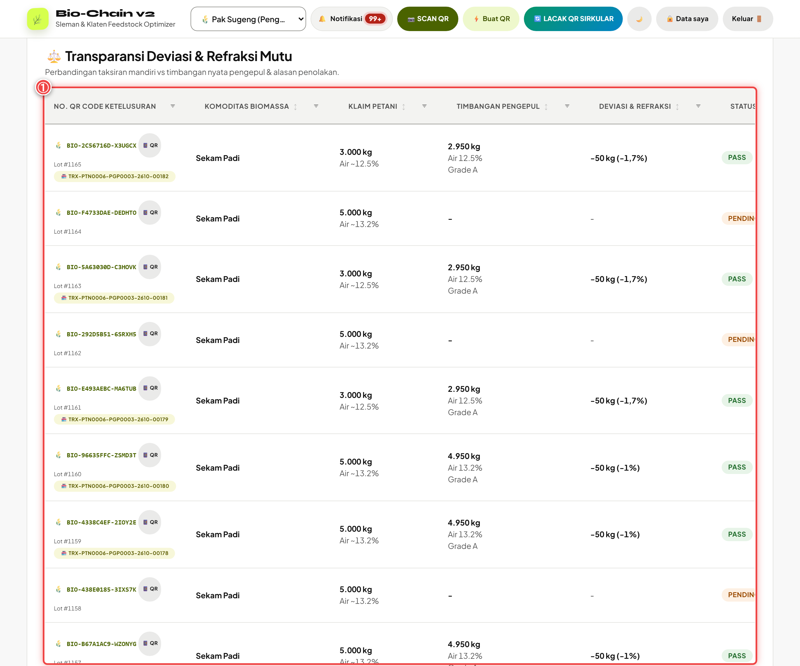

**Panduan Aksi Berdasarkan Nomor pada Gambar:**
- **① Tabel Transparansi Deviasi & Refraksi Mutu:** tiap baris = satu lot. Contoh baris pertama: `BIO-2C56716D-X3UGCX`
  (Lot #1165, resi serah terima `TRX-PTN0006-PGP0003-2610-00182`) · Sekam Padi · **Klaim Petani 3.000 kg, air ~12,5 %**
  · **Timbangan Pengepul 2.950 kg, air 12,5 %, Grade A** · **Deviasi & Refraksi −50 kg (−1,7 %)** · Status **PASS**.
  Lot `BIO-4338C4EF-2IOY2E` (Lot #1159): klaim 5.000 kg (air ~13,2 %) → timbangan 4.950 kg (air 13,2 %, Grade A),
  deviasi −50 kg (−1 %). Lot yang belum ditimbang menampilkan "–" dan status **PENDING**. Kolom paling kanan (Status QC
  dan tombol **Aksi** untuk membuka rincian "Ketelusuran Mutu & Refraksi Lot") ada di ujung kanan tabel.
- Di bawah tabel ini ada kartu **⭐ Reputasi & Keandalan Pengepul** (skor ketepatan bayar & tempo bayar pengepul
  terdekat) dengan tombol **⭐ Beri Rating Pengepul** untuk menilai pengepul setelah transaksi (tidak terlihat di gambar).

Tabel ini lebar; paling nyaman dilihat di tablet/desktop atau dengan HP dimiringkan (gambar diambil dari tampilan
desktop).

> **🔧 Di Balik Layar (Sistem):** Data dari `GET /api/v1/farmer/qc-deviations` (klaim, timbangan, deviasi kg/%,
> kadar air taksiran vs terukur, grade, alasan tolak). Berat yang dibayar dihitung `app/engines/refraction.py`:
>
> `kg_bayar = kg_timbang × (1 − max(0, kontaminan − toleransi)) × (1 − MC) / (1 − MC_acuan)`
>
> Tidak ada bonus bila lebih kering dari acuan (kecuali diaktifkan per transaksi). Bila MC di atas batas tolak
> (`harga_mutu.moisture_reject` = 25 %), lot ditolak kecuali pengepul memilih "terima basah" secara eksplisit.
> Grade resmi A/B/C/D berasal dari skor mutu `app/engines/quality.py`. Reputasi pengepul dari
> `GET /api/v1/farmer/collector-reputations`; rating disimpan via `POST /api/v1/farmer/collector-ratings`.

### Layar 3.5c — Lacak QR Sirkular End-to-End

**Tujuan Proses & Standar Terkait:** Melacak perjalanan satu batch dari sawah → pengepul → driver → pabrik (pirolisis /
abu) → muatan balik → sawah, dengan rantai sidik digital SHA-256. Pencatatan *chain of custody* ini *selaras* dengan
prinsip ISO 22095 (bukan sertifikasi).


**Panduan Aksi Berdasarkan Nomor pada Gambar:**
- **① Kolom kode lot:** ketik atau tempel kode QR batch, contoh `BIO-F4733DAE-DEDHTO`, lalu ketuk **🔍 LACAK** (atau
  tekan Enter). Tersedia tombol contoh "Lot #6 (Converted)", "Lot #25", "Muatan Balik #1".
- **② Lencana tahap (hasil):** posisi batch dalam 6 tahap, contoh **Tahap 1/6** untuk lot yang baru dilaporkan; bila
  siklus tertutup menjadi "🟢 100% Sirkular Terpenuhi".
- **③ Ringkasan aliran massa & linimasa tahap:** kartu Input Biomassa Sawah (**5.000 kg** Sekam Padi), Timbang Terima
  Pabrik (4.750 kg), Biochar Dihasilkan (1.425 kg, yield ~30 %), Abu Sisa Pembakaran (688,8 kg), Kembali ke Sawah
  (57 sak), dan Emisi CO₂ Dihindari (1.211,3 kg, metodologi IPCC Tier 2). Di bawahnya linimasa: **Tahap 1 ✓ Selesai**
  (Pelaporan Stok Biomassa Petani), Tahap 2 dan 3 **Menunggu**.
  ⚠️ Untuk lot yang belum sampai pabrik (seperti contoh ini, Tahap 1/6), angka pabrik/biochar/abu/CO₂ adalah
  **proyeksi** dari angka default sistem, bukan hasil timbang atau produksi nyata.

Di bagian bawah jendela ada **SHA256 Chained Provenance Integrity** (sidik digital rantai data; bila ada data yang diubah
diam-diam, sidiknya tidak cocok), tombol **🖨 Cetak Paspor Sirkular**, dan **Tutup**.

> **🔧 Di Balik Layar (Sistem):** `GET /api/v1/traceability/circular/{kode}` → `app/services/circular_traceability.py`
> menggabungkan data panen, custody event, ledger biochar, konversi pabrik, surat jalan muatan balik, dan penebusan
> biochar. Bila konversi belum ada, yield biochar memakai default 30 % dan abu diperkirakan 14,5 % dari berat terima
> pabrik; bila timbang pabrik belum ada, berat pabrik diperkirakan 95 % berat pengepul. Sidik dihitung `hashlib.sha256`.

### Layar 3.5d — Pembayaran & Kuitansi Saya

**Tujuan Proses & Standar Terkait:** Melacak uang muka (DP), kuitansi digital, dan pelunasan. Batas waktu bayar petani
adalah **maksimal 3 hari** setelah biomassa ditimbang & diuji (lebih ketat dari target ≤ 14 hari); lewat batas ditandai
**terlambat**.

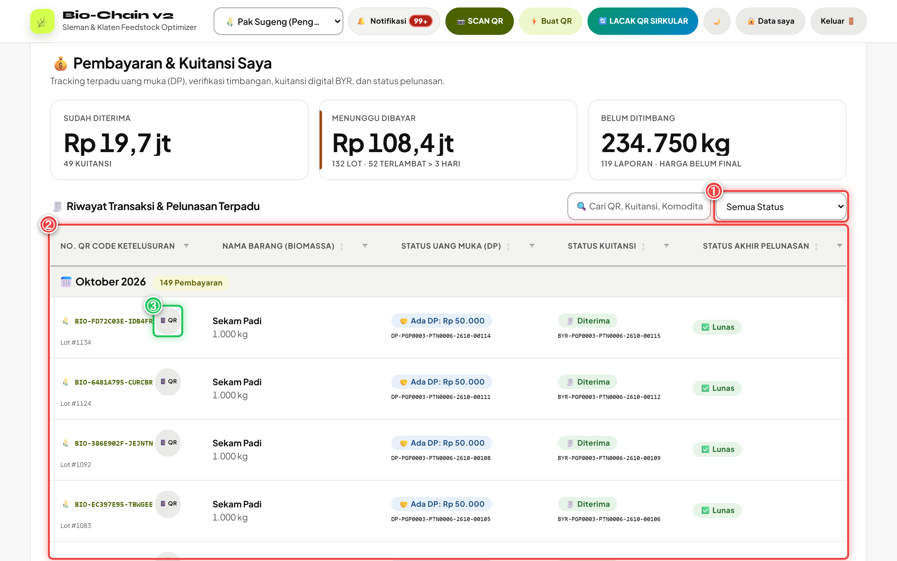

**Panduan Aksi Berdasarkan Nomor pada Gambar:**

Tiga kartu ringkasan di atas:
- **Sudah Diterima** — **Rp 19,7 jt · 49 kuitansi**.
- **Menunggu Dibayar** — **Rp 108,4 jt · 132 lot · 52 terlambat > 3 hari**.
- **Belum Ditimbang** — **234.750 kg · 119 laporan · harga belum final**.

Lalu di bagian **Riwayat Transaksi & Pelunasan Terpadu**:
- **① Filter status:** pilih **Semua Status**, **✅ Sudah Lunas**, **⏳ Menunggu Pelunasan**, atau **🤝 Ada Uang Muka
  (DP)**. Kolom pencarian di sebelahnya menerima kode QR, nomor kuitansi, atau nama komoditas.
- **② Tabel riwayat:** dikelompokkan per bulan (contoh "Oktober 2026 · 149 Pembayaran"). Contoh baris:
  `BIO-FD72C03E-IDB4FR` (Lot #1134) · **Sekam Padi 1.000 kg** · **Ada DP: Rp 50.000** (`DP-PGP0003-PTN0006-2610-00114`)
  · Status Kuitansi **Diterima** (`BYR-PGP0003-PTN0006-2610-00115`) · Status Akhir **Lunas**. Status lain yang mungkin
  muncul: "⚪ Tanpa DP", "⏳ Menunggu Terbit", "⏳ Menunggu Pelunasan", "⏳ Belum Ditimbang". Di ujung kanan ada kolom
  Nominal Net, Pengepul & Waktu, dan Aksi (tombol **🧾 Kuitansi** / **🤝 Kuitansi DP** untuk membuka kuitansi digital).
- **③ 📱 QR:** ketuk untuk menampilkan kode QR lot asal pembayaran tersebut.

Tabel ini lebar; paling nyaman dilihat di tablet/desktop atau dengan HP dimiringkan (gambar diambil dari tampilan
desktop).

> **🔧 Di Balik Layar (Sistem):** `GET /api/v1/farmer/payments/overview` → `farmer_overview()` di
> `app/services/payments.py` membagi lot menjadi tiga keranjang: **dibayar** (ada `FarmerPayment` + kuitansi BYR),
> **menunggu bayar** (sudah diverifikasi, belum dibayar), dan **belum ditimbang** (status `REPORTED`). Lot menunggu
> ditandai `late = hari_menunggu > pasar.farmer_payment_due_days` (default **3 hari**, rentang 0–60, diatur di menu
> Parameter). Nilai bersih = bruto − PPh 22 (`pajak.pph22_farmer_pct`) − DP aktif. Tabel dirender oleh
> `renderUnifiedPaymentTable()` (`app/static/field-ops.js` → `app/static/js/modules/field-kuitansi.js`). Penanda
> terlambat tampil di kartu "Menunggu Dibayar"; tabel menampilkan status DP, kuitansi, dan lunas.

---

## Tips Lapangan

| Situasi | Yang perlu dilakukan | Yang terjadi di sistem |
|:---|:---|:---|
| Sinyal hilang saat kirim laporan **Jual ke pengepul** | Tetap ketuk **Kirim Laporan Stok**. | Muncul pesan "Sinyal hilang. Laporan disimpan di HP & dikirim otomatis saat online." Laporan masuk antrean (*outbox*) di IndexedDB HP (cadangan `localStorage`). |
| Banner kuning **📵 Mode Hemat Sinyal** muncul di atas layar | Lanjutkan bekerja; jangan hapus data browser/cache aplikasi. | Banner menampilkan jumlah data antre (contoh "2 data antre"). Antrean dikirim otomatis saat sinyal kembali, saat aplikasi dibuka lagi, dan dicoba setiap 30 detik. |
| Sinyal kembali tapi data masih antre | Ketuk **Kirim sekarang** pada banner biru "📶 Sinyal tersedia". | `flushOutbox()` mengirim antrean berurutan; foto antrean diunggah dulu. Tiap laporan punya `client_event_id` sehingga **tidak tercatat dobel**. |
| Muncul banner **🔐 Sesi berakhir** | Login ulang. | Antrean tetap aman di HP dan dikirim setelah login. |
| Data antre ditolak server | Baca pesan "Ditolak server (…)". | Data dipindah ke kotak gagal untuk ditinjau, tidak hilang diam-diam. |
| Ingin **Lelang** | Cari tempat bersinyal. | Lelang perlu sinyal agar pengepul bisa menawar langsung. |
| Kuota/sinyal lemah saat foto | Foto seperti biasa. | Foto otomatis dikecilkan ≤ 300 KB dan disimpan di HP bila offline. |
| Jam HP salah | Atur tanggal & jam HP otomatis. | Waktu catat offline divalidasi server terhadap `CLIENT_CLOCK_MAX_PAST_HOURS` (default 72 jam); di luar jendela itu jam HP tidak dipakai dan server memakai jam server. |
| Biomassa masih basah (MC > 18 %) | Jemur dulu sebelum lapor/serah. | Estimasi menampilkan "Berisiko ditolak"; di atas 25 % lot ditolak saat uji mutu. |

# Bab 4 — Panduan Langkah demi Langkah Modul Pengepul / Agregator

Modul Pengepul dipakai oleh agregator (KUD, pedagang sekam, pemilik gudang) yang membeli biomassa dari petani,
menimbang dan menguji mutunya, mengatur rute jemput, membayar petani, lalu menjual dan mengirim ke pabrik.
Semua layar di bab ini diambil pada laptop/desktop (1440 × 900) dengan akun demo **Pak Ahmad (KUD Tani …)**.
Pengepul demo ini dikunci ke **satu komoditas** (Sekam Padi). Sistem menolak tawaran atau verifikasi untuk
komoditas lain dengan pesan "Isolasi spesialisasi" (`app/services/trade.py` → `place_bid`, `app/routers/collector.py` → `verify_harvest`).

Alur kerja harian pengepul:

1. **4.1** Lihat penawaran petani, kirim tawaran lelang, periksa margin kontrak.
2. **4.2** Susun rute jemput yang memperhitungkan berat **dan** volume bak, termasuk muatan balik biochar.
3. **4.3** Timbang dan uji mutu di lokasi, terbitkan resi TRX, lalu bayar petani (DP atau lunas).
4. **4.4** Ajukan pengiriman ke pabrik, pantau piutang, dan baca umpan balik QC gerbang pabrik.

---

## 4.1 Dashboard Konsolidasi, Bursa Lelang & Margin Kontrak

### Layar 4.1a — Dashboard Penawaran Biomassa Petani (tiga jalur masuk)

**Tujuan Proses & Standar Terkait:** Menyatukan semua biomassa yang ditawarkan petani dalam satu dashboard. Penawaran
dibagi menurut cara transaksi dan cara angkut, supaya pengepul tahu lot mana yang harus dijemput, ditawar, atau ditunggu.
Setiap lot membawa nomor QR ketelusuran yang menjadi awal rantai *chain of custody* (selaras ISO 22095).

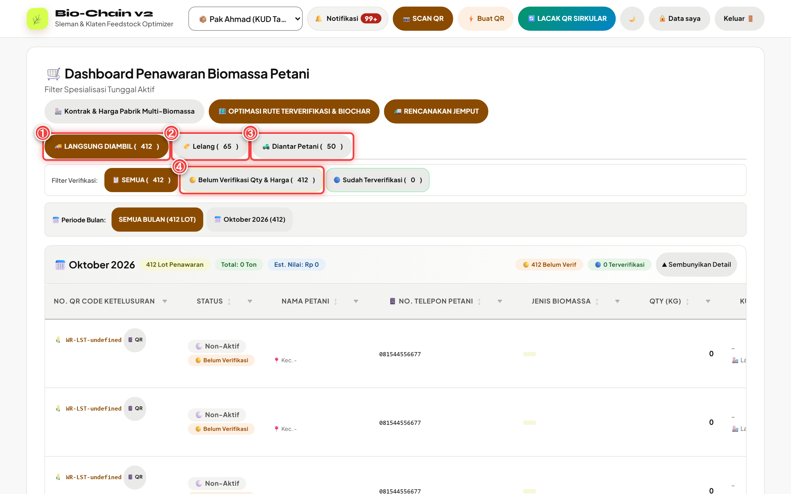

**Panduan Aksi Berdasarkan Nomor pada Gambar:**
- **① Tab "LANGSUNG DIAMBIL" (412):** lot yang dijual langsung oleh petani dengan skema *dijemput armada*. Pada
  gambar, tab ini sedang aktif. Kartu bulan "Oktober 2026" menampilkan "412 Lot Penawaran". Dari sinilah lot masuk ke
  antrean timbang dan uji (Layar 4.3a).
- **② Tab "Lelang" (65):** stok yang dilelang petani di Bursa Lelang. Di sini Anda mengirim tawaran harga (Layar 4.1b).
- **③ Tab "Diantar Petani" (50):** lot yang diantar sendiri oleh petani ke gudang Anda, jadi tidak perlu dijemput.
- **④ Filter "Belum Verifikasi Qty & Harga" (412):** menyaring lot yang berat dan harganya belum Anda konfirmasi.
  Di sampingnya ada "SEMUA (412)" dan "Sudah Terverifikasi (0)". Baris "Periode Bulan" menyaring per bulan
  ("SEMUA BULAN (412 LOT)", "Oktober 2026 (412)").

*Catatan data contoh: baris tabel pada gambar menampilkan kode "WR-LST-undefined", status Non-Aktif, dan Qty 0, dan
ringkasan bulan menunjukkan "Total: 0 Ton · Est. Nilai: Rp 0". Ini cacat tampilan data demo, bukan isi lot yang
sebenarnya.*

Tombol di atas tab: **Kontrak & Harga Pabrik Multi-Biomassa** (Layar 4.1c), **OPTIMASI RUTE TERVERIFIKASI & BIOCHAR**
(Layar 4.2a), dan **RENCANAKAN JEMPUT** (rencana jemput cepat dari tawaran lelang yang sudah diterima petani).

> **🔧 Di Balik Layar (Sistem):** Data diambil dari `GET /api/v1/collector/offers-dashboard`
> (`app/routers/collector_bidding.py`) lewat fungsi `loadMarket()` di `app/static/app.js`. Server mengelompokkan
> lot menjadi `langsung_diambil`, `lelang`, dan `diantar_petani`. Stok lelang hanya muncul untuk komoditas
> spesialisasi pengepul, diurutkan dari yang paling dekat ke gudang. Tombol **WA** pada setiap baris membuka WhatsApp
> ke petani. Nomor HP diambil lewat `GET /collector/harvests/{id}/contact`, dan setiap akses tercatat sesuai kontrol
> privasi PDP (masking di daftar, nomor lengkap hanya saat diminta).

### Layar 4.1b — Tab Bursa Lelang: Mengirim Tawaran

**Tujuan Proses & Standar Terkait:** Pengepul mengajukan harga beli untuk stok yang dilelang petani. Keputusan tetap
ada di tangan petani. Server menolak tawaran di bawah harga minimum (*reserve price*) yang dipasang petani.

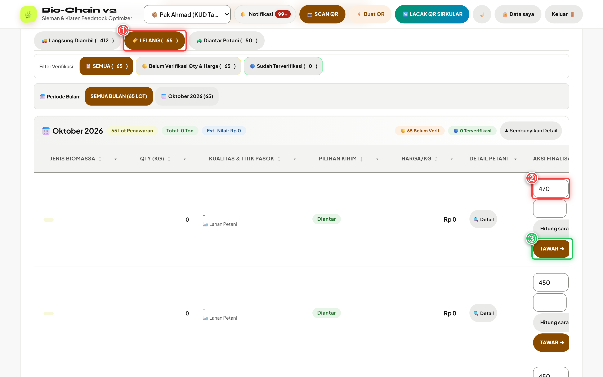

**Panduan Aksi Berdasarkan Nomor pada Gambar:**
- **① Tab "LELANG (65)":** klik untuk membuka daftar stok lelang. Kolom tabel: Jenis Biomassa, Qty (kg), Kualitas &
  Titik Pasok, Pilihan Kirim, Harga/kg, Detail Petani, dan Aksi Finalisasi.
- **② Kotak harga tawaran (Rp/kg):** ketik harga beli Anda, contoh **470**. Kotak kosong di bawahnya untuk jumlah
  kg (boleh sebagian dari stok). Tombol **Hitung saran** (penasihat harga) mengisi otomatis harga yang masih
  menguntungkan. Contoh data skenario: stok 3.000 kg, harga minimum petani Rp450/kg (dijemput), tawaran Rp470/kg.
- **③ TAWAR ➔:** kirim tawaran. Muncul notifikasi "Tawaran terkirim. Petani yang memutuskan." Harga di bawah harga
  minimum petani ditolak dengan pesan berisi angka minimumnya.

*Catatan data contoh: baris pada gambar menampilkan Qty 0, Harga/kg Rp 0, dan Pilihan Kirim "Diantar". Ini cacat data
demo yang sama dengan Layar 4.1a.*

> **🔧 Di Balik Layar (Sistem):**
> - **Anti klik-ganda:** tombol dibungkus `withBusy()` (`app/static/app.js`). Selama permintaan berjalan, tombol
>   dinonaktifkan dan klik kedua diabaikan (`btn.dataset.busy === "1"`).
> - **Satu tawaran aktif per pengepul per skema:** `trade.place_bid` (`app/services/trade.py`) menarik otomatis
>   (status `WITHDRAWN`) tawaran aktif sebelumnya dari pengepul yang sama pada lot dan skema yang sama, lalu membuat
>   yang baru. Validasi yang dijalankan: lot masih terbuka dan belum kedaluwarsa, harga ≥ *reserve* petani, dan
>   jumlah ≤ sisa stok.
> - **Penerimaan atomik (CAS):** saat petani menerima tawaran (`trade.accept_bid`), stok dikurangi dengan
>   *compare-and-swap* `UPDATE … WHERE remaining_kg >= qty AND status IN (OPEN, PARTIAL)`. Tawaran dikunci sekali
>   pakai (`WHERE status = ACTIVE`). Jika dua penerimaan datang bersamaan, yang kalah mendapat pesan "Sisa stok tidak
>   mencukupi atau listing sudah ditutup — muat ulang data". Pada PostgreSQL dipakai fungsi `accept_bid_atomic`
>   (migrasi 013, `SELECT … FOR UPDATE`). Ketika stok habis, tawaran lain otomatis berstatus `REJECTED`.
> - **Penasihat harga** (`POST /collector/bid-advisor`):
>   `tawaran_maks = harga_jual_ke_pabrik − biaya_logistik_marginal/kg − margin/kg`.
>   Biaya logistik marginal = (km rute dengan lot ini − km rute tanpa lot ini) × Rp/km ÷ kg, dihitung oleh mesin rute
>   `app/engines/routing.py` (konsep *insertion cost*).

### Layar 4.1c — Modul Kontrak & Harga Jual Multi-Biomassa (margin agregator)

**Tujuan Proses & Standar Terkait:** Mencatat harga beli ke petani dan harga jual ke pabrik mitra untuk tiap komoditas,
supaya margin pengepul terlihat transparan. Margin ini dipakai sebagai dasar perhitungan tawaran yang adil bagi petani
dan pengepul.


**Panduan Aksi Berdasarkan Nomor pada Gambar:**
- **① Harga Beli Petani (Rp/kg):** isi harga acuan beli. Contoh baris Sekam Padi: **450**.
- **② Harga Jual Pabrik (Rp/kg):** isi harga kontrak dengan offtaker. Contoh: **580** (PT Bio-Energi Sleman).
- **③ Baris komoditas (hasil):** kolom **Margin Laba** dihitung otomatis = 580 − 450 = **+Rp130/kg**. Komoditas lain
  pada gambar: Tongkol Jagung 380/520 (+Rp140), Ampas Tebu 260/390 (+Rp130), Serbuk Sengon 320/470 (+Rp150),
  Serbuk Karet 300/460 (+Rp160), Tempurung/Sabut Kelapa 500/780 (+Rp280).
- **④ Simulasi Margin Truk:** membuka form proyeksi satu ritase. Isinya pilihan komoditas, muatan (ton, default 5),
  jarak ke pabrik (km, default 35), dan biaya truk per km (default Rp4.500). Klik **SIMPAN PERUBAHAN KONTRAK** setelah
  mengubah harga.

> **🔧 Di Balik Layar (Sistem):**
> - Simulasi margin truk (`openSimulateTruckMarginModal`, `app/static/app.js`):
>   `laba_bersih = kg × (harga_jual − harga_beli) − km × biaya_per_km`.
>   Contoh: 5.000 kg × Rp130 − 35 km × Rp4.500 = Rp650.000 − Rp157.500 = **Rp492.500 per ritase**.
> - **Margin proporsional:** penasihat tawaran (Layar 4.1b) mengambil margin dalam bentuk **persen** dari tabel ini,
>   bukan angka rupiah tetap, sehingga margin naik-turun mengikuti harga. Server menghitung
>   `margin_per_kg = harga_jual × margin_pct / 100` (`collector_bidding.py` → `bid_advisor`). Nilai default parameter:
>   `pasar.default_margin_pct` = 5 % dan `pasar.default_margin_per_kg` = Rp30/kg.
> - Tabel kontrak ini **disimpan di browser perangkat** (`localStorage`, kunci `biochain_factory_pricing_v1`), bukan di
>   server. Jika pengepul berganti HP/laptop, harga harus diisi ulang. Harga yang mengikat pabrik tetap mengikuti ajuan
>   pengiriman (Layar 4.4a).

---

## 4.2 Optimasi Rute Angkut Berbasis Volume & Muatan Balik Biochar

**Mengapa volume penting?** Sekam padi sangat ringan, dengan densitas curah ±110–120 kg/m³. Truk CDD 5.000 kg / 30 m³
yang diisi sekam akan **penuh secara volume** (30 m³ × 120 kg/m³ = 3.600 kg) jauh sebelum batas beratnya tercapai.
Karena itu rute di Bio-Chain dihitung dengan **dua batas sekaligus**: kg dan m³ bak.

### Layar 4.2a — Pilih Armada, Batas Muatan & Lot Terverifikasi

**Tujuan Proses & Standar Terkait:** Menyusun penjemputan multi-titik khusus untuk lot yang **sudah terverifikasi**
pengepul, dengan memeriksa kapasitas berat dan volume truk. Muatan balik biochar ke sawah ikut diperhitungkan.

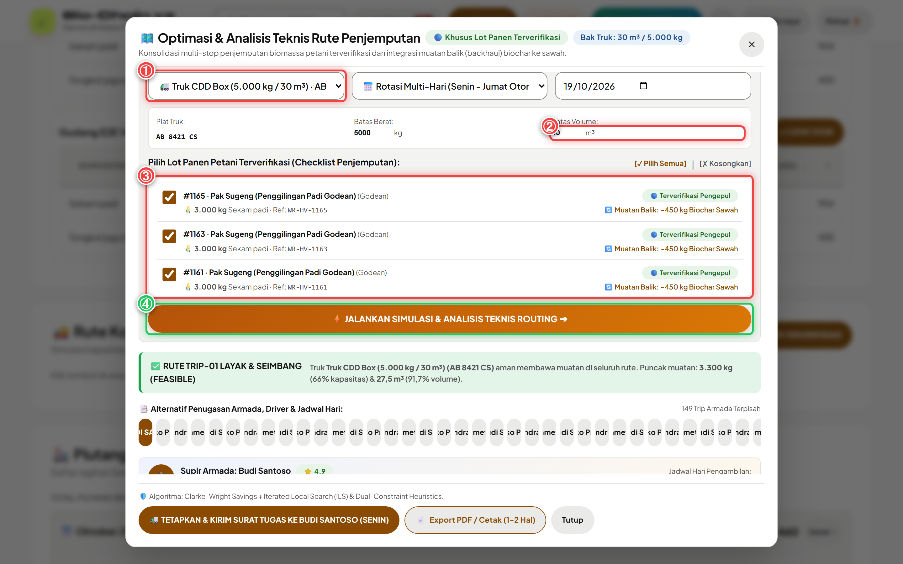

**Panduan Aksi Berdasarkan Nomor pada Gambar:**
- **① Pilihan armada:** pilih truk, misalnya **"Truk CDD Box (5.000 kg / 30 m³) · AB 8421 CS"**. Plat, Batas Berat
  (**5000 kg**), dan Batas Volume terisi otomatis dari preset armada. Di sebelahnya ada pilihan jadwal ("Rotasi
  Multi-Hari (Senin – Jumat …)") dan tanggal jemput (**19/10/2026**).
- **② Batas Volume (m³):** kotak isian kapasitas bak, bersebelahan dengan Batas Berat. Untuk truk CDD nilainya
  30 m³ (lencana di judul modal: "Bak Truk: 30 m³ / 5.000 kg"). Boleh diubah bila bak diberi tambahan pagar/jaring.
- **③ Checklist lot terverifikasi:** centang lot yang akan dijemput. Contoh: #1165, #1163, dan #1161 milik Pak Sugeng
  (Penggilingan Padi Godean), masing-masing 3.000 kg sekam padi (Ref WR-HV-1165 dst.), semua berlabel "Terverifikasi
  Pengepul". Label "Muatan Balik: ~450 kg Biochar Sawah" adalah **perkiraan 15 % dari berat lot**. Gunakan
  **[✓ Pilih Semua]** / **[X Kosongkan]** untuk memilih cepat.
- **④ JALANKAN SIMULASI & ANALISIS TEKNIS ROUTING:** klik untuk menghitung. Hasilnya muncul di bawah: banner
  **"RUTE TRIP-01 LAYAK & SEIMBANG (FEASIBLE)"** dengan puncak muatan 3.300 kg (66 % kapasitas) dan 27,5 m³ (91,7 %
  volume), daftar alternatif armada/driver/hari ("149 Trip Armada Terpisah"), lalu tombol **TETAPKAN & KIRIM SURAT
  TUGAS KE BUDI SANTOSO (SENIN)** dan **Export PDF / Cetak**.

> **🔧 Di Balik Layar (Sistem):** Modal ini (`app/static/js/modules/route-optimization-modal.js`) mengirim
> `POST /api/v1/collector/consolidated-pickup-plan` (`app/routers/collector_logistics.py`) dengan `harvest_ids`,
> `truck_max_kg`, dan `truck_max_m3`. Server mengubah berat menjadi volume (`V = kg ÷ ρ`) lalu memanggil
> **Engine ⑤** `plan_routes()` di `app/engines/routing.py` dengan `mode="auto"`:
> - **≤ 10 titik** → *exact* (Held-Karp + DP *set-partitioning*), solusi optimal terbukti.
> - **> 10 titik** → **Clarke-Wright Savings** granular + *local search* (relocate, swap, 2-opt) + *iterated local
>   search* (ruin & recreate) dalam anggaran waktu.
>
> **Rumus savings Clarke-Wright (1964):** `s(i,j) = d(0,i) + d(0,j) − d(i,j)`. Artinya, menjemput titik *i* dan *j*
> dalam satu trip menghemat jarak sebesar *s* dibanding dua trip terpisah dari gudang (titik 0). Pasangan diurutkan
> dari *s* terbesar dan digabung **hanya jika** `V_rute_i + V_rute_j ≤ Q` (volume bak). Jarak = haversine × faktor jalan
> `logistik.road_factor` (1,3). Lot yang volumenya melebihi satu bak dipecah: trip penuh langsung ditambah sisa yang
> ikut solver, dengan rumus `trip_langsung = ⌈V/Q⌉ − 1`.
>
> Setelah rute terbentuk, server mensimulasikan **beban per stop**: truk berangkat membawa biochar, menurunkan biochar
> di petani, lalu memuat biomassa. Rute dinilai *feasible* bila puncak berat ≤ `truck_max_kg` **dan** puncak volume ≤
> `truck_max_m3`. Densitas yang dipakai di endpoint ini: biomassa 120 kg/m³ dan biochar 300 kg/m³. Parameter umum
> sistem `logistik.bulk_density_kg_m3` bernilai default 110 kg/m³.
>
> **Pembanding OR-Tools:** `app/engines/routing_ortools.py` (Google OR-Tools, konstruksi PATH_CHEAPEST_ARC +
> *Guided Local Search*) memodelkan **dua dimensi kapasitas sekaligus**, yaitu `Volume` (m³) dan `Weight` (kg,
> `logistik.vehicle_payload_kg` = 5.000). Fungsi tujuannya adalah **gram CO₂e** dengan biaya busur yang
> memperhitungkan muatan. OR-Tools dipakai pada mode `ortools` di `POST /api/v1/routes/optimize` dan pada alokasi
> armada pabrik `POST /factory/dispatch/optimize`. Modal pengepul ini sendiri memakai Engine ⑤ (mode *auto*), sesuai
> keterangan di kaki modal: "Algoritma: Clarke-Wright Savings + Iterated Local Search (ILS) & Dual-Constraint
> Heuristics".

### Layar 4.2b — Hasil Rute: KPI Volume, Peta & Muatan Balik

**Tujuan Proses & Standar Terkait:** Memastikan rute aman secara kapasitas dan menunjukkan penghematan jarak sebelum
surat tugas dikirim ke driver. Jarak dan muatan menjadi dasar estimasi emisi transport (ISO 14083 di sisi driver).

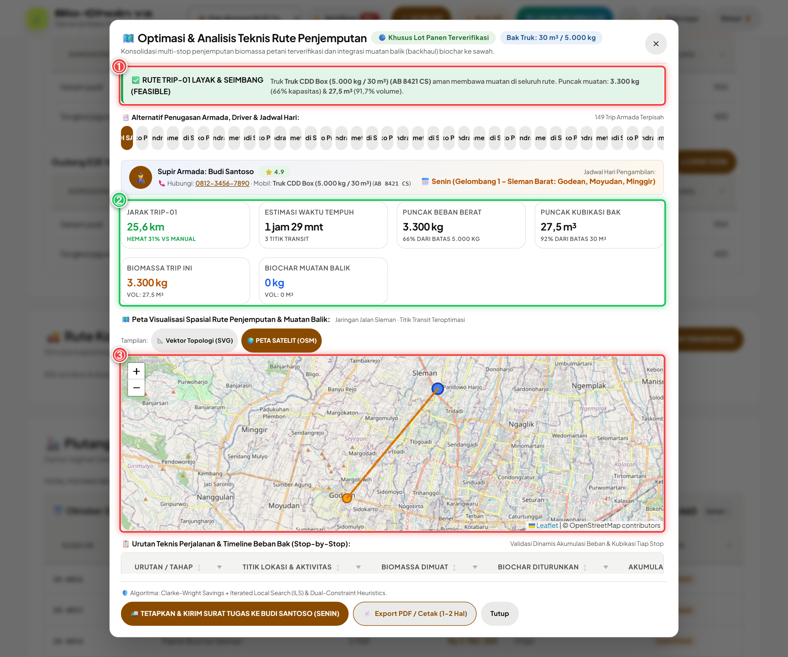

**Panduan Aksi Berdasarkan Nomor pada Gambar:**
- **① Banner kelayakan:** **"RUTE TRIP-01 LAYAK & SEIMBANG (FEASIBLE)"**, dengan keterangan "Truk CDD Box (5.000 kg /
  30 m³) (AB 8421 CS) aman membawa muatan di seluruh rute. Puncak muatan: 3.300 kg (66% kapasitas) & 27,5 m³ (91,7%
  volume)". Jika melewati batas, banner berubah merah menjadi peringatan overload dengan saran membagi ke multi-armada.
  Di bawahnya ada kartu **Supir Armada: Budi Santoso** (★ 4.9, telepon, jenis mobil) dan **Jadwal Hari Pengambilan:
  Senin (Gelombang 1 – Sleman Barat: Godean, Moyudan, Minggir)**.
- **② Baris KPI trip (hasil):** **Jarak TRIP-01 25,6 km** ("Hemat 31% vs manual"), **Estimasi Waktu Tempuh 1 jam
  29 mnt** (3 titik transit), **Puncak Beban Berat 3.300 kg** (66 % dari batas 5.000 kg), **Puncak Kubikasi Bak
  27,5 m³** (92 % dari batas 30 m³), **Biomassa Trip Ini 3.300 kg** (vol 27,5 m³), dan **Biochar Muatan Balik 0 kg**
  (vol 0 m³).
- **③ Peta Visualisasi Spasial:** tampilan **PETA SATELIT (OSM)** (Leaflet) atau **Vektor Topologi (SVG)**. Garis
  oranye menghubungkan titik jemput dan gudang di wilayah Sleman (Godean ↔ Pandowo Harjo).

Di bawah peta ada tabel **Urutan Teknis Perjalanan & Timeline Beban Bak (Stop-by-Stop)** dengan kolom Urutan/Tahap,
Titik Lokasi & Aktivitas, Biomassa Dimuat, Biochar Diturunkan, dan Akumulasi. Baris yang melewati batas ditandai
merah. Setelah dicek, klik **TETAPKAN & KIRIM SURAT TUGAS** untuk menugaskan driver, atau **Export PDF / Cetak** untuk
manifest 1–2 halaman.

> **🔧 Di Balik Layar (Sistem):**
> - **Muatan balik (backhaul):** biochar baru dihitung bila permintaan biochar petani (`biochar_backhaul_requests`)
>   ikut dikirim. Volume biochar = kg ÷ 300 kg/m³. Biochar diturunkan di petani pemesan sehingga ruang bak bertambah
>   untuk biomassa yang dimuat. Pada data contoh ini nilainya **0 kg** karena modal belum mengirim daftar permintaan
>   biochar. Angka "~450 kg" pada checklist Layar 4.2a hanya perkiraan tampilan (15 %).
> - **"Hemat … % vs manual"** di kartu KPI dihitung di layar terhadap jarak acuan = jarak rute × 1,45, sehingga
>   nilainya selalu ±31 % (indikatif). Penghematan yang benar-benar dihitung solver terhadap trip langsung per titik
>   ada di `summary.saving_pct` Engine ⑤ (dipakai di Rencana Jemput dan `/routes/optimize`).
> - **Estimasi waktu** = jarak ÷ 35 km/jam + 15 menit per stop.

---

## 4.3 Uji Cepat Lapangan, Timbang Aktual, Resi TRX & Pembayaran Petani

### Layar 4.3a — Uji Mutu Lapangan, Timbang Aktual & Grade Otomatis

**Tujuan Proses & Standar Terkait:** Menetapkan berat **aktual** dan mutu biomassa di lokasi petani sebagai dasar harga.
Harga dihitung dari timbangan pengepul, bukan dari estimasi petani. Inilah prosedur **"Uji Cepat Lapangan"**: sebuah
*prosedur kerja* memakai form Uji Mutu ini (kadar air wajib dengan moisture meter, kontaminan ditaksir visual, abu/VM/FC
opsional dari lab). **Aplikasi tidak memiliki timer atau label "15 menit".** Durasi uji adalah target prosedur di
lapangan.


Sebelum mengisi form, klik tombol **UJI** pada baris lot di tabel antrean kiri (lot Sekam padi 3.000 kg atau 5.000 kg,
taksiran petani 12,5 % / 13,2 %). Tombol cokelat di bawah form berubah menjadi **"VERIFIKASI MUTU #1164 ➔"**.

**Panduan Aksi Berdasarkan Nomor pada Gambar:**
- **① Berat Timbangan Pengepul (kg):** ketik hasil timbang aktual, contoh **4950** (petani melapor 5.000 kg). Tombol
  cepat **−50 / +50 / +100 / +500 / +1 ton / +1 truk** membantu koreksi tanpa mengetik.
- **② Kadar Air (% bb) — wajib:** baca dari moisture meter, contoh **13.2**. Kolom **Kadar Abu (% bk)**, **Volatile
  Matter (%)**, dan **Fixed Carbon (%)** bertanda "opsional · uji lab". Biarkan kosong bila tidak ada hasil lab.
- **③ Kontaminan (%):** taksiran pasir/batu/plastik, contoh **0.5**. Suhu Pirolisis default **500 °C**. Foto bukti
  bisa diisi lewat **URL Foto Bukti Serah-Terima (opsional)** atau tombol **Ambil foto**.
- **④ Preview Mutu:** kotak bertuliskan "Grade A · Skor 91.2 · Pengali Harga ×1.10". *Catatan jujur: teks ini adalah
  contoh statis bawaan form dan tidak dihitung ulang saat angka diketik.* Grade resmi baru keluar setelah tombol ⑤
  ditekan dan tampil di resi (Layar 4.3b).
- **⑤ VERIFIKASI MUTU #1164 ➔:** klik untuk mengirim hasil timbang dan uji. Jika mutu tidak layak, gunakan **Tolak lot
  (sebutkan penyebab)** dan pilih kategori: terlalu basah, berjamur, kontaminan, selisih berat, stok tidak ada, atau
  lainnya.

> **🔧 Di Balik Layar (Sistem):** `POST /api/v1/collector/verify` (`app/routers/collector.py`) memanggil
> `score_sample()` di `app/engines/quality.py`:
> - Skor komponen linear: kadar air (ideal `harga_mutu.moisture_best` = 10 %, tolak > `harga_mutu.moisture_reject`
>   = 25 %) dan kontaminan (ideal 1 %, tolak > 10 %). Abu dan fixed carbon ikut dinilai **hanya bila diisi**, dan
>   bobot dinormalisasi atas komponen yang terukur.
> - **Grade hasil verifikasi pengepul:** skor ≥ `harga_mutu.grade_A_min` (80) → **A**, ≥ `grade_B_min` (60) → **B**,
>   di bawahnya → **C**. Jika melewati batas tolak → **TOLAK** (tidak dibeli). Grade **D** hanya muncul pada
>   *estimasi petani* di form lapor (aturan kadar air: ≤ 12 → A, ≤ 15 → B, ≤ 18 → C, > 18 → D).
> - **Harga ke petani** (metode default `harga_mutu.pricing_method = basis_kering`, `quality.farmgate_price`):
>   `harga/kg = harga_dasar × (1 − M) / (1 − M_acuan)`, `kg_bayar = timbangan × (1 − kontaminan)`,
>   `total = kg_bayar × harga/kg`. M_acuan = `harga_mutu.reference_moisture_pct` (12 %). Untuk lot lelang dipakai harga
>   kesepakatan, dan hanya ada potongan bila lebih basah dari kontrak. Contoh pada gambar (harga dasar Rp450/kg):
>   450 × (1 − 0,132)/(1 − 0,12) = Rp443,86/kg; kg bayar = 4.950 × (1 − 0,005) = 4.925,25 kg; total ≈
>   **Rp2.186.121**, sama dengan angka di resi.
> - Pengiriman memakai `apiMutation` dengan `client_event_id`. Bila tanpa sinyal, hasil uji disimpan di antrean HP
>   ("Offline: hasil uji disimpan & dikirim otomatis saat online"), dan pengulangan dari antrean tidak menggandakan data.
>   Status lot: `REPORTED → VERIFIED` dengan *custody event* `COLLECTOR_WEIGH`.

### Layar 4.3b — Resi Serah-Terima TRX & QR (Chain of Custody)

**Tujuan Proses & Standar Terkait:** Memberi petani bukti serah-terima yang unik dan bisa dipindai. Resi ini menyambung
QR asal lot ke tahap berikutnya (driver → pabrik), sesuai prinsip ketertelusuran *chain of custody* ISO 22095.


**Panduan Aksi Berdasarkan Nomor pada Gambar:**
- **① Judul "Resi Serah-Terima Sekam":** muncul otomatis setelah verifikasi berhasil. Tunjukkan QR 2D ini kepada
  sopir armada atau mitra logistik untuk dipindai.
- **② Kode resi (hasil):** **TRX-PTN0006-PGP0003-2610-00183** dengan ringkasan **"4.950 kg · Grade A ·
  Rp 2.186.121"**. Kotak "Rantai Ketelusuran Batch" menampilkan Kode Dokumen, **QR Code Asal BIO-F4733DAE-DEDHTO**,
  **Batch Referensi WR-HV-1164**, rincian muatan (sekam_padi · 4.950 kg · Grade A), dan alur mutasi *Pelaporan Awal →
  Lelang → Timbang TRX → Pabrik*. Tombol: **TELUSURI SILSILAH SIRKULAR PENUH**, **Salin Teks**, **UNDUH GAMBAR QR**,
  **Cetak**.

> **🔧 Di Balik Layar (Sistem):** Format kode `TRX-<pengirim>-<penerima>-<YYMM>-<urut bulanan>` (PTN0006 = petani,
> PGP0003 = pengepul, 2610 = Oktober 2026, 00183 = nomor urut). Kode dibuat server saat verifikasi dan dicatat sebagai
> *custody event*. Tombol telusuri membuka modal Lacak QR Sirkular (sama dengan Bab 3.5) yang menampilkan rantai
> sawah → pengepul → pabrik → abu/biochar → sawah beserta hash rantainya.

### Layar 4.3c — Instruksi Pembayaran ke Petani (DP / Lunas) & SLA

**Tujuan Proses & Standar Terkait:** Membayar petani tepat waktu dan tercatat. SLA bayar petani di Bio-Chain adalah
**maksimal 3 hari** setelah lot ditimbang (lebih ketat dari target ≤ 14 hari).

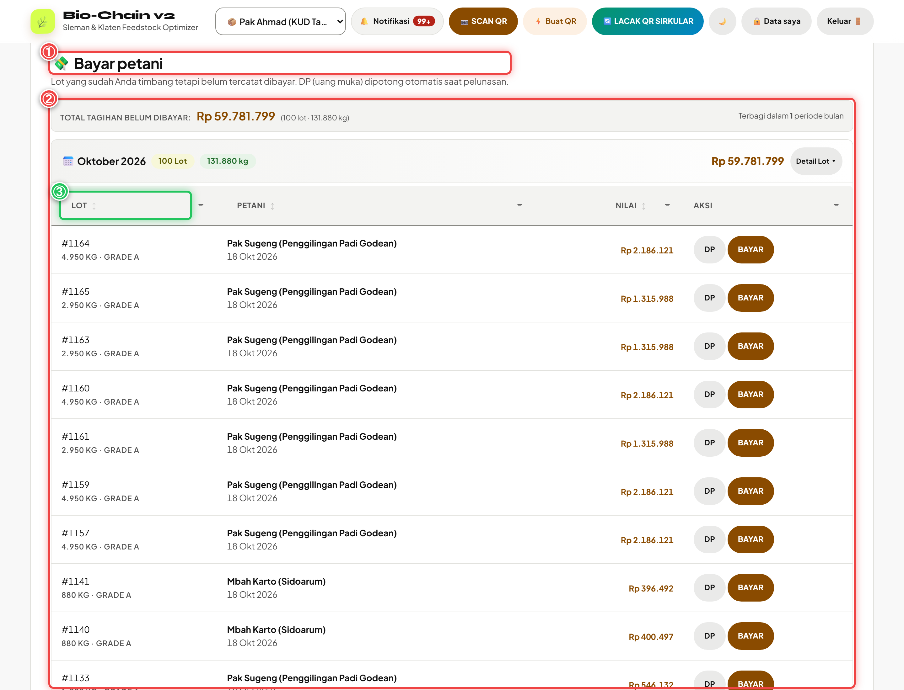

**Panduan Aksi Berdasarkan Nomor pada Gambar:**
- **① Kartu "💸 Bayar petani":** berisi lot yang sudah Anda timbang tetapi belum tercatat dibayar. Keterangannya: "DP
  (uang muka) dipotong otomatis saat pelunasan."
- **② Ringkasan dan tabel lot:** **TOTAL TAGIHAN BELUM DIBAYAR: Rp 59.781.799 (100 lot · 131.880 kg)**, terbagi dalam
  1 periode bulan. Grup **Oktober 2026** berisi 100 lot, 131.880 kg, dan bisa dibuka lewat "Detail Lot ▾". Contoh baris:
  - **#1164** · 4.950 kg · Grade A · Pak Sugeng (Penggilingan Padi Godean) · 18 Okt 2026 · **Rp 2.186.121** (lot dari
    Layar 4.3b)
  - #1165 · 2.950 kg · Grade A · Rp 1.315.988
  - #1141 · 880 kg · Grade A · Mbah Karto (Sidoarum) · Rp 396.492
- **③ Kolom Lot dan tombol aksi per baris:** kolom **Lot** memuat #ID, kg, dan Grade. *Pada gambar, kotak ③ menandai
  judul kolom LOT, bukan tombolnya.* Di ujung kanan setiap baris ada dua tombol:
  - **DP**: mencatat uang muka. Hanya untuk lot yang belum diangkut, maksimal `pasar.dp_max_pct` = **30 %** dari
    perkiraan nilai lot.
  - **BAYAR**: pelunasan. Pilih metode (tunai/transfer/QRIS). **No. referensi wajib** untuk selain tunai.
  Setelah dicatat, muncul **Kuitansi bayar petani** dengan kode kuitansi, nilai bersih, serta rincian bruto − pajak −
  DP untuk diberikan atau difoto petani.

> **🔧 Di Balik Layar (Sistem):** Daftar diambil dari `GET /collector/unpaid-harvests`. Pembayaran dicatat lewat
> `POST /collector/harvests/{id}/pay-farmer` dan DP lewat `POST /collector/harvests/{id}/pay-dp`
> (`app/services/payments.py`).
> - **DP dipotong otomatis saat pelunasan.** Jika DP melebihi nilai timbangan, sisanya dicatat sebagai kewajiban petani
>   untuk mengembalikan.
> - DP dan pelunasan untuk lot yang sama diserialkan dengan **kunci baris harvest** (`lock_row`), sehingga petani tidak
>   bisa menerima DP + pelunasan penuh akibat klik bersamaan. Kiriman ganda DP ditolak ("baru saja tercatat").
> - Pajak (PPh 22 petani) dihitung server bila parameter `pajak.pph22_farmer_pct` diisi.
> - **SLA:** parameter `pasar.farmer_payment_due_days` (default **3 hari**, rentang 0–60). Lot terverifikasi yang belum
>   dibayar melewati batas ini ditandai **terlambat** di menu Pembayaran petani (Bab 3.5). Keterlambatan juga masuk
>   indikator sosial ESG dan temuan efisiensi P8 "Pembayaran petani terlambat".

---

## 4.4 Pengiriman ke Pabrik, Piutang, Muatan Balik & Umpan Balik QC

### Layar 4.4a — Ajukan Pengiriman ke Pabrik (Dijemput Armada Pabrik / Antar Mandiri)

**Tujuan Proses & Standar Terkait:** Pengepul mengajukan *Delivery Request* (DR) ke pabrik: berapa kg, mutu, tanggal, dan
harga. Pabrik bisa menerima, menawar balik, atau menolak (Bab 6.1). Lot petani yang dilampirkan memastikan bagian biochar
sirkular kembali ke dompet petani yang bersangkutan.

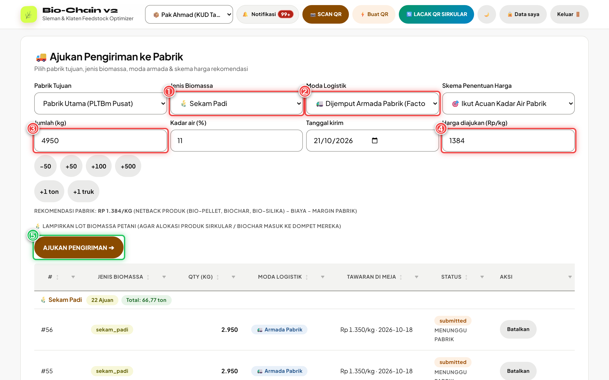

**Panduan Aksi Berdasarkan Nomor pada Gambar:**
- **① Jenis Biomassa:** pilih **Sekam Padi**. Pabrik Tujuan: **Pabrik Utama (PLTBm Pusat)**.
- **② Moda Logistik:**
  - **Dijemput Armada Pabrik (Factory Fleet)**: truk pabrik yang menjemput ke gudang Anda.
  - **Antar Mandiri Pengepul (Self-Delivery Slip)**: Anda mengirim sendiri dengan truk pengepul.
  Skema Penentuan Harga: **Ikut Acuan Kadar Air Pabrik** atau **Tawar Bebas**.
- **③ Jumlah (kg):** contoh **4950** (sama dengan hasil timbang di Layar 4.3a). Tersedia tombol cepat −50 … +1 truk.
  Kadar air (%) contoh **11**, Tanggal kirim **21/10/2026**.
- **④ Harga diajukan (Rp/kg):** terisi otomatis dengan harga rekomendasi, contoh **1384**. Di bawahnya tampil
  **"REKOMENDASI PABRIK: RP 1.384/KG (netback produk bio-pellet, biochar, bio-silika − biaya − margin pabrik)"**.
  Ubah angkanya bila ingin menawar lain (pilih skema "Tawar Bebas"). Buka **"Lampirkan lot biomassa petani"** untuk
  mengaitkan lot petani.
- **⑤ AJUKAN PENGIRIMAN ➔:** kirim ajuan. Ajuan masuk ke tabel di bawah dengan status awal **submitted / MENUNGGU
  PABRIK** (contoh #56 dan #55, masing-masing 2.950 kg, Armada Pabrik, Rp 1.350/kg · 2026-10-18). Ajuan yang masih
  menunggu bisa **Batalkan**. Ajuan yang disetujui pabrik berstatus **accepted**. Ringkasan grup: "Sekam Padi · 22 Ajuan ·
  Total 66,77 ton".

> **🔧 Di Balik Layar (Sistem):** `POST /api/v1/collector/delivery-requests` → `factory_ops.submit_request`
> (`app/services/factory_ops.py`). Field `logistics_carrier` bernilai `FACTORY_FLEET | COLLECTOR_SELF` dan
> `pricing_mode` bernilai `FACTORY_PRICE | AUCTION`. Rekomendasi harga diambil dari `GET /collector/factory-price`
> (`factory_ops.factory_price_preview`) untuk kadar air yang diisi. Negosiasi berjalan lewat
> `POST /delivery-requests/{id}/respond` (accept | counter | reject | cancel). **Berat yang menentukan tagihan adalah
> hasil jembatan timbang di gerbang pabrik** (Gross − Tare = Net, Bab 6.1), bukan angka ajuan ini.

### Layar 4.4b — Rute Konsolidasi & Muatan Balik, Piutang Pabrik & Status DR

**Tujuan Proses & Standar Terkait:** Memantau uang yang masih harus dibayar pabrik (piutang) beserta umurnya, dan membuka
modul rute muatan balik biochar.

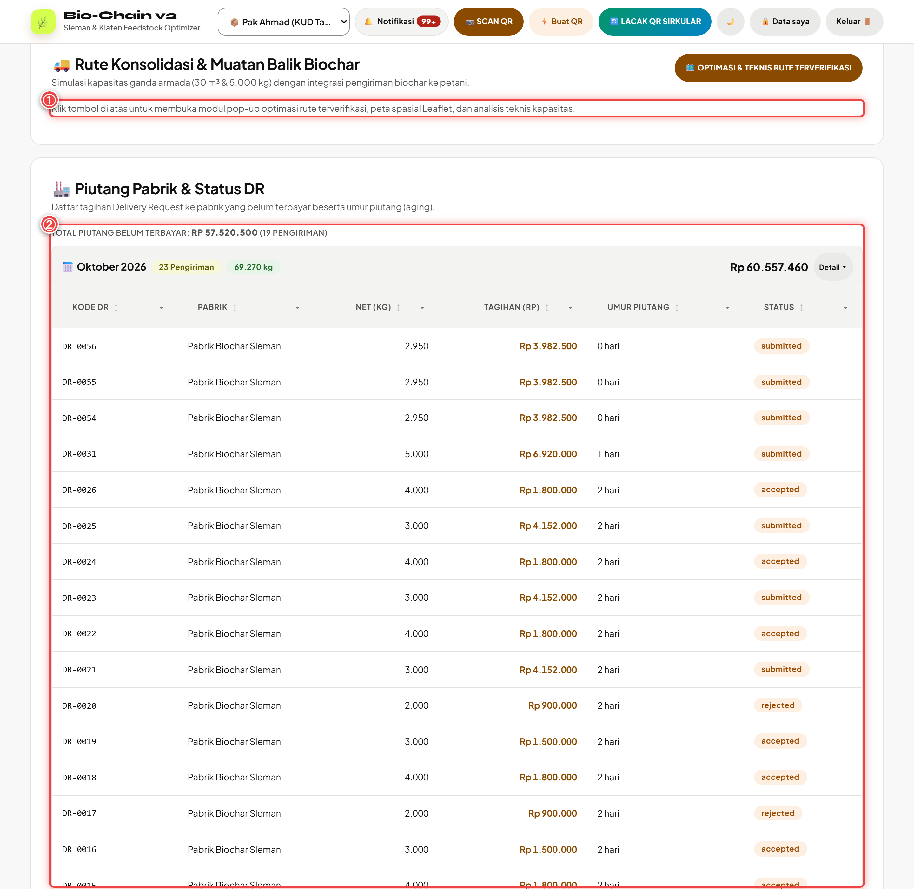

**Panduan Aksi Berdasarkan Nomor pada Gambar:**
- **① Status muatan balik:** kartu "Rute Konsolidasi & Muatan Balik Biochar" (kapasitas ganda 30 m³ & 5.000 kg).
  Teksnya: "Klik tombol di atas untuk membuka modul pop-up optimasi rute terverifikasi…". Klik **OPTIMASI & TEKNIS
  RUTE TERVERIFIKASI** untuk membuka Layar 4.2a.
- **② Piutang Pabrik & Status DR:** **TOTAL PIUTANG BELUM TERBAYAR: RP 57.520.500 (19 pengiriman)**. Grup **Oktober
  2026** berisi 23 pengiriman, 69.270 kg, Rp 60.557.460. Tabel memuat Kode DR (DR-0056, DR-0055 …), Pabrik (Pabrik
  Biochar Sleman), Net (kg), Tagihan (Rp), **Umur Piutang** (0–2 hari), dan Status (submitted / accepted / rejected).

Di bawah kartu piutang ada kartu **Potongan logistik saya**: ongkos jarak kosong bila pengepul membatalkan saat truk
sudah di jalan atau stok tidak ada saat truk tiba. Potongan ini dikurangkan dari pembayaran pabrik berikutnya.

> **🔧 Di Balik Layar (Sistem):** `GET /collector/factory-receivables` (`app/routers/collector.py`). Umur piutang =
> hari sejak DR dibuat. Status `settled / paid / delivered` dianggap lunas. Angka total di atas hanya menjumlahkan yang
> **belum lunas**, sedangkan angka grup bulan menjumlahkan semua DR pada bulan itu. Karena itu kedua angka bisa berbeda
> (Rp57,52 jt vs Rp60,56 jt). Potongan logistik dari `GET /collector/charges` berstatus *terbuka / dipotong /
> dibebaskan*.

### Layar 4.4c — Transparansi Mutu & Evaluasi QC Gerbang Pabrik

**Tujuan Proses & Standar Terkait:** Pengepul melihat hasil timbang jembatan dan uji mutu pabrik untuk setiap kiriman:
berapa kg yang diterima atau ditolak, dan apa sebabnya. Dengan begitu perbaikan mutu bisa diteruskan ke petani.

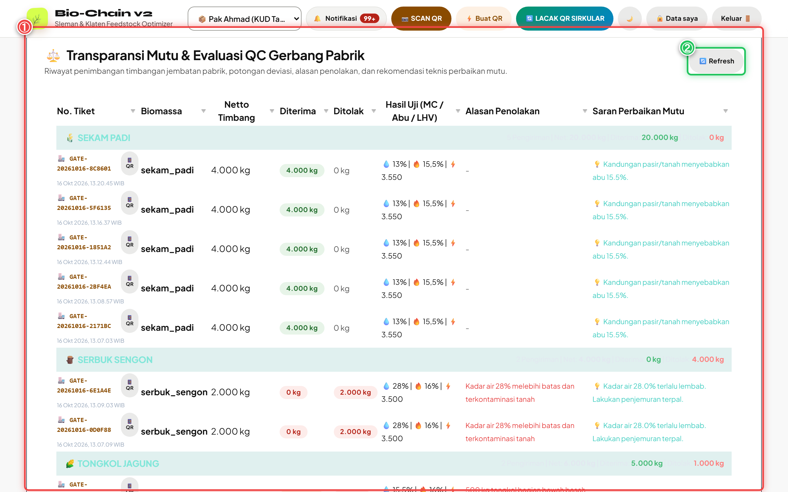

**Panduan Aksi Berdasarkan Nomor pada Gambar:**
- **① Tabel QC gerbang:** dikelompokkan per komoditas. Kolom: **No. Tiket** (mis. GATE-20261016-8C8601, 16 Okt 2026),
  Biomassa, **Netto Timbang**, **Diterima**, **Ditolak**, **Hasil Uji (MC / Abu / LHV)**, **Alasan Penolakan**,
  **Saran Perbaikan Mutu**. Contoh:
  - **SEKAM PADI:** 4.000 kg diterima penuh. Hasil 13 % | 15,5 % | 3.550, dengan saran "Kandungan pasir/tanah
    menyebabkan abu 15.5%".
  - **SERBUK SENGON:** 2.000 kg ditolak. Hasil 28 % | 16 % | 3.500, alasan "Kadar air 28% melebihi batas dan
    terkontaminasi tanah", saran "Lakukan penjemuran terpal".
- **② Refresh:** memuat ulang data terbaru setelah pabrik memproses tiket baru.

> **🔧 Di Balik Layar (Sistem):** `GET /collector/gate-feedback` (`app/routers/collector.py`) membaca catatan penerimaan
> gerbang pabrik (tiket timbang + keputusan QC: diterima / diterima sebagian / ditolak, Bab 6.1). Hasil QC lot juga
> diteruskan ke harvest petani yang dilampirkan, dibagi proporsional timbangan (`factory_ops.py`), sehingga petani
> menerima umpan balik yang sama di Bab 3.5.

---

# Bab 5 — Panduan Langkah demi Langkah Modul Driver & Ketertelusuran Lapangan

Modul Driver dipakai sopir truk di HP (layar 390 × 844), sering di tempat dengan sinyal lemah. Prinsipnya: **setiap
tindakan tetap bisa disimpan tanpa sinyal** dan terkirim otomatis saat sinyal kembali. Akun demo: **Budi Santoso
(Driver)**.

> **Catatan peran:** Driver **tidak** menginput slip timbangan jembatan. Penimbangan resmi (Gross/Tare/Net) dilakukan
> petugas di gerbang pabrik (lihat **Bab 6.1**). Berat yang dibawa driver hanya catatan; angka otoritatif tetap
> timbangan pengepul (Bab 4.3) dan jembatan timbang pabrik.

## 5.1 Daftar Job, Utilisasi Volume Bak & Instruksi Muatan Balik

### Layar 5.1a — Status Rute, Jarak & Utilisasi Bak

**Tujuan Proses & Standar Terkait:** Driver melihat rute yang ditugaskan, jarak rencana, jarak GPS yang terekam, dan
seberapa penuh bak truk (berbasis volume, karena sekam ringan).

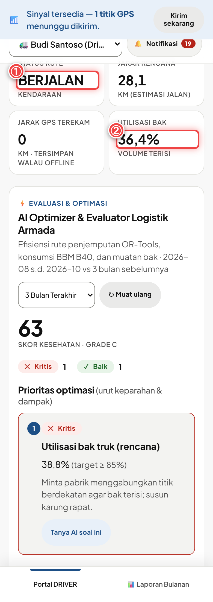

**Panduan Aksi Berdasarkan Nomor pada Gambar:**
- **① Status Rute:** pada gambar **BERJALAN**, artinya rute sudah dimulai. Sebelum dimulai, statusnya
  **DIRENCANAKAN**. Di sebelahnya: **Jarak Rencana 28,1 km** (estimasi jalan).
- **② Utilisasi Bak: 36,4 %** (volume terisi). Kartu **Jarak GPS Terekam: 0 km** bertanda "tersimpan walau offline".

**Tombol aksi rute** (di bawah daftar stop, tidak tampak pada gambar): **▶️ Mulai Rute (aktifkan GPS)** sebelum
berangkat. Setelah rute berjalan, tombol berubah menjadi **🏁 Selesaikan Rute**. Tombol ini terkunci selama masih ada
stop yang belum ditangani.

Di bawah KPI ada kartu **AI Optimizer & Evaluator Logistik Armada** (skor kesehatan 63 · Grade C, 1 Kritis, 1 Baik)
yang merangkum efisiensi rute, BBM B40, dan muatan bak selama 3 bulan terakhir. Prioritas optimasi teratas pada gambar
adalah **"Utilisasi bak truk (rencana) 38,8 % (target ≥ 85 %)"**, dengan saran "Minta pabrik menggabungkan titik
berdekatan agar bak terisi; susun karung rapat" dan tombol **Tanya AI soal ini**.

> **🔧 Di Balik Layar (Sistem):** `loadDriverData()` (`app/static/app.js`) membaca `GET /api/v1/driver/active-route`
> (`app/routers/driver.py`). Rute terakhir disimpan di HP (`localStorage biochain_driver_route:<id>`) sehingga tetap
> tampil saat offline. `utilization_pct` berasal dari Engine ⑤: `100 × m³ muatan ÷ m³ bak`. **Mulai Rute**
> (`POST /driver/start-route`) dan **Selesaikan Rute** (`POST /driver/complete-route`) dikirim lewat antrean offline.
> Saat selesai, server menghitung jarak nyata dari jejak GPS serta BBM dan CO₂e menurut ISO 14083. Sebelum itu, antrean
> pickup offline dikirim lebih dulu (`flushOutbox`, `trackFlush`).

### Layar 5.1b — Instruksi Muatan Balik Abu/Biochar (Pabrik → Petani)

**Tujuan Proses & Standar Terkait:** Menutup lingkar ekonomi sirkular. Truk yang kembali dari pabrik membawa biochar/abu
untuk sawah petani, dan setiap titik serah-terimanya terekam.

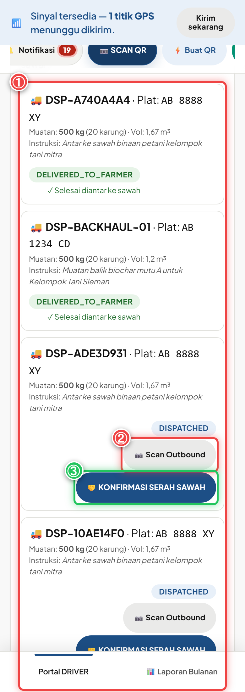

**Panduan Aksi Berdasarkan Nomor pada Gambar:**
- **① Daftar penugasan muatan balik:** setiap kartu berisi kode dispatch, plat, muatan, volume, instruksi, dan status.
  Contoh:
  - **DSP-A740A4A4** · Plat AB 8888 XY · 500 kg (20 karung) · 1,67 m³ · "Antar ke sawah binaan petani kelompok tani
    mitra" · **DELIVERED_TO_FARMER** ("✓ Selesai diantar ke sawah").
  - **DSP-BACKHAUL-01** · AB 1234 CD · 500 kg · 1,2 m³ · "Muatan balik biochar mutu A untuk Kelompok Tani Sleman".
  - **DSP-ADE3D931** dan **DSP-10AE14F0** · status **DISPATCHED** (belum diantar). Kartunya masih menampilkan
    tombol aksi ② dan ③.
- **② Scan Outbound:** tekan saat memuat biochar di gerbang keluar pabrik. Checkpoint `FACTORY_OUTBOUND` tercatat.
- **③ KONFIRMASI SERAH SAWAH:** tekan saat tiba di sawah. Isi **ID Petani Penerima**, **Berat Biochar Diserahkan
  (kg)** (default sesuai muatan), dan **Catatan Serah Terima**, lalu **Konfirmasi Serah Terima**. Status berubah menjadi
  **DELIVERED_TO_FARMER**.

> **🔧 Di Balik Layar (Sistem):** Data dari `GET /driver/backhaul-tasks`. Scan outbound memanggil
> `POST /driver/checkpoint-scan` dengan `checkpoint_type = FACTORY_OUTBOUND`, dan serah sawah memanggil
> `POST /driver/confirm-backhaul-drop`. Surat jalan biochar dibuat oleh pabrik (Bab 6.4). Endpoint serah sawah
> menerima `evidence_photo_url`, tetapi dialog di aplikasi driver saat ini belum menyediakan kolom foto.

## 5.2 Titik Jemput, Scan QR Checkpoint, Laporan Gagal & Mode Offline

### Layar 5.2a — Titik Jemput: Scan QR atau Laporkan Gagal

**Tujuan Proses & Standar Terkait:** Membuktikan bahwa lot yang dimuat adalah lot yang benar (QR karung/nota cocok), di
lokasi yang benar, pada waktu yang benar. Ini adalah checkpoint serah-terima kedua dalam rantai ketertelusuran
(selaras ISO 22095).

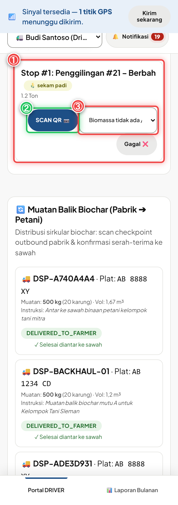

**Panduan Aksi Berdasarkan Nomor pada Gambar:**
- **① Kartu stop:** **Stop #1: Penggilingan #21 – Berbah**, komoditas **sekam padi**, rencana **1.2 Ton**. Tombol aksi
  baru muncul setelah rute dimulai (**Mulai Rute**, Layar 5.1a).
- **② SCAN QR 📷:** tekan saat tiba. Kamera terbuka dengan judul "Scan QR Petani (Stop #…)". Arahkan ke QR karung/nota
  atau resi TRX (Layar 4.3b). Jika berhasil, muncul "✅ Pickup dikonfirmasi!" dan stop berlabel **DIJEMPUT**.
- **③ Alasan gagal + tombol "Gagal ❌":** bila biomassa tidak bisa diambil, pilih alasan lalu tekan **Gagal ❌**.
  Pilihan alasan: *Biomassa tidak ada / sudah dijual*, *Dibatalkan pengepul*, *Basah / berjamur*, *Jalan tidak bisa
  dilalui*, *Lokasi / titik tutup*, *Bak truk penuh*, *Lainnya*. Stop ditutup sebagai **GAGAL** dan lot kembali ke
  antrean.

Di atas layar terlihat banner **"Sinyal tersedia — 1 titik GPS menunggu dikirim"** dengan tombol **Kirim sekarang**.

> **🔧 Di Balik Layar (Sistem):** `confirmPickupStop()` → `startCameraScanner()` → `sendPickup()` di
> `app/static/app.js` → `POST /api/v1/driver/confirm-pickup` (`app/routers/driver.py`).
> - **Cek QR tanpa sinyal:** sebelum dikirim, HP mencocokkan QR dengan *digest* SHA-256 yang ikut dalam rute
>   (`qr_check`, QR bertanda tangan F14). Jika QR salah, muncul "QR tidak cocok dengan lot di stop ini" dan tidak ada
>   yang dikirim. Server mengecek ulang tanda tangan: QR palsu ditolak "QR tidak sah", lot berbeda ditolak "QR code
>   tidak cocok". QR lama tanpa tanda tangan mengikuti kebijakan `logistik.qr_legacy_policy`.
> - **GPS & geofence:** koordinat HP dibandingkan dengan titik penggilingan (haversine). Jika lebih jauh dari
>   `logistik.pickup_geofence_m` (default **500 m**), pickup tetap diterima tetapi **ditandai untuk auditor** ("⚠️ Lokasi
>   scan jauh dari penggilingan").
> - **Waktu & offline:** `client_recorded_at` = waktu scan sebenarnya di HP, walaupun terkirim belakangan. Server
>   memakai jam HP hanya bila berada dalam jendela **−`CLIENT_CLOCK_MAX_PAST_HOURS` (72 jam)** sampai
>   **+`CLIENT_CLOCK_MAX_FUTURE_MINUTES` (10 menit)**. Di luar itu dipakai jam server dan diberi catatan
>   (`trusted_device_time`, `app/services/custody.py`). *Custody event* menyimpan keduanya.
> - **Aman diulang:** setiap aksi membawa `client_event_id`. Kiriman ulang dari antrean dijawab "sudah dikonfirmasi
>   sebelumnya" tanpa data ganda. Status lot: `VERIFIED → COLLECTED` (*custody stage* `DRIVER_PICKUP`).
> - **Foto bukti:** API menerima `photo_url`, tetapi alur Scan QR di aplikasi driver **belum** menyediakan pengambilan
>   foto (dikirim kosong). Foto serah-terima saat ini diambil pengepul di Layar 4.3a.
> - Laporan gagal: `POST /driver/stop-failed` (`logistics.fail_stop`), juga lewat antrean offline dan menyertakan GPS.

### Layar 5.2b — Pemindai QR Checkpoint

**Tujuan Proses & Standar Terkait:** Membaca kode QR karung, nota, atau layar mitra dengan kamera HP. Jika kamera rusak
atau QR buram, kode bisa diketik manual sehingga pekerjaan tidak terhenti.

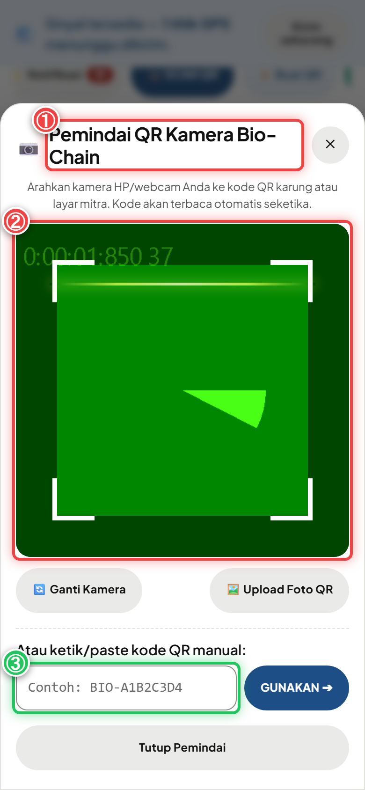

**Panduan Aksi Berdasarkan Nomor pada Gambar:**
- **① Judul "Pemindai QR Kamera Bio-Chain":** dibuka dari tombol **SCAN QR** di header. Petunjuknya: "Arahkan kamera
  HP/webcam Anda ke kode QR karung atau layar mitra. Kode akan terbaca otomatis seketika."
- **② Area kamera:** bingkai bidik dengan garis laser pemindai. *Pada gambar, isi kamera berupa pola hijau uji
  (kamera simulasi browser), bukan QR sungguhan.* Tombol **Ganti Kamera** menukar kamera depan/belakang. **Upload Foto
  QR** membaca QR dari foto di galeri.
- **③ "Atau ketik/paste kode QR manual":** ketik kode, contoh `BIO-A1B2C3D4`, lalu tekan **GUNAKAN**. **Tutup
  Pemindai** untuk keluar.

> **🔧 Di Balik Layar (Sistem):** `startCameraScanner()` (`app/static/app.js`) menangani kamera, unggah foto, dan input
> manual. Pemindai yang dibuka dari header (`openGlobalScanner`) hanya **menampilkan isi kode** yang terbaca. Untuk
> mencatat checkpoint pickup, driver harus memakai tombol **SCAN QR** di kartu stop (Layar 5.2a). Pemindai yang sama
> kemudian mengirim `confirm-pickup` beserta GPS dan waktu.

### Layar 5.2c — Mode Hemat Sinyal (Offline) & GPS Tersimpan

**Tujuan Proses & Standar Terkait:** Menjamin data lapangan tidak hilang di daerah tanpa sinyal. Scan, laporan gagal,
mulai/selesai rute, dan titik GPS disimpan di HP, lalu dikirim berurutan saat sinyal kembali.

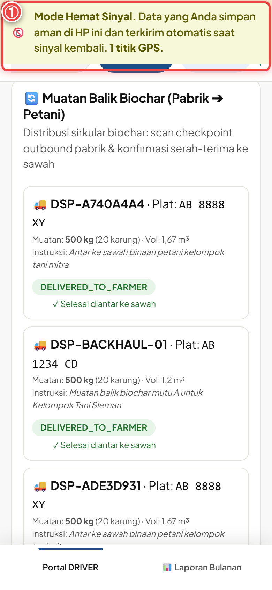

**Panduan Aksi Berdasarkan Nomor pada Gambar:**
- **① Banner "Mode Hemat Sinyal":** muncul otomatis saat HP kehilangan koneksi. Isinya: "Data yang Anda simpan aman di
  HP ini dan terkirim otomatis saat sinyal kembali. **1 titik GPS**." Tetap bekerja seperti biasa. Tidak perlu menutup
  aplikasi.

Selama offline, kartu **Jarak GPS Terekam** (Layar 5.1a) terus bertambah dan daftar stop serta muatan balik tetap bisa
dibuka. Saat sinyal kembali, banner berubah menjadi **"Sinyal tersedia — … menunggu dikirim"** dengan tombol **Kirim
sekarang** (lihat Layar 5.2a).

> **🔧 Di Balik Layar (Sistem):**
> - Banner diatur `syncBanner()` (`app/static/ui-enhance.js`). Banner menghitung antrean data (`myOutbox()`) dan titik
>   GPS tertunda (`TRACK.pending`), lalu menampilkan "Sesi berakhir" bila token kedaluwarsa saat offline lama. Antrean
>   **tetap disimpan** dan dikirim setelah login ulang.
> - Antrean aksi tulis disimpan di HP (kunci `biochain_outbox`). Setiap item membawa `client_event_id` dan waktu
>   perangkat. `flushOutbox()` mengirim item **berurutan**: foto antrean diunggah dulu, lalu berhenti bila jaringan
>   masih putus atau server sibuk, dan dicoba lagi nanti.
> - Jejak GPS dan jarak per rute disimpan di penyimpanan lokal (IndexedDB, `track-km-<route>`) dan dikirim lewat
>   `POST /driver/track`.
> - Waktu kejadian dari HP diterima server bila tidak lebih tua dari `CLIENT_CLOCK_MAX_PAST_HOURS` (**72 jam**,
>   `app/config.py`). Lebih dari itu, server memakai jam server untuk laporan dan mencatat selisihnya.

# Bab 6 — Panduan Langkah demi Langkah Modul Pabrik

Bab ini ditujukan bagi staf **Pabrik Pengolahan** (operator gerbang timbang, petugas QC, admin keuangan, kepala
produksi, dan penanggung jawab ESG). Masuk dengan peran **Pabrik Pengolahan** (pilih di menu peran kanan atas). Semua
layar dalam bab ini diambil pada tampilan desktop (layar lebar) karena pekerjaan pabrik umumnya dilakukan di komputer
kantor gerbang atau ruang kendali.

Alur kerja pabrik secara ringkas:

1. **Gerbang** — menanggapi ajuan pengiriman pengepul, menimbang truk (Gross/Tare/Net), menguji sampel, memutuskan
   QC (Diterima Penuh / Sebagian / Ditolak), dan menempatkan biomassa ke *loading ramp* (6.1).
2. **Keuangan** — invoice terbit otomatis dengan skema Cash / DP / TOP, lalu tagihan pengepul dilunasi (6.2).
3. **Produksi** — memantau stok ramp, mengoptimalkan campuran bahan bakar dan pilihan produk akhir (6.3).
4. **Pelaporan & sirkularitas** — KPI karbon, batch produksi, laporan ESG, klaim removal karbon, penyaluran abu ke
   kelompok tani, dan pengiriman biochar balik ke petani (6.4).

---

## 6.1 Gerbang Timbangan & QC 2 Tahap

QC di pabrik berjalan dalam **dua tahap**:
- **Tahap 1 (di hulu, oleh pengepul):** uji cepat kadar air di lokasi petani/gudang (lihat Bab 4). Hasilnya ikut
  terkirim dalam ajuan pengiriman sebagai "AIR xx %".
- **Tahap 2 (di gerbang pabrik):** penimbangan jembatan timbang dan uji sampel ulang oleh petugas QC pabrik.
  Keputusan tahap 2 inilah yang menentukan berat yang dibayar.

### Layar 6.1a — Ajuan Pengiriman dari Pengepul

**Tujuan Proses & Standar Terkait:** Pabrik menyetujui, menawar balik, atau menolak jadwal & harga kiriman yang
diajukan pengepul, lalu membuka form QC saat truk tiba. Setiap tindakan tercatat di jejak audit (kontrol yang
*selaras* dengan ISO 27001 — bukan sertifikasi).

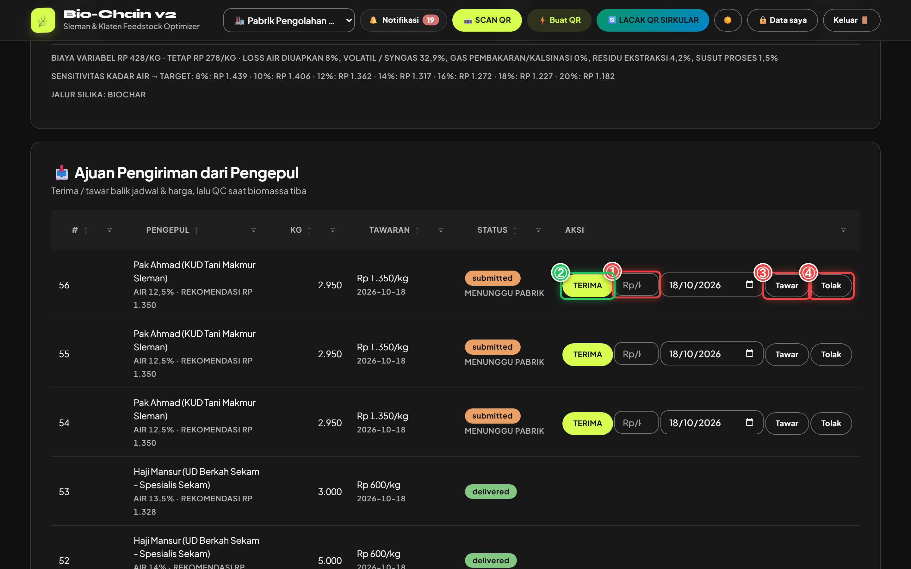

Tabel berisi kolom **#**, **Pengepul** (nama, kadar air hasil uji tahap 1, dan *rekomendasi harga* netback dari sistem,
mis. "Pak Ahmad (KUD Tani Makmur Sleman) · AIR 12,5 % · REKOMENDASI RP 1.350"), **KG** (mis. 2.950), **Tawaran**
(mis. Rp 1.350/kg, tanggal 2026-10-18), **Status** (`submitted` · *MENUNGGU PABRIK*, `accepted`, `delivered`), dan
**Aksi**. Contoh pada gambar: ajuan #56 dari Pak Ahmad, 2.950 kg, Rp 1.350/kg.

**Panduan Aksi Berdasarkan Nomor pada Gambar:**
- **① Harga tawar (Rp/kg) & tanggal:** hanya diisi bila ingin menawar balik — ketik harga usulan pabrik di kotak
  *Rp/kg* dan pilih tanggal kirim (contoh `18/10/2026`).
- **② TERIMA:** klik bila jadwal dan harga tawaran pengepul disetujui. Status menjadi `accepted`.
- **③ Tawar:** kirim harga/tanggal dari kotak ① sebagai tawar balik. Pengepul akan melihat tawaran ini di layarnya.
- **④ Tolak:** menolak ajuan (mis. ramp penuh atau mutu tahap 1 di luar spesifikasi).

Setelah ajuan diterima (`accepted`), kolom Aksi menampilkan tombol **QC MASUK**. Klik saat truk sudah di gerbang untuk
mencatat QC tahap 2; setelah QC, status menjadi `delivered` (contoh baris #53 dan #52 pada gambar).

> **🔧 Di Balik Layar (Sistem):** Tombol ②–④ memanggil fungsi `drRespond(id, 'accept'|'counter'|'reject')` dan tombol
> QC MASUK memanggil `showQcForm(id)` di frontend; semua permintaan lewat pembungkus `api()` (token Bearer + CSRF). Kolom "Rekomendasi Rp"
> berasal dari model harga netback pabrik (nilai produk pellet/biochar/silika dikurangi biaya proses), sehingga petugas
> punya acuan sebelum menyetujui harga tawaran.

### Layar 6.1b — Timbang Masuk Jembatan & Keputusan QC 3-State

**Tujuan Proses & Standar Terkait:** Mencatat berat truk bermuatan (Gross) dan kosong (Tare) di jembatan timbang
pabrik, menguji sampel, lalu memutuskan QC dengan tiga kemungkinan. **Penimbangan jembatan hanya dilakukan di gerbang
pabrik** — driver tidak menginput slip timbangan. Ukur kadar air dengan moisture meter yang dikalibrasi terhadap metode
oven 105 °C (ISO 18134-2).

Buka form ini dengan tombol **+ TIMBANG MASUK & INPUT QC** di panel *Gerbang Masuk & QC Timbangan Jembatan*
(lihat Layar 6.3a ③).


Bagian atas form berisi **Armada Logistik Pengantar** (contoh *Armada Pabrik (FACTORY_FLEET)*; pilihan lain
*Pengantaran Mandiri Pengepul*), **Nomor Polisi Truk** (contoh `AB 8421 CS`), **Nama Sopir**, dan **Komoditas
Biomassa** (contoh *Biomassa Sekam Padi*; pilihan lain tongkol jagung, serbuk sengon, tempurung kelapa, ampas tebu).

**Panduan Aksi Berdasarkan Nomor pada Gambar:**
- **① Berat Kotor (Gross):** ketik berat truk bermuatan dari jembatan timbang, contoh `10950` kg.
- **② Berat Kosong (Tare):** ketik berat truk setelah dibongkar, contoh `6000` kg.
- **③ Netto Terhitung:** terisi otomatis = Gross − Tare. Pada gambar tampil **4.950 kg** (10.950 − 6.000). Kolom ini
  hanya-baca.
- **④ Kadar Air (%):** hasil moisture meter sampel, contoh `13.2`. Lengkapi juga **Kadar Abu (%)** `17.5`,
  **LHV (kcal/kg)** `3450`, dan **Kotoran (%)** `0.5` di baris yang sama (*Pengujian Mutu Sampel (Lab Lapangan)*).
- **⑤ Keputusan QC Gerbang (3-State):** pada gambar dipilih **Diterima Sebagian**. Pilihan yang ada:
  - 🟢 **Diterima Penuh** — seluruh netto diterima dan dibayar.
  - 🟡 **Diterima Sebagian** — muncul kolom **Qty Disetujui Masuk (kg)** (contoh `4800`) dan **Qty Ditolak / Retur (kg)**
    (contoh `150`), serta **Alasan Penolakan (Wajib Dicatat)**. Jumlah diterima + ditolak tidak boleh melebihi netto
    (4.800 + 150 = 4.950 kg ✔).
  - 🔴 **Ditolak Total** — seluruh muatan dikembalikan; alasan penolakan wajib diisi.
- **⑥ Alokasi Loading Ramp Tujuan:** pilih ramp penampung, contoh `RAMP-01: Ramp Biomassa 01 (Granular/Sekam)`.
  Lanjutkan ke bagian pembayaran (Layar 6.2a), lalu klik **✅ PROSES MASUK & TERBITKAN INVOICE**.

> **🔧 Di Balik Layar (Sistem):** Form dibuka oleh `openGateReceptionModal()` (`app/static/field-ops.js`); netto dihitung
> ulang setiap kali Gross/Tare diketik. Data dikirim ke `POST /api/v1/factory/gate-receptions`
> (`app/routers/factory_inbound.py`), yang:
> 1. menolak bila `gross ≤ tare`; untuk **Diterima Sebagian** memeriksa `diterima + ditolak ≤ netto (+0,1 kg)` dan
>    mewajibkan alasan bila ada porsi ditolak; untuk **Ditolak Total** alasan wajib;
> 2. mengunci baris ramp lalu memeriksa kapasitas fisik (`stok + diterima ≤ kapasitas maks`, bila lewat → galat 409);
> 3. memperbarui **mutu agregat ramp secara rekursif (rata-rata berbobot massa)**:
>    `MC_baru = (stok_lama × MC_lama + kg_masuk × MC_uji) / (stok_lama + kg_masuk)` — sama untuk abu dan LHV;
> 4. menerbitkan nomor tiket `GATE-YYYYMMDD-xxxxxx`, membuat lot QC (stok untuk batch produksi), dan menyalurkan
>    tagihan ke dompet pengepul.
>
> **Refraksi.** Pada form gerbang, refraksi "Diterima Sebagian" dimasukkan sebagai pemisahan kg diterima/ditolak oleh
> petugas QC. Rumus refraksi otomatis multi-komoditas (`app/engines/refraction.py`) dipakai di gudang pengepul dan
> pratinjau berat bayar:
> `kg_bayar = kg_timbang × (1 − max(0, kontaminan − toleransi)) × (1 − MC) / (1 − MC_acuan)`,
> dengan MC acuan, batas MC tolak, dan toleransi kontaminan diambil dari master parameter tiap komoditas. Tidak ada
> bonus bila lebih kering dari acuan (kecuali diaktifkan per transaksi), dan di atas MC tolak lot ditolak kecuali dipilih
> eksplisit "terima basah".

#### Protokol Uji Lab Proksimat Bulanan & Kalibrasi Alat

> **⚠️ Belum tersedia di aplikasi.** Fitur penjadwalan uji lab proksimat bulanan dan pencatatan kalibrasi alat
> (moisture meter, timbangan jembatan) **belum ada**. Jalankan sebagai prosedur manual:
> 1. Setiap bulan, ambil sampel komposit dari tiap ramp dan kirim ke laboratorium terakreditasi KAN / ISO 17025 untuk
>    uji proksimat (kadar air, abu, zat terbang/VM, karbon tetap/FC) dan nilai kalor.
> 2. Bandingkan hasil lab dengan rata-rata uji gerbang bulan itu; bila selisih kadar air > ±1 poin, kalibrasi ulang
>    moisture meter terhadap metode oven 105 °C.
> 3. Simpan sertifikat lab dan catatan kalibrasi di arsip mutu pabrik.
>
> Yang **sudah tersedia**: kolom kadar abu, LHV, dan kotoran pada form gerbang (di atas), kolom proksimat opsional pada
> uji mutu pengepul, serta isian **nama laboratorium & nomor laporan lab** pada ledger abu (Layar 6.4e) dan klaim
> karbon (Layar 6.4d).

---

## 6.2 Pembayaran & Pengawasan SLA

### Layar 6.2a — Skema Bayar Cash / DP / TOP & Invoice Otomatis

**Tujuan Proses & Standar Terkait:** Menentukan cara pabrik membayar pengepul untuk muatan yang diterima. Invoice
langsung terbit begitu tombol proses diklik — tidak perlu dibuat terpisah.

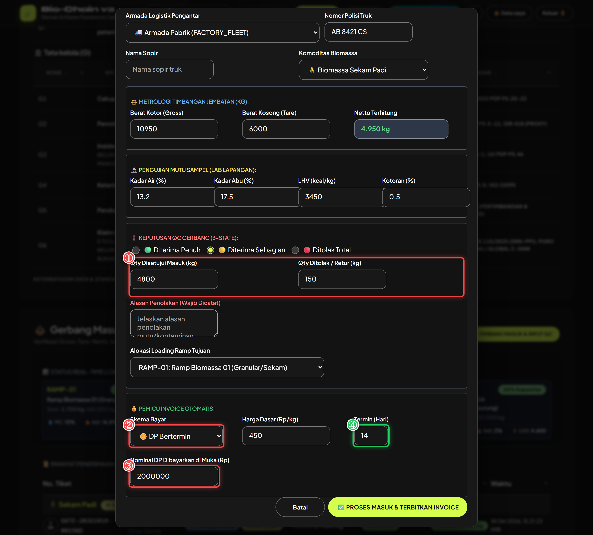

**Panduan Aksi Berdasarkan Nomor pada Gambar:**
- **① Qty Disetujui Masuk / Qty Ditolak (kg):** pastikan kg disetujui (`4800`) dan kg ditolak/retur (`150`) sudah
  benar, karena **invoice hanya dihitung dari kg yang diterima**. Dengan **Harga Dasar (Rp/kg)** `450`:
  4.800 kg × Rp 450 = **Rp 2.160.000**.
- **② Skema Bayar:** pada gambar dipilih **DP Bertermin**. Pilihan yang ada:
  - 💵 **Cash (Lunas Instan)** — invoice langsung berstatus *PAID*.
  - 🪙 **DP Bertermin** — muncul kolom **Nominal DP Dibayarkan di Muka (Rp)**; sisanya menjadi tagihan.
  - ⏳ **TOP (Jatuh Tempo)** — seluruh nilai dibayar pada tanggal jatuh tempo.
- **③ Nominal DP Dibayarkan di Muka (Rp):** contoh `2000000`. Sisa tagihan = Rp 2.160.000 − Rp 2.000.000 =
  **Rp 160.000**.
- **④ Termin (Hari):** jumlah hari sampai jatuh tempo, contoh `14` (bawaan 14, rentang 1–90). Setelah semua benar,
  klik **✅ PROSES MASUK & TERBITKAN INVOICE**. Muncul notifikasi sukses, lalu panel ramp dan riwayat gerbang
  (Layar 6.3a) langsung diperbarui.

> **🔧 Di Balik Layar (Sistem):** `factory_inbound.py` menghitung `total = kg_diterima × harga_dasar`, membuat
> `FactoryInvoice` bernomor `INV-YYYYMMDD-xxxxxx` dengan `due_date = sekarang + termin`:
> - **CASH** → `dibayar = total`, sisa 0, status `PAID`;
> - **DP** → `dibayar = min(DP, total)`, sisa = total − DP, status `PARTIALLY_PAID` (atau `PENDING` bila DP 0);
> - **TOP** → sisa = total, status `PENDING`.
>
> **Blokir TOP (disiplin kredit).** Sebelum menerbitkan invoice, sistem mencari invoice pabrik yang `is_overdue = True`
> dan belum lunas. Bila ada dan skema yang dipilih **TOP**, transaksi ditolak (HTTP 403): *"Pabrik memiliki tagihan TOP
> yang telah jatuh tempo belum dilunasi. Wajib melunasi tagihan overdue sebelum membuka transaksi TOP baru."* Skema Cash
> dan DP tetap bisa dipakai. Penanda jatuh tempo diperbarui otomatis setiap daftar invoice dibuka
> (`GET /factory/invoices`: belum lunas dan lewat `due_date` → overdue), dan dibuka kembali lewat pelunasan
> `POST /factory/invoices/{id}/pay`.

### Layar 6.2b — Pembayaran ke Pengepul & Pengawasan Jatuh Tempo

**Tujuan Proses & Standar Terkait:** Menimbang-terima biomassa yang tiba lewat rute armada pabrik, menetapkan harga
settlement, lalu menandai tagihan pengepul sudah dibayar dengan bukti transfer.

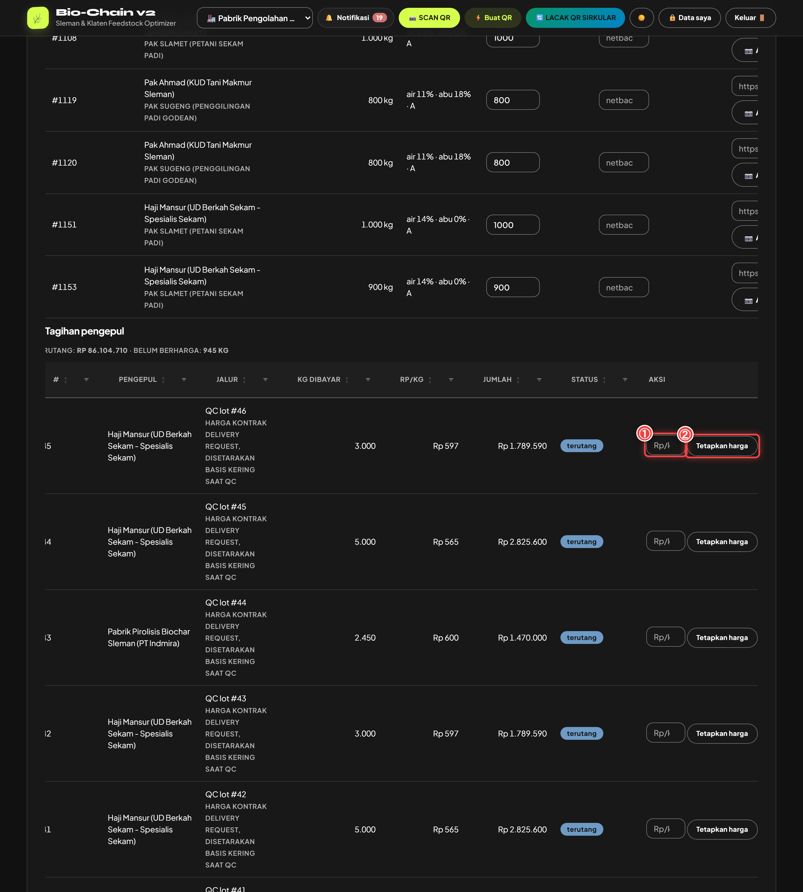

Kartu **Pembayaran ke Pengepul (jalur QC & rute armada)** memiliki dua bagian:
- **Tiba via rute armada — menunggu timbang terima** (bagian atas gambar): Harvest (mis. #1119), Pengepul / Petani
  (Pak Ahmad (KUD Tani Makmur Sleman) · Pak Sugeng (Penggilingan Padi Godean)), timbang pengepul (800 kg), mutu (air
  11 % · abu 18 % · A), **Timbang Pabrik (kg)** yang dapat dikoreksi, **Harga (Rp/kg, opsional)** — kosong berarti
  memakai rekomendasi *netback* — dan foto bukti. Filter **Semua status / menunggu harga / terutang / dibayar** ada di
  kanan atas kartu.
- **Tagihan pengepul**: ringkasan *Terutang: Rp 86.104.710 · Belum berharga: 945 kg*, lalu tabel #, Pengepul, Jalur
  (mis. *QC lot #46 · Harga kontrak delivery request, disetarakan basis kering saat QC*), kg dibayar (3.000), Rp/kg
  (Rp 597), Jumlah (Rp 1.789.590), Status (*terutang*), dan Aksi.

**Panduan Aksi Berdasarkan Nomor pada Gambar:**
- **① Isian Rp/kg:** ketik harga baru per kg pada baris tagihan yang ingin ditetapkan atau dikoreksi.
- **② Tetapkan harga:** klik untuk menyimpan harga. Sistem meminta **alasan** (minimal 5 karakter, contoh "Koreksi mutu
  timbangan pabrik"). Tagihan *menunggu harga* berubah menjadi *terutang*, dan jumlahnya dihitung ulang.

Untuk melunasi, gulir tabel ke kolom paling kanan (di luar gambar): pada tagihan *terutang*, isi **No. transfer**
(minimal 3 karakter) lalu klik **Tandai dibayar**. Status menjadi *dibayar* dan nomor referensi tampil di bawah status.

> **🔧 Di Balik Layar (Sistem):** Timbang terima memanggil `POST /api/v1/factory/receive` dan membuat settlement
> (`kg dibayar × Rp/kg`); bila harga kosong, status *menunggu harga* dan ringkasan "belum berharga: … kg" tampil di
> atas tabel. Penetapan harga (`/settlements/{id}/price`) wajib beralasan dan tercatat di jejak audit; pembayaran
> (`/settlements/{id}/pay`) wajib nomor bukti. Kartu *Evaluasi & Optimasi* di dasbor menandai kg yang "diterima tanpa
> harga settlement" sebagai prioritas (Layar 6.4a).
>
> **SLA hulu ke petani.** Pembayaran pengepul ke petani diawasi oleh parameter `pasar.farmer_payment_due_days`, bawaan
> **3 hari** (dapat diatur 0–60 hari di menu Parameter). Artinya petani wajib dibayar **maksimal 3 hari setelah
> serah-terima (lebih ketat dari target ≤ 14 hari)**; lot yang melewati batas ditandai **terlambat** dan dihitung pada
> ringkasan "… lot · … terlambat > 3 hari".

---

## 6.3 Loading Ramp & Optimasi

### Layar 6.3a — Status Real-Time Loading Ramp & Riwayat Gerbang

**Tujuan Proses & Standar Terkait:** Melihat isi dan mutu rata-rata setiap ramp penampung secara langsung, serta riwayat
semua tiket gerbang, sebagai dasar perencanaan produksi.

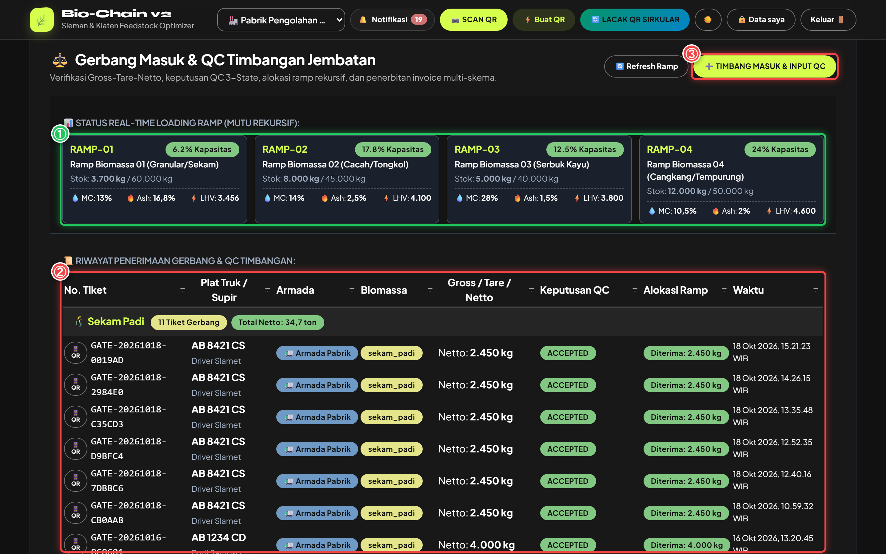

**Panduan Aksi Berdasarkan Nomor pada Gambar:**
- **① Status Real-Time Loading Ramp (Mutu Rekursif):** satu kartu per ramp, contoh **RAMP-01** Ramp Biomassa 01
  (Granular/Sekam) — *Stok: 3.700 kg / 60.000 kg*, lencana **6,2 % Kapasitas**, MC 13 %, Ash 16,8 %, LHV 3.456.
  RAMP-02 (Cacah/Tongkol) 8.000/45.000 kg; RAMP-03 (Serbuk Kayu) 5.000/40.000 kg dengan MC 28 % (perlu pengeringan);
  RAMP-04 (Cangkang/Tempurung) 12.000/50.000 kg, LHV 4.600. Klik **Refresh Ramp** untuk memuat ulang.
- **② Riwayat Penerimaan Gerbang & QC Timbangan:** dikelompokkan per komoditas (mis. *Sekam Padi · 11 Tiket Gerbang ·
  Total Netto 34,7 ton*). Tiap baris: No. Tiket (mis. `GATE-20261018-0019AD`, tombol QR), Plat Truk/Supir (`AB 8421 CS`,
  Driver Slamet), Armada, Biomassa, Netto (2.450 kg), Keputusan QC (`ACCEPTED`), Alokasi Ramp (Diterima: 2.450 kg), dan
  Waktu (WIB).
- **③ + TIMBANG MASUK & INPUT QC:** membuka form gerbang (Layar 6.1b).

> **🔧 Di Balik Layar (Sistem):** Data diambil dari `GET /factory/loading-ramps` dan `GET /factory/gate-receptions`
> (`factory_inbound.py`). Persentase kapasitas = `stok ÷ kapasitas maks × 100`. Mutu ramp adalah rata-rata berbobot
> massa dari semua muatan yang masuk (lihat rumus di Layar 6.1b), sehingga kartu langsung mencerminkan campuran fisik di
> ramp.

### Layar 6.3b — Prototipe 1: Blend Bahan Bakar & Briket Biaya Terendah & Risiko Terak (HiGHS)

**Tujuan Proses & Standar Terkait:** Mencari campuran biomassa **termurah** yang tetap memenuhi spesifikasi produk
(pelet ISO 17225-6, briket SNI/pasar, atau co-firing PLN) — nilai kalor, abu, klorin, sulfur — sekaligus membatasi
**indeks alkali** agar abu tidak membentuk terak (*slagging*) di boiler. Solver yang dipakai adalah **HiGHS** (program
linear) melalui SciPy.

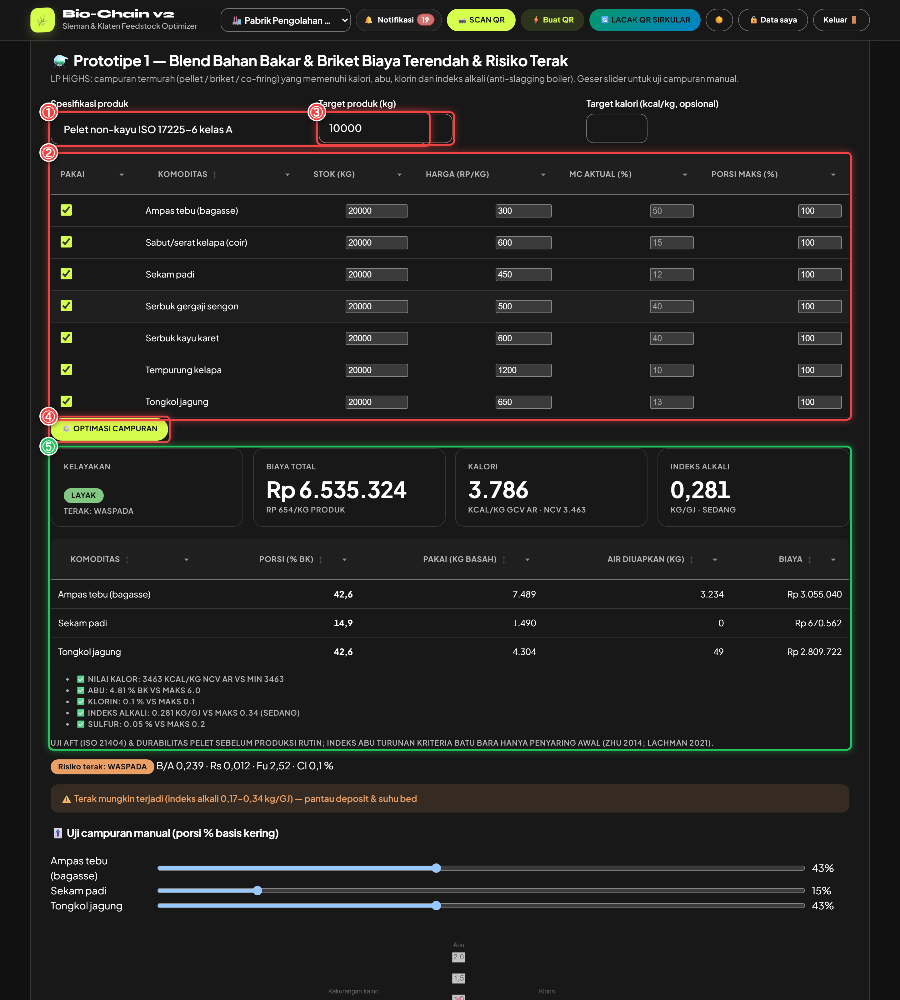

**Panduan Aksi Berdasarkan Nomor pada Gambar:**
- **① Spesifikasi produk:** pilih preset, contoh **Pelet non-kayu ISO 17225-6 kelas A** (MC produk 12 %, LHV ≥ 14,5
  MJ/kg, abu ≤ 6 %, Cl ≤ 0,10 %, S ≤ 0,20 %). Pilihan lain: kelas B (abu ≤ 10 %), pelet industri 4.000 kcal/kg, briket
  (GCV ≥ 4.400 kcal/kg, MC ≤ 8 %, abu ≤ 8 %), dan co-firing PLTU (GCV ≥ 3.009 kcal/kg, MC ≤ 25 %).
- **② Tabel bahan:** centang **Pakai** untuk bahan yang tersedia, lalu periksa **Stok (kg)**, **Harga (Rp/kg)**,
  **MC aktual (%)**, dan **Porsi maks (%)**. Pada gambar ketujuh bahan dicentang dengan stok masing-masing `20000` kg;
  harga: ampas tebu 300, sabut kelapa 600, sekam padi 450, serbuk gergaji sengon 500, serbuk kayu karet 600, tempurung
  kelapa 1200, tongkol jagung 650. Tulisan *wajib* pada kolom harga berarti harga harus diisi sebelum bahan dapat dipakai.
  Porsi maks dapat diturunkan, mis. sekam ≤ 30 % demi durabilitas pelet.
- **③ Target produk (kg):** contoh `10000`. **Target kalori (kcal/kg, opsional)** boleh dikosongkan; bila kosong, batas
  kalori dari preset yang dipakai.
- **④ OPTIMASI CAMPURAN:** klik untuk menjalankan solver.
- **⑤ Hasil:** empat kotak ringkasan dan tabel komposisi. Contoh pada gambar:
  - **Kelayakan: LAYAK** · *Terak: WASPADA*.
  - **Biaya total Rp 6.535.324** (Rp 654/kg produk).
  - **Kalori 3.786 kcal/kg GCV ar** · NCV 3.463.
  - **Indeks alkali 0,281 kg/GJ** · sedang.
  - Komposisi: **Ampas tebu** 42,6 % bk (pakai 7.489 kg basah, air diuapkan 3.234 kg, Rp 3.055.040); **Sekam padi**
    14,9 % (1.490 kg, Rp 670.562); **Tongkol jagung** 42,6 % (4.304 kg, air 49 kg, Rp 2.809.722).
  - Daftar cek (semua ✔): nilai kalor 3463 kcal/kg NCV ar vs min 3463; **abu 4,81 % bk vs maks 6,0**; klorin
    0,1 % vs maks 0,1; indeks alkali 0,281 vs maks 0,34 (sedang); sulfur 0,05 % vs maks 0,2. Di bawahnya ada saran uji
    AFT (ISO 21404) dan durabilitas pelet.
  - Pita **Risiko terak: WASPADA** (B/A 0,239 · Rs 0,012 · Fu 2,52 · Cl 0,1 %) dengan peringatan *"Terak mungkin terjadi
    (indeks alkali 0,17–0,34 kg/GJ) — pantau deposit & suhu bed"*.

  Di bawah hasil tersedia **Uji campuran manual (porsi % basis kering)**: geser slider tiap bahan (contoh ampas tebu 43 %,
  sekam padi 15 %, tongkol jagung 43 %) untuk menguji campuran sendiri dengan cek yang sama.

  **Hasil "tidak layak" juga sah.** Bila stok bahan rendah abu tidak cukup (mis. hanya sekam padi, abu ±17 %, padahal
  batas kelas A 6 %), solver menjawab *"Tidak ada campuran yang memenuhi semua batas. Tambah stok bahan rendah
  abu/alkali atau kurangi target."* Bila hanya satu batas yang menghalangi, sistem menyebut batas mana yang bila
  dilonggarkan membuat campuran layak.

> **🔧 Di Balik Layar (Sistem):** `app/engines/fuel_blend.py` (endpoint `POST /factory/fuel-blend/optimize`).
> **Formulasi LP** — variabel keputusan **xᵢ = kg bahan KERING komoditas i** (agar semua kendala linear):
>
> - **Fungsi tujuan (minimasi biaya):**
>   `min Σ xᵢ · [ harga_arᵢ / (1 − MCᵢ) + max(0, wᵢ − w_produk) · biaya_pengeringan ]`,
>   dengan `w = MC/(100 − MC)` = kg air per kg kering (biaya pengeringan opsional).
> - **Kendala massa:** `Σ xᵢ = D`, dengan `D = target × (1 − MC_produk)`.
> - **Kendala kalor (≥ minimum):** `Σ xᵢ · (LHV_d,min − LHV_dᵢ) ≤ 0`, dengan
>   `LHV_d,min = (LHV_ar,min + 2,443·MC) / (1 − MC)` dari rumus ISO 18125
>   `LHV_ar = LHV_d·(1 − MC) − 2,443·MC` [MJ/kg]. Untuk preset berbasis GCV:
>   `Σ xᵢ · (GCV_min/(1 − MC) − HHVᵢ) ≤ 0`.
> - **Kendala abu, klorin, sulfur (≤ maksimum):** `Σ xᵢ · (Aᵢ − A_max) ≤ 0`, `Σ xᵢ · (Clᵢ − Cl_max) ≤ 0`,
>   `Σ xᵢ · (Sᵢ − S_max) ≤ 0`.
> - **Kendala indeks alkali (Miles 1996, ditulis linear):**
>   `Σ xᵢ · (Aᵢ · alkᵢ / 10⁴ − AI_max · HHVᵢ / 1000) ≤ 0`, dengan `alk = K₂O + Na₂O (% abu)` dan `AI_max = 0,34
>   kg/GJ` (bawaan). Ambang: < 0,17 rendah · 0,17–0,34 terak mungkin · > 0,34 hampir pasti terak. Bahan yang K₂O
>   abunya belum diketahui **tidak boleh dipakai** selama batas ini aktif (gagal-tertutup, bukan dianggap 0).
> - **Batas variabel:** `0 ≤ xᵢ ≤ min(stokᵢ · (1 − MCᵢ), porsi_maksᵢ · D)`; porsi minimum opsional
>   `xᵢ ≥ porsi_minᵢ · D`.
>
> Diselesaikan dengan `scipy.optimize.linprog(method="highs")`. Setelah solusi ditemukan, `evaluate()` menghitung indeks
> abu lain dari komposisi oksida berbobot massa abu (B/A, Rs, Fu, Si/Al, viskositas G; ambang Zhu dkk. 2014) dan
> peringatan khusus (sekam > 30 % → risiko kristobalit; K₂O + SiO₂ tinggi → uji AFT ISO 21404). Indeks tersebut hanya
> **penyaring awal**; uji titik leleh abu (AFT, ISO 21404) tetap wajib sebelum produksi rutin.

### Layar 6.3c — Mesin Rekomendasi Blending Multi-Ramp (4 Produk Akhir)

**Tujuan Proses & Standar Terkait:** Memberi usulan cepat alokasi isi ramp untuk empat lini produk — Biopellet, Biochar,
Bio-Silika, dan Briket — lengkap dengan mutu campuran, margin, dan perkiraan serapan karbon, lalu mengunci batch
produksi.

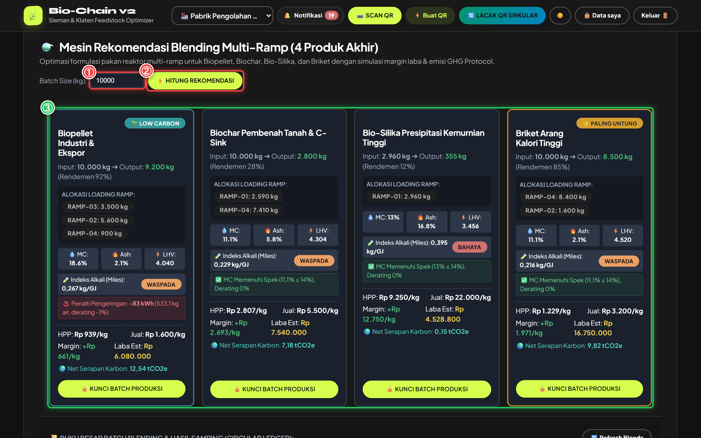

**Panduan Aksi Berdasarkan Nomor pada Gambar:**
- **① Batch Size (kg):** ketik ukuran batch, contoh `10000`.
- **② HITUNG REKOMENDASI:** klik untuk menyusun usulan.
- **③ Kartu 4 produk:** setiap kartu menampilkan input → output dan rendemen, alokasi ramp, mutu campuran (MC, Ash,
  LHV), indeks alkali Miles dengan label (WASPADA/BAHAYA), status spesifikasi MC/derating, penalti pengeringan, HPP,
  harga jual, margin, laba estimasi, dan *Net Serapan Karbon*. Contoh pada gambar:
  - **Biopellet Industri & Ekspor** (lencana *LOW CARBON*): 10.000 kg → 9.200 kg (rendemen 92 %), alokasi RAMP-03
    3.500 kg + RAMP-02 5.600 kg + RAMP-04 900 kg, MC 18,6 % → *Penalti Pengeringan −83 kWh*, laba est. Rp 6.080.000,
    12,54 tCO₂e.
  - **Biochar Pembenah Tanah & C-Sink:** 10.000 → 2.800 kg (28 %), indeks alkali 0,229 (WASPADA), laba Rp 7.540.000.
  - **Bio-Silika Presipitasi Kemurnian Tinggi:** hanya dari ramp sekam (RAMP-01 2.960 kg) → 355 kg (12 %), indeks alkali
    0,395 (**BAHAYA**), laba Rp 4.528.800.
  - **Briket Arang Kalori Tinggi** (lencana *PALING UNTUNG*): 10.000 → 8.500 kg (85 %), RAMP-04 8.400 kg + RAMP-02
    1.600 kg, LHV 4.520, laba Rp 16.750.000.
  Klik **KUNCI BATCH PRODUKSI** pada kartu yang dipilih untuk mencatat batch dan mengurangi stok ramp.

> **🔧 Di Balik Layar (Sistem):** Kartu ini **tidak memakai HiGHS**. `app/routers/factory_production.py` memakai
> **heuristik urut-prioritas**: ramp diurutkan menurut aturan tiap produk (pellet: bahan kayu/tebu/jagung dulu, lalu abu
> terendah dan LHV tertinggi; biochar: sekam/tempurung/tebu dulu; briket: LHV tertinggi; bio-silika: wajib ramp sekam),
> lalu diambil berurutan hingga target terpenuhi dengan batas **70 % stok tiap ramp** (bio-silika 80 % ramp sekam).
> Mutu campuran adalah rata-rata berbobot; indeks alkali memakai rumus Miles yang sama dengan Prototipe 1; penalti
> pengeringan dari `engines/energy.py`. Serapan karbon memakai faktor tetap per ton produk (indikatif, bukan klaim) —
> klaim resmi melalui Layar 6.4d. Untuk campuran biaya terendah yang benar-benar optimal, gunakan Prototipe 1 (Layar
> 6.3b); untuk alokasi stok optimal ke empat produk, gunakan Prototipe 4 (Layar 6.3d).

### Layar 6.3d — Prototipe 4: Optimasi Multi-Biomassa ke Produk Akhir

**Tujuan Proses & Standar Terkait:** Membandingkan secara menyeluruh hasil satu lot biomassa bila diolah menjadi
Bio-Pellet (ISO 17225-2/-6), Briket (SNI 01-6235-2000), Biochar (pembenah tanah & C-sink, EBC/IBI), atau Bio-Silika —
neraca massa, energi (SEC/IKE), margin Rupiah, karbon tCO₂e, dan skor kesesuaian teknis — serta mengalokasikan stok
pabrik secara optimal dengan **HiGHS**.

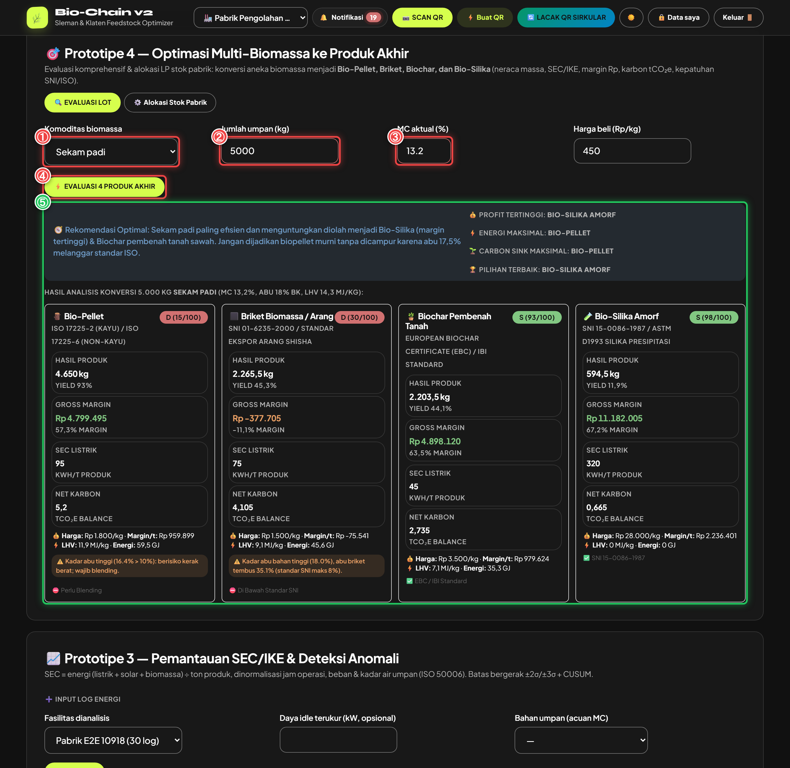

Kartu memiliki dua tab: **EVALUASI LOT** (satu lot, dibandingkan ke 4 produk) dan **Alokasi Stok Pabrik** (banyak stok
biomassa, dialokasikan dengan LP).

**Panduan Aksi Berdasarkan Nomor pada Gambar:**
- **① Komoditas biomassa:** pilih, contoh **Sekam padi**.
- **② Jumlah umpan (kg):** contoh `5000`.
- **③ MC aktual (%):** contoh `13.2`. **Harga beli (Rp/kg)** terisi `450` (dapat diubah).
- **④ EVALUASI 4 PRODUK AKHIR:** klik untuk menghitung.
- **⑤ Hasil:** di bagian atas tampil kotak **Rekomendasi Optimal**. Contoh: *"Sekam padi paling efisien dan
  menguntungkan diolah menjadi Bio-Silika (margin tertinggi) & Biochar pembenah tanah sawah. Jangan dijadikan biopellet
  murni tanpa dicampur karena abu 17,5 % melanggar standar ISO."* Di sampingnya ada ringkasan: *Profit tertinggi:
  Bio-Silika Amorf · Energi maksimal: Bio-Pellet · Carbon sink maksimal: Bio-Pellet · Pilihan terbaik: Bio-Silika Amorf*.
  Di bawahnya tertulis *"Hasil analisis konversi 5.000 kg sekam padi (MC 13,2 %, abu 18 % bk, LHV 14,3 MJ/kg)"*, lalu
  empat kartu produk. Setiap kartu memuat grade/skor, standar acuan, hasil produk, gross margin, SEC listrik, net
  karbon, harga, dan LHV/energi:

  | Produk (standar) | Skor | Hasil produk | Gross margin | SEC listrik | Net karbon | Catatan |
  |---|---|---|---|---|---|---|
  | **Bio-Pellet** (ISO 17225-2 / 17225-6) | D (15/100) | 4.650 kg (yield 93 %) | Rp 4.799.495 (57,3 %) | 95 kWh/t | 5,2 tCO₂e | Kadar abu 16,4 % > 10 %: berisiko kerak berat, wajib blending → *Perlu Blending* |
  | **Briket Biomassa / Arang** (SNI 01-6235-2000) | D (30/100) | 2.265,5 kg (45,3 %) | **Rp −377.705** (−11,1 %) | 75 kWh/t | 4,105 tCO₂e | Abu briket tembus 35,1 % (SNI maks 8 %) → *Di Bawah Standar SNI* |
  | **Biochar Pembenah Tanah** (EBC / IBI) | S (93/100) | 2.203,5 kg (44,1 %) | Rp 4.898.120 (63,5 %) | 45 kWh/t | 2,735 tCO₂e | ✔ EBC / IBI Standard |
  | **Bio-Silika Amorf** (SNI 15-0086-1987 / ASTM D1993) | S (98/100) | 594,5 kg (11,9 %) | **Rp 11.182.005** (67,2 %) | 320 kWh/t | 0,665 tCO₂e | ✔ SNI 15-0086-1987 |

  Margin negatif (briket) berarti jalur itu merugi untuk lot ini. Skor kesesuaian di bawah 45 juga membuat jalur tersebut
  dikunci 0 pada tab **Alokasi Stok Pabrik**.

> **🔧 Di Balik Layar (Sistem):** `app/engines/product_optimization.py`. Tab **Evaluasi Lot** memanggil
> `evaluate_feedstock()` (perhitungan per jalur, tanpa solver). Tab **Alokasi Stok Pabrik** memanggil
> `optimize_allocation()` — **LP HiGHS** dengan variabel **x[i,j] = ton biomassa i ke lini produk j** (j = pellet,
> briket, biochar, bio-silika):
> - **Tujuan** (pilih): *max_profit* → `max Σ laba_kotor_ij · x_ij`; *max_energy* → energi bersih GJ; *max_carbon* →
>   manfaat iklim bersih tCO₂e; *balanced* → `skor_kesesuaian × 100 + margin/5000` (diminimasi sebagai `−c`).
> - **Kendala pasokan:** `Σ_j x_ij ≤ tonase_i`.
> - **Kendala kapasitas lini** (opsional): `Σ_i rendemen_ij · x_ij ≤ kapasitas_j` (ton produk; bio-silika dalam kg).
> - **Larangan teknis:** bila skor kesesuaian jalur < 45, `x_ij = 0` (bahan tidak dipaksakan ke lini yang gagal spek).
>
> Karbon biochar memakai `C_sink = t_biochar × C_org × F_perm × 44/12`.

---

## 6.4 ESG, Output Produksi & Sirkularitas Abu

### Layar 6.4a — Dasbor KPI Karbon, Output & Evaluasi Pabrik

**Tujuan Proses & Standar Terkait:** Ringkasan kinerja pabrik di halaman awal: emisi karbon yang dihindari, output
biochar, potensi biosilika, serta skor kesehatan operasi dan prioritas perbaikan dari *AI Optimizer & Evaluator Pirolisis
Pabrik*.

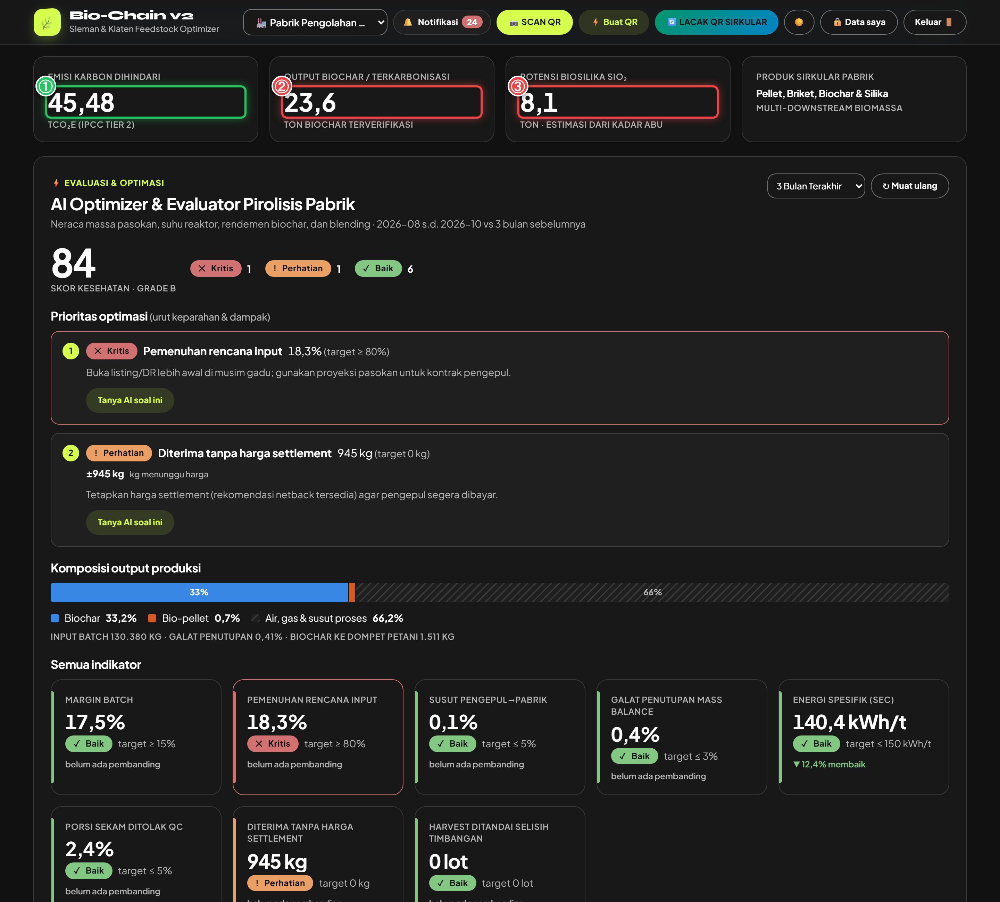

**Panduan Aksi Berdasarkan Nomor pada Gambar:**
- **① Emisi Karbon Dihindari:** **45,48 tCO₂e** (IPCC Tier 2) — kredit karbon bersih dari klaim terverifikasi.
- **② Output Biochar / Terkarbonisasi:** **23,6 ton** biochar terverifikasi.
- **③ Potensi Biosilika SiO₂:** **8,1 ton**, estimasi dari kadar abu. Di sebelahnya, kotak **Produk Sirkular Pabrik** menyebut
  lini produk *Pellet, Briket, Biochar & Silika · Multi-downstream biomassa*.

Di bawah KPI, kartu **Evaluasi & Optimasi — AI Optimizer & Evaluator Pirolisis Pabrik** (neraca massa pasokan, suhu
reaktor, rendemen biochar, dan blending; periode 2026-08 s.d. 2026-10 dibanding 3 bulan sebelumnya) menampilkan:
- **Skor Kesehatan 84 · Grade B**, dengan temuan *Kritis 1 · Perhatian 1 · Baik 6*.
- **Prioritas optimasi** (urut keparahan & dampak):
  1. *Kritis* — **Pemenuhan rencana input 18,3 %** (target ≥ 80 %): buka listing/DR lebih awal di musim gadu; gunakan
     proyeksi pasokan untuk kontrak pengepul.
  2. *Perhatian* — **Diterima tanpa harga settlement 945 kg** (target 0 kg): tetapkan harga settlement agar pengepul
     segera dibayar (Layar 6.2b).

  Tombol **Tanya AI soal ini** membuka Asisten dengan konteks temuan tersebut.
- **Komposisi output produksi:** Biochar 33,2 %, Bio-pellet 0,7 %, Air, gas & susut proses 66,2 % (input batch
  130.380 kg · galat penutupan 0,41 % · biochar ke dompet petani 1.511 kg).
- **Semua indikator:** Margin batch 17,5 % (target ≥ 15 %, Baik); Pemenuhan rencana input 18,3 % (≥ 80 %, Kritis); Susut
  pengepul→pabrik 0,1 % (≤ 5 %); Galat penutupan mass balance 0,4 % (≤ 3 %); Energi spesifik (SEC) 140,4 kWh/t
  (≤ 150 kWh/t, membaik 12,4 %); Porsi sekam ditolak QC 2,4 % (≤ 5 %); Diterima tanpa harga settlement 945 kg (target
  0 kg, Perhatian); Harvest ditandai selisih timbangan 0 lot.

Pilih periode (mis. *3 Bulan Terakhir*) dan klik **Muat ulang** untuk memperbarui. Lebih ke bawah di dasbor ada grafik
**Proyeksi Pasokan Biomassa 30 Hari** (model cosinus musiman panen Sleman & Klaten, BPS), **Kalkulator Pengurangan
Emisi Karbon** (isi biomassa dalam ton dan jarak angkut dalam km, lalu klik **HITUNG PENGURANGAN CO₂ ➔**), dan kartu
**Rekomendasi Harga Beli Multi-Biomassa**.

> **🔧 Di Balik Layar (Sistem):** KPI ①–③ diambil dari ringkasan karbon pabrik (`app/routers/factory.py`,
> metodologi "IPCC 2006 Tier 2"). Emisi dihindari (`app/engines/carbon.py`):
> `E_dihindari = (M_biomassa × (1 − MC) × HHV_biomassa × η_boiler) × EF_batubara`;
> `E_angkut = M × jarak × EF_angkut`; `Neto = E_dihindari − E_angkut` — faktor HHV, η, dan EF batu bara diambil dari
> menu Parameter (`karbon.*`). Estimasi biochar = biomassa × rendemen model aktif (suhu pirolisis & abu acuan); potensi
> SiO₂ = biomassa × abu acuan × fraksi SiO₂ dalam abu (`rendemen.sio2_fraction_of_ash`). Angka ini **estimasi internal**,
> bukan kredit karbon.

### Layar 6.4b — Batch Produksi Multi-Produk: Produk Utama & Hasil Samping

**Tujuan Proses & Standar Terkait:** Mencatat setiap batch produksi — lot biomassa yang dipakai, timbangan output
(bio-pellet/briket, biochar, bio-silika), susut terukur, dan biaya — agar neraca massa tertutup dan biaya per ton produk
diketahui (GRI 301-1).

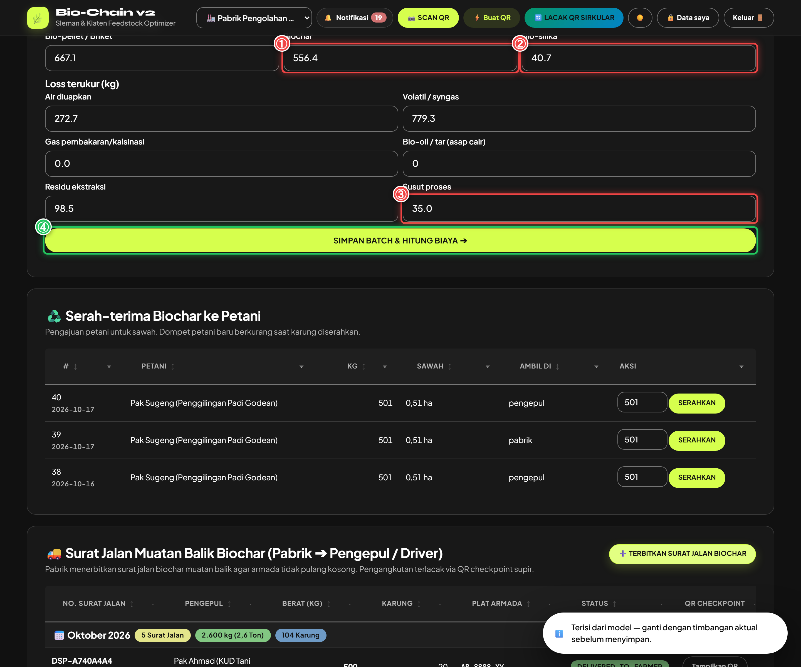

**Sebelum bagian yang tampak pada gambar** (di atas kartu):
1. **Kode batch** terisi otomatis (contoh `B-20261018-926`).
2. Pada daftar **Lot biomassa (stok QC)** — lot hasil QC gerbang (Layar 6.1b), mis. *Lot #46 · sisa 3.000 kg · air
   14 % · A* — ketik kg yang masuk reaktor di kotak kanan lot, contoh `2450` pada Lot #46. Lot lain dibiarkan 0.
3. Klik **Isi dari model** (kanan atas kartu). Output dan loss terisi otomatis dari model rendemen, lalu muncul pesan
   *"Terisi dari model — ganti dengan timbangan aktual sebelum menyimpan."* Bila belum ada kg lot, muncul peringatan
   *"Isi kg dari minimal satu lot dulu."*

Contoh hasil model untuk 2.450 kg: Bio-pellet / Briket 667,1 kg; Air diuapkan 272,7; Volatil/syngas 779,3; Gas
pembakaran/kalsinasi 0,0; Bio-oil/tar 0; Residu ekstraksi 98,5.

**Panduan Aksi Berdasarkan Nomor pada Gambar:**
- **① Biochar (kg):** ganti angka model (contoh `556.4`) dengan timbangan output biochar yang sebenarnya.
- **② Bio-silika (kg):** timbangan output bio-silika (contoh `40.7`). Kolom *Bio-pellet / Briket* ada di sebelah kiri.
- **③ Susut proses (kg):** contoh `35.0`. Periksa juga kolom **Loss terukur** lainnya: *Air diuapkan*, *Volatil /
  syngas*, *Gas pembakaran/kalsinasi*, *Bio-oil / tar (asap cair)*, dan *Residu ekstraksi*.
- **④ SIMPAN BATCH & HITUNG BIAYA ➔:** menyimpan batch, mengurangi sisa lot, dan menampilkan neraca massa serta biaya
  per ton produk.

Sebelum menyimpan, isi juga **Biaya batch** (listrik kWh, tenaga kerja jam, bahan kimia silika, kemasan, jam operasi)
dan **Jalur bio-silika** (dari biochar / abu pembakaran / biomassa langsung).

> **🔧 Di Balik Layar (Sistem):** *Isi dari model* menghitung MC dan abu rata-rata berbobot dari lot yang dipilih, lalu
> memanggil `POST /factory/pricing/recommend` untuk rendemen dan loss per kg biomassa; output = rendemen × total kg.
> kWh bawaan = `pabrik.kwh_per_ton_input` × ton input. Data batch (`manufacturing_batches`, `batch_outputs`,
> `batch_losses`, `batch_costs`) menjadi sumber KPI E2, E3, E4 laporan ESG.

### Layar 6.4c — Laporan ESG (E · S · G)

**Tujuan Proses & Standar Terkait:** Menyusun laporan Lingkungan, Sosial, Tata kelola dari data operasional nyata,
mengikuti GRI, GHG Protocol LSR, IFRS S2, dan struktur Lampiran II POJK 51/2017. **Emisi bruto, karbon tersimpan, dan
emisi dihindari dilaporkan terpisah** — emisi dihindari tidak mengurangi emisi bruto.

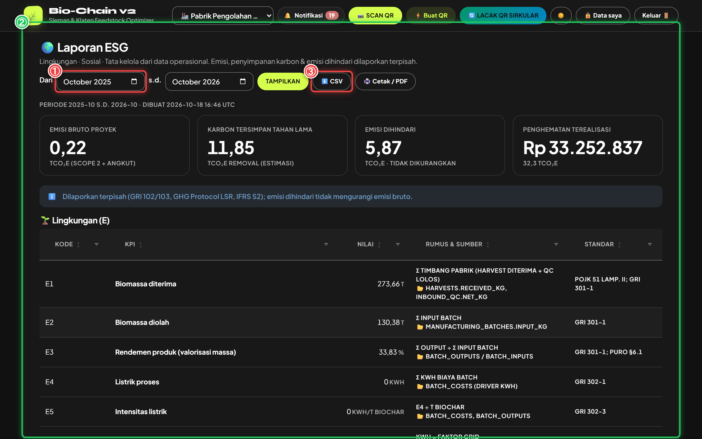

**Panduan Aksi Berdasarkan Nomor pada Gambar:**
- **① Dari … s.d. …:** pilih bulan awal (contoh *October 2025*) dan akhir (*October 2026*), lalu klik **TAMPILKAN**.
- **② Isi laporan:** baris periode & waktu dibuat (*Periode 2025-10 s.d. 2026-10 · dibuat 2026-10-18 16:46 UTC*),
  empat kotak ringkasan — **Emisi Bruto Proyek 0,22 tCO₂e** (Scope 2 + angkut), **Karbon Tersimpan Tahan Lama 11,85
  tCO₂e** (removal, estimasi), **Emisi Dihindari 5,87 tCO₂e** (tidak dikurangkan), **Penghematan Terealisasi Rp
  33.252.837** (32,3 tCO₂e) — lalu tabel KPI **Lingkungan (E)**: Kode, KPI, Nilai, Rumus & Sumber (tabel basis data),
  Standar. Contoh: E1 Biomassa diterima 273,66 t (POJK 51 Lamp. II; GRI 301-1), E2 Biomassa diolah 130,38 t, E3 Rendemen
  produk 33,83 % (GRI 301-1; Puro §6.1), E4 Listrik proses (GRI 302-1), E5 Intensitas listrik (GRI 302-3). Gulir ke bawah
  untuk bagian **Sosial (S)** dan **Tata kelola (G)**.
- **③ CSV:** unduh laporan sebagai CSV. **Cetak / PDF** untuk mencetak atau menyimpan PDF.

> **🔧 Di Balik Layar (Sistem):** `app/services/esg.py` mengumpulkan batch, rute, retur, pembayaran petani, persetujuan
> data, dan perubahan parameter pada periode, lalu memanggil `engines/green_scorecard.py`. Setiap KPI menyebut rumus,
> tabel sumber, dan rujukan standar. Angka karbon adalah **estimasi internal** sampai diverifikasi pihak ketiga
> (Puro / VM0044 / Global C-Sink). Contoh KPI tampil 0 kWh bila biaya listrik batch belum diisi (Layar 6.4b).

### Layar 6.4d — Klaim Removal Karbon & Uji Lab (H/C-org, EBC/IBI)

**Tujuan Proses & Standar Terkait:** Pabrik mengajukan klaim removal karbon dari biochar yang **terbukti diserahkan ke
lahan petani**, dengan hasil laboratorium C-organik dan rasio H/C-org (kriteria stabilitas EBC/IBI dan Puro.earth).
Auditor (orang lain, bukan pengaju) memverifikasi. **"Terverifikasi" = verifikasi internal, bukan kredit karbon.**


Pilih **Bulan awal** dan **Bulan akhir** periode klaim (contoh *October 2026*).

**Panduan Aksi Berdasarkan Nomor pada Gambar:**
- **① C-organik lab (% bk):** kadar karbon organik biochar dari laporan lab (basis kering), contoh `45`.
- **② Rasio H/C-org (molar):** contoh `0.3`. Harus **di bawah 0,7**; di atas itu klaim diblokir.
- **③ Nama laboratorium:** contoh *Laboratorium Uji Mutu …* (sebaiknya terakreditasi KAN / ISO 17025).
- **④ No. laporan lab:** nomor laporan hasil uji (LHU), contoh `LHU-2026-10-0142`. Unggah **Foto/scan laporan lab** di
  kolom sebelahnya (*Choose File*).
- **⑤ AJUKAN:** klik **Pratinjau** dulu untuk melihat hitungan removal dan pemblokir (bila ada). Tombol Ajukan baru aktif
  setelah pratinjau tanpa pemblokir; mengubah isian apa pun menonaktifkannya lagi (harus pratinjau ulang).

Tabel di bawah menampilkan klaim: **Klaim** (kode, mis. `CLM-2610-014`, pabrik, tanggal), **Periode**, **Biochar ke
lahan** (mis. 9.161 kg · 32 serah-terima), **Removal bersih** (mis. 9,632 tCO₂e), **Lab** (C-org 45 % · H/C 0,3 · nama
lab), dan **Status** (*diajukan*, *diverifikasi*, atau *ditolak* beserta catatan auditor, mis. "tolak agar kunci
dilepas").

> **🔧 Di Balik Layar (Sistem):** `app/services/carbon_claims.py` + `engines/green_scorecard.py`:
> `Removal = t biochar KERING yang diserahkan ke lahan × F_C × F̄_perm × 44/12`, dikurangi potongan ketidakpastian
> (`karbon.uncertainty_deduction_pct`). C-org lab menggantikan parameter F_C. F_perm (IPCC 2019 Ap.4) menurut suhu
> pirolisis: 350–<450 °C 0,65 · 450–<600 °C 0,80 · ≥ 600 °C 0,89; suhu tak tercatat → 0 (tidak boleh diklaim).
> Batas H/C-org = parameter `karbon.h_corg_max` (bawaan **0,7**). Anti hitung-ganda: satu serah-terima biochar hanya
> boleh terkunci di satu klaim aktif, periode klaim aktif tidak boleh tumpang-tindih, dan snapshot perhitungan dibekukan
> dengan SHA-256. Auditor tidak boleh memutus klaim yang ia ajukan sendiri; klaim ditolak melepas serah-terimanya agar
> dapat diajukan ulang.

### Layar 6.4e — Ledger Abu → Kelompok Tani (Uji Logam Berat)

**Tujuan Proses & Standar Terkait:** Mencatat abu boiler/pirolisis (silica ash, bottom ash, fly ash) dan menyalurkannya
ke kelompok tani **hanya bila lulus uji logam berat** sesuai Kepmentan No. 261/KPTS/SR.310/M/4/2019. Serah-terima wajib
foto dan titik lahan.

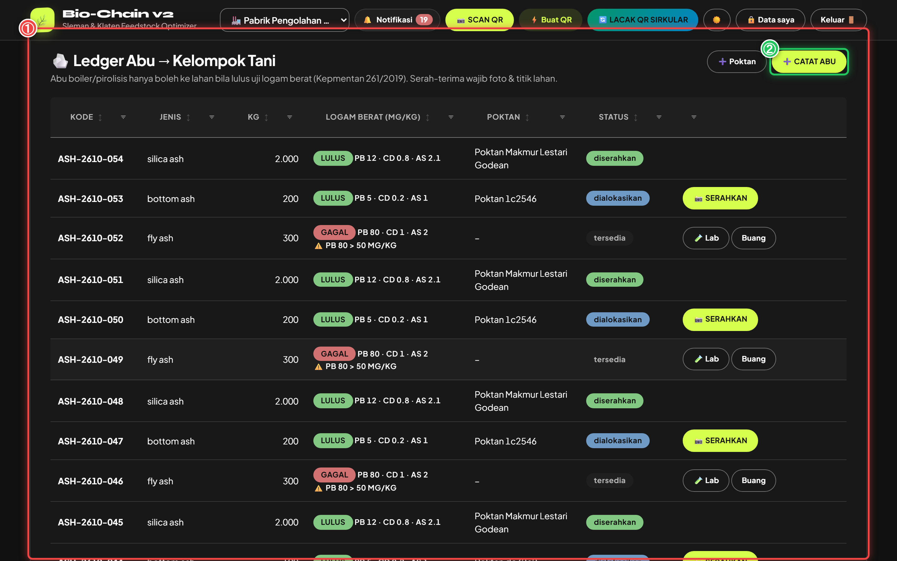

**Panduan Aksi Berdasarkan Nomor pada Gambar:**
- **① Tabel ledger abu:** kolom **Kode** (mis. `ASH-2610-054`), **Jenis** (silica ash / bottom ash / fly ash), **KG**,
  **Logam berat (mg/kg)** dengan lencana **LULUS** (mis. Pb 12 · Cd 0,8 · As 2,1) atau **GAGAL** (mis. Pb 80 → peringatan
  *PB 80 > 50 mg/kg*), **Poktan** (mis. Poktan Makmur Lestari Godean), dan **Status**:
  - *tersedia* → tombol **Lab** (input hasil uji) dan **Buang** (abu gagal dibuang dengan alasan);
  - *dialokasikan* → tombol **SERAHKAN** (serah-terima ke poktan dengan foto & titik lahan);
  - *diserahkan* → selesai.
  Tombol **+ Poktan** untuk mendaftarkan kelompok tani baru.
- **② + CATAT ABU:** isi **Jenis abu**, **Asal biomassa**, dan **Tonase (kg)**. Setelah itu klik **Lab** pada baris
  baru untuk mengisi Pb, Cd, As (wajib), Hg, Cr, Ni (opsional), **Laboratorium**, **No. laporan lab** (wajib), dan
  K₂O abu (opsional, untuk dosis).

> **🔧 Di Balik Layar (Sistem):** `app/routers/multibiomass.py` (`/factory/ash`, `/lab`, `/allocate`, `/handover`,
> `/dispose`). Abu **lulus hanya bila semua logam yang terukur ≤ batas** parameter `abu.limit_*_ppm`: As 10, Hg 1,
> Pb 50, Cd 2, Cr 180, Ni 50 mg/kg. Abu gagal tidak dapat dialokasikan ke lahan. Petani dapat melihat abu yang
> dialokasikan untuknya di menu petani (`/farmer/ash`).

### Layar 6.4f — Serah-terima Biochar ke Petani & Surat Jalan Muatan Balik

**Tujuan Proses & Standar Terkait:** Menyerahkan biochar dari "dompet biochar" petani (hasil penjualan biomassanya) dan
menerbitkan **surat jalan muatan balik** agar truk yang kembali ke pengepul tidak pulang kosong. Pengangkutan terlacak
lewat QR checkpoint sopir (Bab 5).

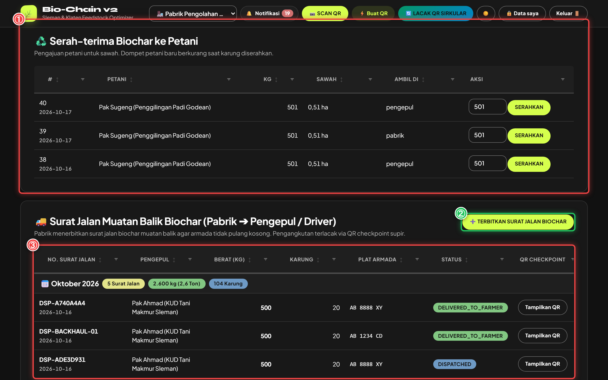

**Panduan Aksi Berdasarkan Nomor pada Gambar:**
- **① Serah-terima Biochar ke Petani:** daftar pengajuan petani untuk sawah — **#** (mis. 40, 2026-10-17), **Petani**
  (Pak Sugeng (Penggilingan Padi Godean)), **KG** (501), **Sawah** (0,51 ha), **Ambil di** (*pengepul* atau *pabrik*).
  Pada kolom **Aksi**, periksa kg yang benar-benar diserahkan (contoh `501`) lalu klik **SERAHKAN**. Dompet biochar
  petani baru berkurang saat karung diserahkan.
- **② + TERBITKAN SURAT JALAN BIOCHAR:** isi pengepul tujuan, driver/rute, plat armada, berat total, jumlah karung
  (opsional) dan instruksi muat. Surat jalan berstatus **DISPATCHED** dan memiliki QR.
- **③ Daftar surat jalan:** dikelompokkan per bulan (contoh *Oktober 2026 · 5 Surat Jalan · 2.600 kg (2,6 ton) · 104
  karung*). Kolom: **No. Surat Jalan** (mis. `DSP-A740A4A4`), **Pengepul** (Pak Ahmad (KUD Tani Makmur Sleman)),
  **Berat** (500 kg), **Karung** (20), **Plat Armada** (`AB 8888 XY`), **Status** (`DISPATCHED` → `DELIVERED_TO_FARMER`
  setelah sopir/pengepul memindai serah-terima), dan **Tampilkan QR**.

> **🔧 Di Balik Layar (Sistem):** Surat jalan dibuat oleh `POST /api/v1/factory/dispatch-biochar`
> (`app/routers/factory.py`): kode `DSP-xxxxxxxx`, token QR acak, volume = berat ÷ 300 kg/m³ (densitas biochar), jumlah
> karung bawaan = berat ÷ 25 kg. Status berubah menjadi `DELIVERED_TO_FARMER` melalui pemindaian QR di aplikasi driver
> (`app/routers/driver.py`). Serah-terima ke petani dicatat oleh `app/services/circular.py` (`handover`) dan menjadi
> dasar "biochar ke lahan" pada klaim removal karbon (Layar 6.4d) — satu serah-terima hanya dapat diklaim sekali.

# Storyboard & Naskah Video Demonstrasi Bio-Chain

**Durasi target:** ± 7 menit 45 detik (18 adegan) · **Penonton:** investor & mitra pendanaan · **Bahasa:** Bahasa Indonesia lisan
**Bahan visual:** screenshot beranotasi `docs/manual/screenshots/NN_*.png` (kotak merah = aksi/input, kotak hijau = hasil, lencana ①②③).

> **Aturan kejujuran yang dipakai di seluruh naskah** (keputusan pemilik produk, `docs/manual/parts/_BRIEF_AGEN.md`):
> aplikasi **tidak** tersertifikasi ISO 27001 (yang benar: kontrol keamanan yang *selaras* dengan ISO 27001); grade biomassa
> **A/B/C/D**, bukan "A1"; **belum ada** fitur jadwal/kalibrasi lab bulanan otomatis; kartu "Mesin Rekomendasi Blending
> Multi-Ramp" memakai **heuristik urut-prioritas**, bukan HiGHS. HiGHS hanya disebut untuk Prototipe 1 (blend bahan bakar),
> Prototipe 4 (optimasi produk akhir) dan `blending.py`.

---

## 1. Ringkasan Pesan Kunci (5 poin)

1. **Satu rantai, lima peran.** Petani/penggilingan, pengepul, sopir, pabrik, dan auditor bekerja di satu aplikasi PWA yang tetap jalan saat sinyal hilang. Data tersimpan di HP dan terkirim sendiri ketika sinyal kembali.
2. **Harga ditentukan mutu yang diukur, bukan tawar-menawar.** Uji mutu dua tahap (lapangan di pengepul, lalu gerbang/lab di pabrik) menghasilkan grade A/B/C/D, pengali harga, dan refraksi berat dengan rumus terbuka. Petani bisa melihat sendiri selisih taksirannya.
3. **Setiap kilogram tertelusur.** QR lot, resi serah-terima TRX, dan silsilah sirkular (sawah → pengepul → truk → pabrik → abu/biochar → sawah) memakai rantai hash SHA-256, dengan pendekatan *chain of custody* ISO 22095.
4. **Logistik dan produksi dioptimasi dengan solver nyata.** Rute memakai Clarke-Wright + local search dan dibandingkan dengan Google OR-Tools, dengan kapasitas dalam kg **dan** m³. Blend bahan bakar biaya terendah memakai LP HiGHS.
5. **Adil dan terukur dampaknya.** Margin pengepul transparan, batas bayar petani maksimal **3 hari** (lebih ketat dari target ≤ 14 hari), laporan ESG tCO₂e, klaim removal karbon dengan uji lab (H/C-org), dan abu/biochar yang lolos uji logam berat kembali ke kelompok tani.

---

## 2. Tabel Adegan

Kolom "Pesan/standar" juga memuat **sumber setiap angka** yang diucapkan narasi.

| No | Durasi | Visual (screenshot + gerakan kamera) | Narasi Voice-Over | Teks layar / lower-third | Pesan/standar yang ditonjolkan · sumber angka |
|:--:|:--|:--|:--|:--|:--|
| 1 | 0:00–0:20 (20 dtk) | Pembuka: video stok tumpukan sekam di penggilingan (B-roll, bukan dari aplikasi) → potong ke `11_petani_lacak_qr_sirkular.png`, zoom pelan ke kotak ③ (enam kartu angka). | "Setiap musim giling, tumpukan sekam dan limbah biomassa menggunung di penggilingan padi. Sebagian dibakar begitu saja, sebagian dijual murah tanpa catatan. Padahal limbah ini bisa jadi pelet, briket, biochar, dan silika. Masalahnya ada di rantai pasok yang belum tercatat." | **"Limbah hari ini, bahan baku besok."** | Hook masalah. Angka belum diucapkan. |
| 2 | 0:20–0:35 (15 dtk) | `00_login_pilih_peran.png`. Zoom ke ① (lima kartu peran), lalu geser ke ④ tombol "MASUK SEBAGAI PETANI". | "Bio-Chain menyatukan lima peran dalam satu aplikasi: petani, pengepul, driver, pabrik, dan auditor. Setiap peran hanya melihat menu dan data yang menjadi haknya." | Lower-third: *Petani · Pengepul · Driver · Pabrik · Auditor* | Multi-persona, RBAC. Lima peran terlihat di ①. |
| 3 | 0:35–1:00 (25 dtk) | `02_petani_lapor_biomassa.png` (sekilas) → `03_petani_estimasi_mutu.png`. Zoom ke ① "Taksiran kadar air 13.2", lalu ② "Taksiran grade". | "Pak Sugeng melaporkan stok sekam dari HP-nya. Dia cukup mengisi taksiran kadar air, misalnya 13,2 persen. Aplikasi langsung memperkirakan gradenya: sampai 12 persen grade A, sampai 15 persen B, sampai 18 persen C, di atas itu D. Taksiran ini belum menentukan harga. Harga final tetap menunggu uji kadar air dan timbangan pengepul." | **Estimasi mutu: A ≤ 12 % · B ≤ 15 % · C ≤ 18 % · D > 18 %** | Ambang grade dari `app/static/app.js` fungsi `gradeFrom`. Teks "Tidak memengaruhi harga" ada di gambar 03. |
| 4 | 1:00–1:25 (25 dtk) | `04_petani_jual_langsung_dijemput.png`. Zoom ke ① "Jual ke pengepul", lalu ③ "Dijemput pengepul"; pan ke kartu "Saya antar ke gudang (+Rp 80/kg)". | "Ada dua cara jual. Jual langsung ke pengepul memakai harga acuan otomatis dan bisa dicatat tanpa sinyal. Lalu petani memilih apakah biomassanya dijemput, dengan ongkos angkut ditanggung pengepul, atau diantar sendiri ke gudang dengan premi delapan puluh rupiah per kilogram." | **Jual langsung · Dijemput / Diantar (+Rp 80/kg)** | Premi antar Rp 80/kg: teks gambar 04 & `app.js` (`premiAntar = 80`). |
| 5 | 1:25–1:55 (30 dtk) | `05_petani_bursa_lelang_diantar.png`: zoom ke ① "Lelang", lalu ③ "Harga penawaran minimum 480". Potong ke `14_pengepul_bursa_lelang_tawar.png`: ① tab "LELANG (65)" → ② kolom tawar "470" → ③ tombol "TAWAR ➔" (crop ke kolom kanan saja). | "Kalau ingin harga lebih baik, petani bisa membuka lelang dan menetapkan harga minimum, misalnya 480 rupiah per kilo. Pengepul di wilayahnya saling menawar. Tawaran di bawah batas minimum, misalnya 470, otomatis ditolak sistem, jadi petani tidak perlu khawatir dipaksa menerima harga rendah." | **Lelang: batas minimum dikunci sistem** | Rp 480/kg = nilai contoh di gambar 05; Rp 470 = isian ② gambar 14. Penolakan tawaran: `app/services/trade.py` ("Tawaran … di bawah harga minimum petani"). *Jangan tampilkan kolom kiri tabel gambar 14 (qty 0 / Rp 0, lihat Catatan Produksi).* |
| 6 | 1:55–2:25 (30 dtk) | `18_pengepul_uji_cepat_grade.png`. Urutan zoom: ① berat 4950 → ② kadar air 13.2 → ③ kontaminan 0.5 → ⑤ tombol "VERIFIKASI MUTU #1159". Hindari close-up pada ④ (lihat Catatan Produksi). | "Tahap pertama uji mutu dilakukan di lapangan oleh pengepul. Lot Pak Sugeng ditimbang 4.950 kilogram. Kadar air diukur dengan moisture meter, 13,2 persen, dan wajib diisi. Kontaminan 0,5 persen. Kadar abu, zat terbang, dan karbon tetap boleh diisi bila ada hasil lab. Satu tombol verifikasi lalu menerbitkan grade dan harganya." | **Uji Mutu Tahap 1 · Lapangan (kadar air wajib)** | Angka dari gambar 18. Kolom wajib/opsional: `app.js` form `v-moisture` (required), abu/VM/FC "opsional · uji lab". "Uji cepat" adalah prosedur lapangan, tidak ada timer 15 menit di UI. |
| 7 | 2:25–2:55 (30 dtk) | `31_pabrik_gerbang_timbang_qc.png`: zoom ke panel "PENGUJIAN MUTU SAMPEL (LAB LAPANGAN)": ④ Kadar air 13.2, lalu pan ke Abu 17.5 · LHV 3450 · Kotoran 0.5. Potong ke `23_pengepul_umpan_balik_qc_pabrik.png`, sorot baris SERBUK SENGON (28 % ditolak). Tutup dengan kartu teks ⚠️. | "Tahap kedua ada di gerbang pabrik. Sampel diuji lagi: kadar air, abu, nilai kalor, dan kotoran. Hasilnya langsung kembali ke pengepul. Lot serbuk sengon berkadar air 28 persen ini ditolak lengkap dengan alasan dan saran penjemuran. Satu hal perlu kami sampaikan terus terang: jadwal uji proksimat bulanan dan kalibrasi alat saat ini masih berupa protokol kerja, belum menjadi fitur otomatis di aplikasi." | **Uji Mutu Tahap 2 · Gerbang Pabrik / Lab**<br>⚠️ *Jadwal uji lab bulanan & kalibrasi: belum tersedia di aplikasi* | Nilai sampel dari gambar 31 (④ dan kolom di sebelahnya). Penolakan 28 % dari gambar 23. Status kalibrasi: brief aturan 3. Yang sudah ada: kolom proksimat opsional, uji lab gerbang, nomor sertifikat lab KAN/ISO 17025 untuk abu & klaim karbon. |
| 8 | 2:55–3:15 (20 dtk) | `19_pengepul_resi_serah_terima.png`: zoom ke teks di bawah ② "4.950 kg · Grade A · Rp 2.186.121". Sisipkan kartu rumus refraksi. Lalu `10_petani_deviasi_refraksi.png` (zoom ①). | "Grade menentukan pengali harga: grade A dikali 1,15, B 1,05, C 1,00. Lot yang melewati batas tolak tidak dibayar penuh. Kalau air atau kotoran melebihi acuan, berat bayar dipotong dengan rumus refraksi yang terbuka. Petani bisa membandingkan taksirannya dengan timbangan nyata di menu Transparansi Deviasi." | **Pengali harga A ×1,15 · B ×1,05 · C ×1,00**<br>Rumus: `kg × (1 − max(0, kontaminan − toleransi)) × (1 − MC)/(1 − MC acuan)` | Pengali: `app/params.py` `harga_mutu.mult_A/B/C`. Batas tolak kadar air 25 % (`harga_mutu.moisture_reject`). Rumus: `app/engines/refraction.py`. Rp 2.186.121 dari gambar 19. |
| 9 | 3:15–3:35 (20 dtk) | `14_pengepul_bursa_lelang_tawar.png` (crop header): zoom ke tombol "Data saya" dan "Keluar". Lalu `00_login_pilih_peran.png` ③ (password tersamar). | "Soal keamanan, Bio-Chain menerapkan kontrol yang selaras dengan ISO 27001: hak akses per peran, token login dengan perlindungan CSRF, log audit setiap perubahan, penyamaran data pribadi sesuai UU PDP, dan menu Data Saya agar pengguna bisa melihat datanya sendiri. Ini kontrol yang selaras, bukan klaim sertifikasi." | **Kontrol keamanan selaras ISO 27001**<br>*(belum tersertifikasi)* | Brief aturan 1. Contoh nyata: `app/routers/collector.py` meminta persetujuan petani ("UU PDP") sebelum data dicatat. |
| 10 | 3:35–4:05 (30 dtk) | `19_pengepul_resi_serah_terima.png` → zoom ke ② kode `TRX-PTN0006-PGP0003-2610-00178` dan blok "Rantai Ketelusuran Batch". Potong ke `11_petani_lacak_qr_sirkular.png`: ① kode lot `BIO-F4733DAE-DEDHTO` → ② "Tahap 1/6" → pan ke baris tahap di dalam ③ → baris hash "SHA256 Chained Provenance Integrity" di bawah (tanpa lencana). | "Setelah lot diterima, pengepul menerbitkan resi serah-terima ber-QR dengan nomor TRX. Nomor itu mengikat petani, pengepul, dan lotnya. Siapa pun yang memegang kode lot bisa menelusuri perjalanannya dari sawah ke pengepul, truk, pabrik, sampai biochar kembali ke sawah. Setiap tahap dikunci rantai hash, jadi riwayatnya tidak bisa diubah diam-diam." | **Ketertelusuran ISO 22095 · QR lot · Resi TRX · Hash SHA-256** | Kode & tahap dari gambar 19 dan 11. Rujukan ISO 22095: `app/services/esg.py` (KPI jejak custody). *Jangan bacakan angka kartu ③ gambar 11 (lihat Catatan Produksi).* |
| 11 | 4:05–4:40 (35 dtk) | `16_pengepul_rute_clarke_wright.png`: zoom ke ① "Truk CDD Box (5.000 kg / 30 m³)" → ③ checklist lot → ④ tombol. Potong ke `17_pengepul_rute_hasil_backhaul.png`: ① banner "RUTE TRIP-01 LAYAK & SEIMBANG (FEASIBLE)" → ② kartu "25,6 km", "1 jam 29 mnt · 3 titik transit", "3.300 kg · 66 %", "27,5 m³ · 92 %" → ③ peta. | "Untuk penjemputan, pengepul memilih truk dan lot yang sudah terverifikasi. Mesin rute Clarke-Wright dengan local search menyusun urutan jemput. Kapasitas dihitung dua kali, dalam kilogram dan meter kubik, karena sekam itu ringan tapi makan tempat. Lihat hasilnya: bak sudah terisi 92 persen volume padahal beratnya baru 66 persen. Di sisi pabrik, solver Google OR-Tools menjadi pembanding. Pada 36 titik penggilingan demo, OR-Tools dengan target emisi menempuh 633 kilometer, sedangkan heuristik kami 611 kilometer." | **Clarke-Wright + Local Search vs Google OR-Tools · kapasitas kg & m³**<br>1.000 titik < 0,3 detik | Angka trip dari gambar 17 (① dan ②). 633 vs 611 km: `docs/06_AUDIT_SOP_LAPANGAN_GREEN_LOGISTICS.md` §4.1. p95 279 ms untuk 1.000 titik: `docs/benchmark_results.md`. Engine: `app/engines/routing.py`, `app/engines/routing_ortools.py`. **Jangan ucapkan "hemat 31 %"** (lihat Catatan Produksi). |
| 12 | 4:40–5:00 (20 dtk) | `24_driver_daftar_job_kapasitas.png` (zoom ② "Utilisasi bak 36,4 %") → `25_driver_titik_jemput_scan.png` (② SCAN QR) → `28_driver_mode_offline.png` (① banner "Mode Hemat Sinyal… 1 titik GPS"). | "Sopir menjalankan rute dari HP. Tombol Scan QR baru muncul setelah ia menekan Mulai Rute, jadi setiap jemputan tercatat dengan GPS. Di sawah tanpa sinyal, aplikasi masuk Mode Hemat Sinyal: data aman di HP dan terkirim otomatis ketika sinyal kembali." | **Offline-first · Scan QR per titik · GPS tersimpan walau offline** | Logika tombol: `app/static/app.js` (`driverStart`, Scan QR hanya bila `started`). Server: `app/routers/driver.py` ("Mulai rute terlebih dahulu…"). Banner: `app/static/ui-enhance.js`. |
| 13 | 5:00–5:30 (30 dtk) | `30_pabrik_ajuan_pengiriman.png`: sorot ② "TERIMA" pada ajuan #56 (sekilas ① harga, ③ Tawar, ④ Tolak). → `31_pabrik_gerbang_timbang_qc.png`: ① Gross 10950 → ② Tare 6000 → ③ Netto "4.950 kg" → ⑤ "Diterima Sebagian". → `32_pabrik_skema_bayar_invoice.png`: ① 4800 / 150 → ② "DP Bertermin" → ③ DP 2000000 → ④ Termin 14 → tombol "PROSES MASUK & TERBITKAN INVOICE". | "Di pabrik, ajuan pengiriman diterima, lalu truk ditimbang di jembatan timbang: berat kotor dikurangi berat kosong, netto 4.950 kilogram. Petugas QC memilih satu dari tiga keputusan: diterima penuh, diterima sebagian, atau ditolak total. Di contoh ini 4.800 kilogram masuk dan 150 kilogram diretur, alasannya wajib dicatat. Invoice langsung terbit dengan skema tunai, uang muka, atau tempo. Pabrik yang masih punya tagihan tempo jatuh tempo tidak bisa membuka transaksi tempo baru." | **QC Gerbang 3 Keputusan · Cash / DP / TOP** | Angka dari gambar 31 dan 32. Skema `CASH`/`DP`/`TOP` dan blokir TOP: `app/routers/factory_inbound.py`. Penimbangan jembatan ada di gerbang pabrik, bukan input sopir (brief aturan 7). Termin 14 hari di gambar 32 adalah termin **pabrik → pengepul**, bukan SLA bayar petani; jangan dicampur dengan adegan 15. |
| 14 | 5:30–6:00 (30 dtk) | `35_pabrik_blend_highs_biaya_terendah.png`: zoom ke judul "LP HiGHS" → ② tabel tujuh komoditas → ④ "OPTIMASI CAMPURAN" → ⑤ kartu "LAYAK · Rp 6.535.324 · Rp 654/kg produk", lalu daftar cek (abu 4,81 % vs maks 6,0). Sekilas `37_pabrik_optimasi_produk_akhir.png` ⑤ (empat kartu produk). Potong ke `36_pabrik_blending_multiramp_4produk.png`, pan ke empat kartu. | "Untuk produksi, Prototipe 1 memakai pemrograman linear dengan solver HiGHS. Untuk sepuluh ton pelet, solver memilih campuran termurah dari ampas tebu, sekam, dan tongkol jagung. Biayanya enam koma lima juta rupiah, atau 654 rupiah per kilo produk. Campuran itu tetap memenuhi batas kalori, abu 4,81 persen dari maksimum enam, klorin, dan indeks alkali agar boiler tidak berkerak. Pada uji kinerja, empat bahan selesai dihitung di bawah dua milidetik. Kartu rekomendasi multi-ramp memakai aturan prioritas yang lebih sederhana, untuk membagi stok ramp ke empat produk: biopellet, biochar, bio-silika, dan briket." | **HiGHS LP: blend biaya terendah (Prototipe 1)**<br>Kartu Multi-Ramp = heuristik urut-prioritas | Rp 6.535.324, Rp 654/kg, abu 4,81 %, porsi 42,6/14,9/42,6 % dan target 10.000 kg dari gambar 35. HiGHS: `app/engines/fuel_blend.py`, `blending.py`, `product_optimization.py`. 1,89 ms p95 (4 feedstock): `docs/benchmark_results.md`. Multi-ramp heuristik: `app/routers/factory_production.py` (brief aturan 6). Status "Terak: WASPADA" di gambar 35 tetap tampil, jadi jangan diklaim "bebas terak". |
| 15 | 6:00–6:30 (30 dtk) | `15_pengepul_margin_kontrak_pabrik.png`: zoom ke baris ③ Sekam Padi (① 450, ② 580, margin +Rp 130). Potong ke `22_pengepul_backhaul_piutang.png` ② "TOTAL PIUTANG… Rp 45.573.000". Lalu `09_petani_pembayaran_kuitansi_sla.png` (kartu "Menunggu dibayar · terlambat > 3 hari"). | "Pengepul juga dibayar layak. Margin per komoditas terlihat jelas, misalnya sekam dibeli 450 dan dijual ke pabrik 580 rupiah per kilo, margin 130 rupiah. Untuk satu truk lima ton, itu sekitar 650 ribu rupiah per ritase. Piutang ke pabrik dipantau beserta umurnya. Untuk petani, batas pembayaran maksimal tiga hari, lebih ketat dari target empat belas hari. Lewat dari itu, lot otomatis ditandai terlambat di layar petani." | **Kompensasi margin pengepul · Bayar petani maks. 3 hari (lebih ketat dari ≤ 14 hari)** | 450/580/130 dari gambar 15. Rp 650.000 = 130 × 5.000 kg (hitungan dari catatan gambar 15: "kapasitas angkut truk 5.000 kg"). Rp 45.573.000 dari gambar 22. 3 hari: `app/params.py` `pasar.farmer_payment_due_days` (default 3, rentang 0–60). DP maks 30 %: `pasar.dp_max_pct`. |
| 16 | 6:30–7:00 (30 dtk) | `39_pabrik_laporan_esg.png`: zoom ke empat kartu KPI (0,22 · 11,85 · 5,87 · Rp 33.252.837), lalu ke banner biru "Dilaporkan terpisah…". Potong ke `40_pabrik_klaim_karbon_ebc.png`: ① C-organik 45 → ② Rasio H/C-org 0.3 → ③ nama lab → ④ No. laporan "LHU-2026-10-0142" → ⑤ "AJUKAN". Crop di atas tabel klaim. | "Dampak lingkungannya terhitung dari data operasional. Dalam setahun data demo, emisi bruto proyek 0,22 ton CO₂e, karbon yang tersimpan diperkirakan 11,85 ton, dan emisi yang dihindari 5,87 ton. Ketiganya dilaporkan terpisah dan tidak saling mengurangi. Klaim removal karbon hanya bisa diajukan dengan hasil lab, misalnya C-organik 45 persen dan rasio H terhadap C-organik 0,3. Rasio itu harus di bawah 0,7, dan klaim diverifikasi orang lain, bukan pengajunya sendiri." | **ESG tCO₂e (GRI · GHG Protocol LSR · IFRS S2)**<br>**Klaim removal: H/C-org < 0,7 · empat mata** | Angka dari gambar 39 (periode Okt 2025–Okt 2026) dan isian gambar 40. Batas 0,7: `app/params.py` `karbon.h_corg_max` (sumber Puro.earth 2025, EBC). Empat mata: `app/services/carbon_claims.py`. Teks layar 40: "Terverifikasi = verifikasi internal, **bukan kredit karbon**". |
| 17 | 7:00–7:25 (25 dtk) | `41_pabrik_ledger_abu_kelompok_tani.png`: zoom ke baris LULUS "PB 12" lalu baris GAGAL "PB 80 > 50 MG/KG". Potong ke `27_driver_muatan_balik_biochar.png` (status DELIVERED_TO_FARMER) → `12_petani_alokasi_abu_evaluasi.png` ②. | "Lingkarannya tertutup di sawah. Abu boiler dan biochar baru boleh dikirim ke kelompok tani kalau lolos uji logam berat sesuai Kepmentan 261 tahun 2019. Abu dengan timbal 80 miligram per kilo, di atas batas 50, otomatis tertahan. Yang lolos dibawa truk sebagai muatan balik, dan petani menilai mutunya langsung dari aplikasi." | **Sirkular: abu & biochar kembali ke petani (uji logam berat)** | Pb 80 > 50 mg/kg dan Pb 12 dari gambar 41. Aturan blokir: `app/services/biomass.py` ("Abu belum/tidak lulus uji logam berat…"). |
| 18 | 7:25–7:45 (20 dtk) | `29_pabrik_dashboard_esg_kpi.png` (crop ke panel "Skor kesehatan 84") → kembali ke `11_petani_lacak_qr_sirkular.png` lebar, fade ke logo. | "Bio-Chain mengubah limbah menjadi rantai pasok yang terukur, adil, dan tertelusur, dari sawah kembali ke sawah. Kami mengundang Anda menjadi mitra untuk uji lapangan berikutnya di Sleman dan Klaten." | **Bio-Chain · Dari sawah, kembali ke sawah**<br>CTA: kontak tim / jadwal demo langsung | Penutup + ajakan. Wilayah "Sleman & Klaten" dari subjudul header aplikasi. |

---

## 3. Catatan Produksi

### 3.1 Screenshot yang perlu diganti sebelum dipakai di video investor

| Gambar | Masalah untuk video | Tindakan |
|:--|:--|:--|
| `35_pabrik_blend_highs_biaya_terendah.png` | ✅ Sudah diganti: hasil kini LAYAK (Rp 6.535.324 · Rp 654/kg · abu 4,81 %). | Siap dipakai (adegan 14). |
| `37_pabrik_optimasi_produk_akhir.png` | ✅ Bug `numOrNull` sudah diperbaiki; empat kartu produk tampil. Kartu Bio-Pellet dan Briket bergrade "D", dan margin briket negatif (Rp −377.705). | Boleh dipakai sekilas (adegan 14). Huruf D/S di kartu ini adalah skor kesesuaian produk, bukan grade biomassa, jadi jangan dibacakan. |
| `40_pabrik_klaim_karbon_ebc.png` | Isian ①–④ sudah terisi. Tabel klaim di bawahnya masih "ditolak" dengan teks uji "TES OTOMATIS", dan layout bergeser ke kiri (kolom kiri terpotong). | Crop di atas tabel, atau bersihkan data uji klaim di DB salinan lalu rekam ulang. |
| `11_petani_lacak_qr_sirkular.png` | Lot kini `BIO-F4733DAE-DEDHTO` (Tahap 1/6). Kartu ③ menampilkan input 5.000 kg, timbang pabrik 4.750 kg, dan biochar 1.425 kg seolah final, padahal lot baru di Tahap 1. Label "IPCC Tier 2" juga dipasang pada nilai `biochar × 0,85` (`app/services/circular_traceability.py`). | Pakai hanya untuk menunjukkan ①, ②, baris tahap, dan hash. Jangan bacakan angka kartu ③. |
| `17_pengepul_rute_hasil_backhaul.png` | Teks "HEMAT 31 % VS MANUAL" adalah konstanta: baseline = km × 1,45 (`app/static/js/modules/route-optimization-modal.js` baris 349–351), jadi selalu 31 %. "Biochar muatan balik 0 kg". Deretan alternatif armada ("149 Trip") tampil bertumpuk. | Narasi tidak menyebut 31 %. Blur atau crop label itu. Untuk adegan backhaul, pakai gambar 27/28. |
| `18_pengepul_uji_cepat_grade.png` | Preview ④ "Grade A · Skor 91.2 · ×1.10" adalah teks awal statis (`app.js` baris 2852), tidak sama dengan pengali server (A ×1,15). | Jangan close-up ④. Angka pengali diambil dari `app/params.py`. |
| `14_pengepul_bursa_lelang_tawar.png` | Penomoran sudah benar (① tab, ② tawar 470, ③ TAWAR). Namun kolom jenis biomassa kosong, qty 0, Harga/kg Rp 0, dan "Total: 0 Ton · Est. Nilai: Rp 0". | Crop ke kolom kanan (②③), atau perbaiki data listing lelang lalu rekam ulang. |
| `20_pengepul_bayar_petani_dp.png` | Tidak ada anotasi. Layar menampilkan daftar "Mbah 185a3…" (nama acak), bukan form DP. | Tidak dipakai di video. |
| `29_pabrik_dashboard_esg_kpi.png` | KPI ①②③ bernilai "—". | Pakai hanya panel "Skor kesehatan 84" (adegan 18). |

### 3.2 Merekam ulang adegan dengan `scripts/capture_annotated_manual.mts`
Petunjuk di header file:
1. Jalankan pada **salinan** database supaya data demo tidak mengotori `biochain.db`:
   `copy biochain.db manual_demo.db` (ikut salin `-wal`/`-shm` bila ada).
2. `set DATABASE_URL=sqlite+aiosqlite:///manual_demo.db && py -m uvicorn app.main:app --port 8765`
3. `set BIOCHAIN_URL=http://127.0.0.1:8765 && node scripts/capture_annotated_manual.mts [filter]`
   `filter` adalah regex awalan nama file, mis. `35_|37_|40_` untuk tiga layar yang perlu diganti.
4. Hasilnya ditulis ke `docs/manual/screenshots/*.png` + `_capture_report.json` (daftar selector yang tidak ketemu). Isian contoh per layar diubah di `scripts/manual_shots_manifest.mts` (field `prepare`, `marks`).
5. Viewport: mobile 390×844, desktop 1440×900 (output @2x: 780×1688 dan 2880×1800).

### 3.3 Merekam video otomatis dengan `scripts/record_hd_video.mjs` (dibaca, tidak dijalankan)
- Playwright Chromium headless, viewport **1920×1080**, `recordVideo` ke `videos/raw/`. Skrip menghapus isi folder itu setiap kali dijalankan. Lalu `ffmpeg -c:v libx264 -preset slow -crf 18 -pix_fmt yuv420p -r 30` ke `videos/video_aplikasi_biochain_hd.mp4`. **ffmpeg** harus ada di PATH.
- `BASE_URL` default `http://127.0.0.1:8000`. Atur variabel lingkungan `BASE_URL` bila server memakai port lain, misalnya salinan DB di 8765.
- Skrip punya HUD subtitle, kursor virtual, dan 8 scene (± 4,5 menit).
- **⚠️ Teks HUD di skrip ini melanggar aturan kejujuran, jadi skrip harus direvisi sebelum dipakai:** baris ±338 dan ±623–626 ("berstandar ISO 27001", "Kepastian bayar maksimal 14 hari"), ±481–482 ("Uji Cepat 15 Menit", "Uji Lab Proksimat Bulanan Otomatisasi", grade "ISO 17225 dan EBC/IBI" untuk biomassa), ±518–519 ("memangkas biaya BBM solar hingga 32 %", tanpa sumber), ±639–641 ("maksimal 14 hari"). Akibatnya, **video `videos/video_aplikasi_biochain_hd.mp4` yang sudah ada kemungkinan besar memuat klaim-klaim itu dan tidak boleh dikirim ke investor apa adanya.** Ganti teksnya dengan narasi pada tabel di atas.
- Skrip memuat password akun demo secara hardcode (fungsi `loginAs`, baris ±370/471/490). Ini bertentangan dengan CLAUDE.md §3.3, jadi sebaiknya password dibaca dari variabel lingkungan.

### 3.4 Format, musik, tempo
- **Resolusi master:** 1920×1080, 30 fps, H.264 (CRF 18), audio AAC 48 kHz stereo. Siapkan juga versi 1080×1920 (vertikal) untuk media sosial dari adegan 3–6 dan 12.
- **Screenshot mobile** (780×1688) ditaruh di mockup ponsel di tengah kanvas 16:9 dengan latar gelap (tema Field Noir). **Screenshot desktop** (2880×1800, 16:10) di-crop ke 16:9 atau di-pan vertikal.
- **Gerakan kamera:** Ken Burns 100 % → 115–130 % selama 3–5 detik per nomor ①②③. Sinkronkan kemunculan lencana dengan kata kunci narasi. Transisi *cut* atau *cross-dissolve* 8–12 frame. Hindari efek berlebihan.
- **Musik:** instrumental corporate-ambient/lo-fi hangat, 90–100 BPM. Naikkan sedikit (± 110 BPM) di adegan 11 dan 14 (rute & solver), lalu kembali tenang di adegan 17–18. Ducking musik −18 s/d −20 dB di bawah VO. Gunakan musik bebas royalti berlisensi.
- **Voice-over:** satu narator, tempo ± 130–140 kata/menit, nada tenang dan meyakinkan. Angka diucapkan lengkap ("empat ribu sembilan ratus lima puluh kilogram"). Rekam di ruang kedap (−3 dBFS puncak, −16 LUFS integrated untuk web).
- **Lower-third:** font Plus Jakarta Sans (sama dengan aplikasi), maksimal 2 baris, tampil ≥ 3 detik. Teks "⚠️ belum tersedia" dan "selaras, bukan sertifikasi" **wajib tampil** di adegan 7 dan 9.
- **Data:** semua angka berasal dari data demo database salinan per 18 Okt 2026, bukan hasil operasi komersial. Tambahkan disclaimer kecil di akhir video: *"Angka berasal dari data demonstrasi prototipe."*

# Lampiran: Tabel Troubleshooting

Semua baris di bawah disusun dari perilaku nyata di kode. Pesan yang dikutip "dalam tanda petik" muncul apa adanya di layar.
Rujukan file disertakan agar admin/teknisi bisa menelusuri penyebabnya.

| Gejala | Persona | Penyebab | Solusi |
|:--|:--|:--|:--|
| Banner kuning di atas layar: **"Mode Hemat Sinyal. Data yang Anda simpan aman di HP ini dan terkirim otomatis saat sinyal kembali."** disertai jumlah "data antre" / "titik GPS". | Semua (paling sering Petani, Driver) | HP sedang tanpa sinyal (`navigator.onLine = false`). Laporan, scan, dan titik GPS disimpan di antrean lokal HP (`app/static/ui-enhance.js`, `app.js` outbox). | Lanjutkan bekerja seperti biasa. Data **tidak hilang**. Begitu sinyal kembali, antrean dikirim otomatis. Jangan hapus data browser atau cache aplikasi selama masih ada antrean. |
| Banner biru: **"Sinyal tersedia — N data antre / N titik GPS menunggu dikirim."** dengan tombol "Kirim sekarang". | Semua | Sinyal sudah kembali, tetapi antrean belum terkirim. Pengiriman otomatis sedang menunggu giliran, atau server sempat sibuk (kode 408/425/429/5xx dianggap "coba lagi nanti", bukan dibuang). | Tekan **Kirim sekarang**. Bila banner tidak hilang, tunggu beberapa menit lalu coba lagi. Data tetap aman di HP. |
| Banner merah: **"Sesi berakhir. Antrean data tetap aman — masuk lagi untuk mengirimnya."** atau toast "Sesi berakhir, silakan login kembali." | Semua | Token login kedaluwarsa (`JWT_EXPIRE_MINUTES` = 480 menit / 8 jam, `app/config.py`), password diganti di perangkat lain, atau server menjawab 401. | Login ulang dengan akun yang **sama**. Antrean offline lalu terkirim otomatis memakai token baru. |
| Di HP bersama, data offline milik pengguna lain tidak ikut terkirim. | Petani/Driver yang berbagi HP | Data antrean terikat pada pemiliknya (perbaikan F18). Data itu hanya bisa dikirim dengan token pemilik. | Minta pemilik data login di HP itu sampai antreannya terkirim, lalu keluar. |
| Tombol **"Scan QR 📷"** tidak muncul di daftar titik jemput. | Driver | Rute belum dimulai. Tombol Scan QR dan "Gagal ❌" hanya tampil bila status rute **BERJALAN** (`app.js`, render `driver-actions`). Server juga menolak pickup sebelum rute dimulai: "Mulai rute terlebih dahulu sebelum konfirmasi pickup." (`app/routers/driver.py`). | Tekan **"▶️ Mulai Rute (aktifkan GPS)"**, izinkan lokasi, lalu tombol Scan QR akan muncul di tiap stop. |
| Tombol **"🏁 Selesaikan Rute"** abu-abu, atau muncul pesan "Masih ada stop yang belum di-scan atau dilaporkan gagal". | Driver | Masih ada stop berstatus *pending* (`app/routers/driver.py`). | Untuk setiap stop yang tersisa: scan QR-nya, **atau** pilih alasan (mis. "Biomassa tidak ada") lalu tekan **Gagal ❌**. Setelah itu rute bisa diselesaikan. |
| Hasil scan: **"QR tidak sah: tanda tangan tidak cocok (QR palsu atau salah ketik). Scan ulang QR asli."** atau "QR token tidak valid atau tidak terdaftar di sistem." | Driver, Pengepul | QR bukan terbitan Bio-Chain, rusak/terpotong, atau kode diketik salah. Tanda tangan QR diverifikasi server (`app/routers/driver.py`). | Scan ulang QR asli dari resi/HP petani dengan pencahayaan cukup. Bila tetap gagal, laporkan stop sebagai gagal dan hubungi pengepul. |
| Kotak kamera: **"Kamera tidak dapat diakses (…). Pastikan izin kamera diizinkan, atau gunakan opsi Upload Foto QR / input manual di bawah."** | Driver, Pengepul, Petani | Izin kamera ditolak di browser/HP, kamera sedang dipakai aplikasi lain, atau halaman tidak dibuka lewat HTTPS (`app/static/app.js`). | Buka pengaturan situs di browser lalu izinkan **Kamera**. Tutup aplikasi lain yang memakai kamera. Sebagai cadangan, pakai **Upload Foto QR** atau ketik kode manual. |
| Toast "GPS tidak tersedia di HP ini." atau label "Lokasi tidak didapat — boleh dilewati."; kartu "Jarak GPS terekam" tetap 0 km. | Petani, Driver | Izin lokasi ditolak, GPS HP mati, atau sinyal satelit lemah (dalam gudang). Batas waktu ambil lokasi hanya 2–3 detik (`field-ops.js`, `app.js`). | Nyalakan **Lokasi/GPS** dan izinkan untuk situs Bio-Chain. Ambil lokasi di area terbuka. Untuk form petani, lokasi boleh dilewati. Untuk driver, mulai ulang rute setelah GPS aktif agar jejak terekam. |
| Pengepul mendapat pesan "Tawaran Rp…/kg di bawah harga minimum petani (Rp…/kg, skema …)." | Pengepul | Di mode **Lelang**, petani menetapkan harga minimum (contoh di layar: Rp 480/kg). Tawaran di bawah batas itu otomatis ditolak (`app/services/trade.py`). Pesan "Petani tidak membuka skema … untuk listing ini." berarti skema jemput/antar yang dipilih tidak dibuka petani. | Naikkan tawaran minimal sama dengan harga minimum petani, dan pilih skema penyerahan yang dibuka petani. Tawaran baru otomatis menggantikan tawaran aktif sebelumnya. |
| "Jumlah tawaran melebihi sisa stok (… kg)." | Pengepul | Sebagian stok listing sudah terikat tawaran/pembelian lain (`app/services/trade.py`). | Kurangi jumlah tawaran sampai tidak melebihi sisa stok yang ditampilkan. |
| Saat lapor biomassa muncul catatan **"Biomassa basah (>18%) biasanya ditolak atau dibeli murah untuk dikeringkan. Jemur dulu bila bisa."** | Petani | Taksiran kadar air > 18 % masuk estimasi **Grade D** (`gradeFrom` di `app.js`: ≤ 12 A, ≤ 15 B, ≤ 18 C, > 18 D). Di timbangan pengepul, lot dengan kadar air > 25 % (`harga_mutu.moisture_reject`) atau kontaminan > 10 % ditandai **TOLAK** (`app/engines/quality.py`). Di pabrik, refraksi memotong berat bayar (`app/engines/refraction.py`). | Jemur biomassa sampai kadar air di bawah ± 15 % sebelum dijual. Ukur dengan moisture meter. Taksiran petani tidak memengaruhi harga final, yang menentukan adalah uji pengepul. |
| Berat bayar di kuitansi lebih kecil dari berat timbang. | Petani, Pengepul | **Refraksi**: `kg_bayar = kg × (1 − max(0, kontaminan − toleransi)) × (1 − MC)/(1 − MC_acuan)`. Berat dipotong bila air/kotoran melebihi acuan komoditas. Tidak ada bonus bila lebih kering dari acuan (`app/engines/refraction.py`). | Buka menu **Transparansi Deviasi & Refraksi** (petani) untuk melihat perbandingan taksiran vs timbangan dan alasannya. Turunkan kadar air dan bersihkan kotoran pada pengiriman berikutnya. |
| Upload foto lama dan muncul label "⏳ Mengompres foto via Canvas (maks 300KB)…". | Petani, Pengepul | Foto otomatis dikompres ≤ 300 KB sebelum diunggah agar hemat kuota (`app.js`, `ui-enhance.js`). Server menolak file > 5 MB atau format selain `.jpg .jpeg .png .webp .pdf` ("Format file '…' tidak diizinkan…", `app/routers/uploads.py`). | Tunggu sampai proses kompres selesai sebelum menekan Simpan. Pakai foto JPG/PNG dari kamera HP. Jangan kirim file video/HEIC. |
| Tanggal kejadian di laporan bulanan tidak sama dengan jam di HP. | Petani, Driver | Jam/tanggal HP salah. Waktu perangkat yang lebih dari `CLIENT_CLOCK_MAX_PAST_HOURS` (72 jam) ke belakang atau lebih dari `CLIENT_CLOCK_MAX_FUTURE_MINUTES` (10 menit) ke depan **tidak dipakai**. Sistem memakai jam server dan mencatat keduanya (`app/services/custody.py`, `app/config.py`). | Aktifkan **tanggal & jam otomatis** di pengaturan HP. Kirim antrean offline sesegera mungkin, paling lambat 3 hari. Data tetap diterima, hanya stempel waktunya memakai jam server. |
| Pabrik memilih skema **TOP** dan mendapat pesan **"Transaksi ditolak! Pabrik memiliki tagihan TOP yang telah jatuh tempo belum dilunasi…"** | Pabrik | Masih ada invoice tempo (TOP) yang lewat jatuh tempo (`app/routers/factory_inbound.py`). | Lunasi tagihan overdue lebih dulu, atau gunakan skema **Cash** / **DP** untuk transaksi ini. |
| "DP maksimal 30% dari perkiraan nilai lot (≈ Rp…)." / "DP hanya untuk lot yang belum diangkut…" | Pengepul | Uang muka dibatasi `pasar.dp_max_pct` (default 30 %) dan hanya untuk lot yang Anda ikat dan belum diangkut (`app/services/payments.py`). | Isi nominal DP ≤ batas yang ditampilkan. Untuk lot yang sudah diangkut, lakukan pelunasan biasa. |
| Lot petani muncul berlabel **terlambat** di menu "Pembayaran & Kuitansi Saya" (contoh: "54 terlambat > 3 hari"). | Petani, Pengepul | Lot terverifikasi belum dibayar melewati `pasar.farmer_payment_due_days` (default **3 hari**, rentang 0–60, `app/params.py`). | Pengepul segera melunasi dan menerbitkan kuitansi BYR. Petani dapat menghubungi pengepul dengan menunjukkan nomor QR/kuitansi. |
| "Muatan melebihi kapasitas truk: volume … m³ > bak … m³ …; berat … kg > muatan maks … kg." | Pabrik, Pengepul | Lot yang dipilih melebihi kapasitas **volume** atau **berat** truk. Sekam biasanya penuh volume lebih dulu (`app/routers/factory.py`). | Kurangi checklist lot, pecah menjadi beberapa rute, atau gunakan **Dispatch Otomatis (OR-Tools)**. |
| "Tanyakan dulu persetujuan petani bahwa datanya dicatat (UU PDP)." | Pengepul | Pencatatan petani baru (mis. "Tanpa HP") wajib menyertakan persetujuan subjek data (`app/routers/collector.py`). | Jelaskan ke petani bahwa datanya dicatat, centang persetujuan, lalu simpan ulang. |
| "Abu belum/tidak lulus uji logam berat — tidak boleh dialokasikan ke lahan petani." Di ledger abu terlihat "GAGAL · PB 80 > 50 MG/KG". | Pabrik | Hasil lab logam berat melewati ambang (Kepmentan 261/2019) atau belum diisi (`app/services/biomass.py`). Status lulus juga wajib menyertakan nomor laporan lab. | Isi hasil lab (tombol **Lab**) dengan nomor laporan. Abu yang gagal tidak dikirim ke poktan; pilih **Buang** / penanganan lain. |
| Klaim removal karbon tidak bisa diajukan ("Klaim belum bisa diajukan: …H/C-org lab … > batas 0,7…") atau verifikasi ditolak "Empat mata: pengaju tidak boleh memverifikasi klaimnya sendiri." | Pabrik, Auditor | H/C-org lab di atas `karbon.h_corg_max` (0,7), periode tumpang-tindih dengan klaim lain, atau verifikator sama dengan pengaju (`app/services/carbon_claims.py`). | Lengkapi hasil lab (C-organik, H/C-org, nama lab, nomor laporan). Pilih periode yang tidak bertumpuk. Minta **auditor lain** memverifikasi. |
| "Username/nomor telepon atau password salah" atau "Terlalu banyak permintaan. Coba lagi nanti." | Semua | Kredensial salah. Bila percobaan login dari satu IP melebihi `LOGIN_RATE_LIMIT` (10 per 60 detik), server membalas 429 (`app/middleware/rate_limiter.py`). | Periksa kembali username/nomor HP dan password (ikon 👁 untuk melihat ketikan). Tunggu ± 1 menit sebelum mencoba lagi. Lupa password: hubungi admin. |

---

## Lampiran: Akun Demo

Akun di bawah dibuat oleh `app/seed.py` (`DEMO_ACCOUNTS`) dan hanya tersedia bila server berjalan dengan `DEMO_MODE=True`.
Di halaman login, daftar ini dilipat di **"Akun uji coba (mode demo)"**, yang mengisi kolom login otomatis. Pada server produksi
(`DEMO_MODE=False`, wajib bila `DEBUG=False`), endpoint `/api/v1/auth/demo-accounts` membalas 404 dan daftar ini tidak muncul.
**Password sengaja tidak dicantumkan di dokumen ini.** Mintalah ke admin sistem atau gunakan menu "Akun uji coba" di lingkungan demo.

| Username | Nama tampilan | Peran (label di aplikasi) | Fungsi utama |
|:--|:--|:--|:--|
| `petani_sugeng` | Pak Sugeng (Penggilingan Padi Godean) | Petani / Penggilingan | Lapor stok biomassa, jual langsung/lelang, lacak QR, pembayaran |
| `petani_sari` | Bu Sari (Penggilingan Padi Moyudan) | Petani / Penggilingan | Pemasok biomassa (akun petani kedua untuk uji lelang) |
| `pengepul_sleman` | Pak Ahmad (KUD Tani Makmur Sleman) | Pengepul / Hub KUD | Uji mutu lapangan, grading, rute jemput, bayar petani |
| `sopir_budi` | Budi Santoso (Driver Armada 01) | Driver Armada Truk | Jalankan rute, scan QR titik jemput, muatan balik biochar |
| `pabrik_indmira` | Pabrik Pengolahan Multi-Biomassa (PT Indmira) | Pabrik Multi-Biomassa | Gerbang timbang & QC, invoice, blending, ESG, klaim karbon, ledger abu |
| `auditor_esg` | Auditor Rantai Pasok & ESG | Auditor (Read-only) | Audit jejak timbangan, susut, klaim; verifikasi empat mata, tanpa hak ubah |
| `admin` | Administrator Bio-Chain | System Admin | Kendali sistem, pengguna, parameter (masuk via "Masuk sebagai Administrator") |
