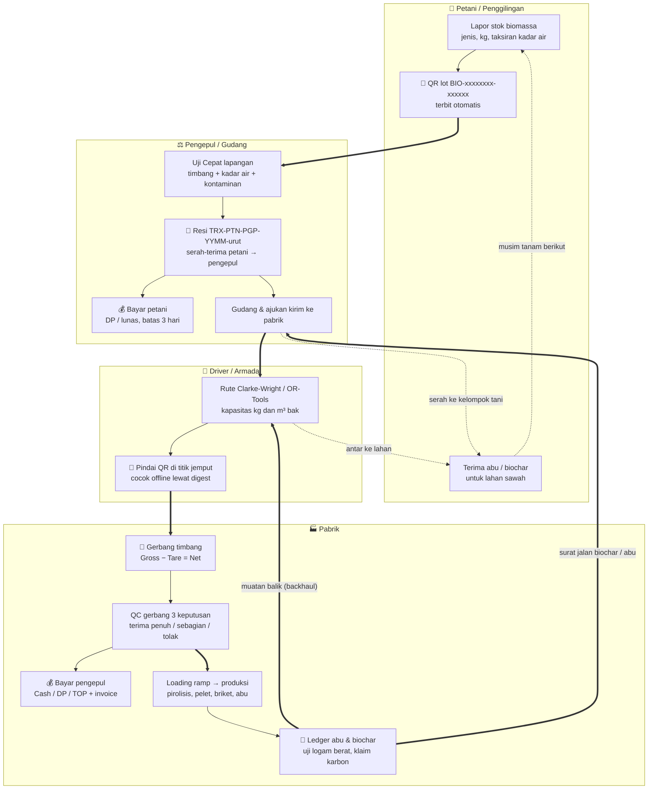

# Bab 1 — Ekosistem Sirkular Bio-Chain & Tata Kelola Standar Internasional

Bio-Chain adalah aplikasi web (PWA, bisa dipasang di ponsel dan tetap mencatat saat sinyal hilang) yang
menghubungkan **petani/penggilingan padi → pengepul → armada truk → pabrik pengolahan**, lalu
mengembalikan **abu dan biochar** ke sawah petani. Bab ini memberi gambaran utuh: siapa melakukan apa,
di mana data dicatat, dan aturan yang dipakai sistem untuk keamanan, ketertelusuran, harga, dan rute.

## 1.1 Diagram Arsitektur Sirkular

Diagram di bawah meringkas alur fisik barang (panah tebal) dan titik-titik pencatatan digital.
Simbol **🔳 QR/Custody** menandai tempat kode dipindai atau serah-terima dicatat; simbol **💰 Bayar**
menandai tempat uang berpindah tangan. Referensi lengkap (±150 simpul) ada di berkas
`GLOBAL_BIOCHAIN_FLOW.mmd` di akar repositori.



**Cara membaca:** satu lot biomassa memperoleh QR saat petani melapor. Kode itu ikut ke setiap
serah-terima (pengepul, driver, gerbang pabrik, batch produksi) dan akhirnya ke surat jalan biochar
yang kembali ke petani — sehingga satu karung biochar bisa ditelusuri balik ke sawah asalnya.

## 1.2 Empat Persona Pengguna

| Persona | Perangkat utama | Tugas utama di aplikasi | Bab rujukan |
|:---|:---|:---|:---|
| **Petani / Penggilingan** | Ponsel (layar 390 px, bisa offline) | Lapor stok & taksiran mutu, pilih jual langsung atau lelang, lacak pembayaran & kuitansi, minta abu/biochar, lacak QR | Bab 3 |
| **Pengepul / Agregator** | Desktop atau tablet di gudang | Dashboard penawaran (langsung/lelang/diantar), Uji Cepat & timbang, terbitkan resi TRX, bayar petani, susun rute, ajukan kirim ke pabrik, atur kontrak & margin | Bab 4 |
| **Driver / Armada** | Ponsel di kabin truk | Daftar job & utilisasi bak, navigasi titik jemput, pindai QR (juga tanpa sinyal), laporkan gagal jemput, antar muatan balik biochar | Bab 5 |
| **Pabrik Pengolahan** | Desktop di pos gerbang & kantor produksi | Gerbang timbang & QC 3 keputusan, pembayaran pengepul, loading ramp & blending, solver HiGHS, ledger abu, klaim removal karbon | Bab 6 |

Selain empat persona lapangan, sistem mengenal peran **Admin** (pengelola akun & parameter) dan
**Auditor** (hanya-baca: rantai custody, neraca massa, keputusan klaim karbon) — lihat
`app/models/user.py` (`UserRole`).

> **Catatan driver:** driver **tidak** menginput slip jembatan timbang. Penimbangan resmi dilakukan
> di gerbang pabrik (Bab 6.1); driver hanya memindai QR dan mengonfirmasi muat/antar.

## 1.3 Keamanan Data — Kontrol yang Selaras dengan ISO/IEC 27001

> **Penting:** Bio-Chain **belum tersertifikasi ISO/IEC 27001**. Yang tersedia adalah sejumlah
> kontrol keamanan yang *selaras* dengan prinsip standar tersebut. Sertifikasi memerlukan audit
> sistem manajemen (ISMS) oleh lembaga sertifikasi, yang belum dilakukan.

| Kontrol | Penerapan nyata di aplikasi | Lokasi kode |
|:---|:---|:---|
| **Kontrol akses berbasis peran (RBAC)** | Setiap alamat API dipetakan ke peran yang boleh memakainya (mis. `/api/v1/collector/` hanya Pengepul, `/api/v1/auditor/` hanya Auditor/Admin). Ditegakkan dua lapis: middleware kebijakan rute + dependensi `require_role` di tiap endpoint. | `app/security/policy.py` (`ROUTE_POLICY`), `app/dependencies.py` (`require_role`) |
| **Autentikasi token JWT** | Token berisi id, peran, dan versi token; kedaluwarsa otomatis (`JWT_EXPIRE_MINUTES`). Token lama langsung ditolak bila peran diubah admin atau password diganti (HP hilang/dipinjam). Akun hasil reset wajib ganti password dulu. | `app/dependencies.py` (`create_access_token`, `get_current_user`) |
| **Penyimpanan password** | Password disimpan sebagai hash PBKDF2-SHA256 bergaram, tidak pernah dikembalikan di respons API. | `app/routers/auth.py` |
| **Perlindungan permintaan lintas situs (CSRF)** | Token dikirim lewat header `Authorization: Bearer` oleh pembungkus `api()` di `app/static/app.js`, **bukan** cookie — sehingga situs lain tidak dapat menumpang sesi pengguna. Tidak ada token CSRF terpisah. | `app/static/app.js` (`api()`), `app/dependencies.py` |
| **Header keamanan & CSP** | Content-Security-Policy tanpa `unsafe-inline` untuk skrip (hash dihitung otomatis dari `index.html`). | `app/security/headers.py` |
| **Pembatasan laju (anti brute force)** | Batas permintaan per IP (`RATE_LIMIT_REQUESTS` per `RATE_LIMIT_WINDOW_SECONDS`) dan batas percobaan login (`LOGIN_RATE_LIMIT`). | `app/middleware/rate_limiter.py`, `app/config.py` |
| **Isolasi baris data (RLS)** | Pada PostgreSQL, identitas pengguna diikat ke sesi basis data sehingga kueri hanya melihat baris yang berhak. | `app/security/rls.py` |
| **Jejak audit (append-only)** | Setiap perubahan parameter asumsi dicatat: siapa, nilai lama → baru, alasan (`parameter_changes`). Setiap serah-terima lot tercatat sebagai `custody_events`. Persetujuan data dicatat append-only (`consents`). | `app/models/params.py`, `app/models/ledger.py`, `app/models/compliance.py` |
| **Masking data pribadi (UU 27/2022 PDP)** | Nomor HP petani disamarkan di daftar lintas-pengguna (mis. `0812****5678`); nomor lengkap hanya lewat aksi "hubungi". | `app/services/privacy.py` (`mask_phone`), `app/routers/collector.py` |
| **Hak subjek data — menu "Data saya"** | Pengguna dapat mengunduh seluruh datanya (JSON/.docx), mengatur persetujuan (GPS, foto bukti), dan meminta hapus akun. Penghapusan = **anonimisasi**: identitas dihapus, catatan transaksi tetap untuk kewajiban audit/pajak tetapi tidak lagi terhubung ke orang. | `app/services/privacy.py` (`export_data`, `anonymize`), `app/routers/me.py` |
| **QR bertanda tangan** | QR lot memuat tag HMAC-SHA256 kunci server, sehingga QR palsu/salah ketik langsung dikenali. | `app/services/qr_sign.py` |

## 1.4 Ketertelusuran ISO 22095 (Chain of Custody)

ISO 22095:2020 menetapkan kerangka umum *chain of custody*: setiap perpindahan kepemilikan atau
penguasaan barang harus terdokumentasi sehingga asal produk dapat dibuktikan. Bio-Chain menerapkan
model ini dengan **tiga lapis bukti** (aplikasi belum diaudit pihak ketiga terhadap ISO 22095).

**1) QR lot asal — `BIO-XXXXXXXX-TTTTTT`.** Terbit saat petani melapor stok. Delapan karakter heksa
acak + enam karakter tanda tangan HMAC (`app/services/qr_sign.py`). Rute driver hanya membawa *digest*
satu arah per titik, sehingga ponsel supir dapat mencocokkan QR **tanpa sinyal** tanpa pernah
mengetahui kodenya. QR lama format `BIO-XXXXXXXX` tetap diterima namun ditandai untuk auditor
(parameter `logistik.qr_legacy_policy`).

**2) Resi serah-terima — `TRX-<pengirim>-<penerima>-<YYMM>-<urut>`.** Dibuat oleh
`app/services/trx_code.py` saat pengepul menyelesaikan uji mutu & timbang. Kode peran: `PTN` petani,
`PGP` pengepul, `DRV` driver, `PBK` pabrik + nomor akun 4 digit; `YYMM` = tahun-bulan WIB; nomor urut
5 digit di-reset tiap bulan per pasangan pengirim–penerima. Contoh `TRX-PTN0006-PGP0003-2610-00183` =
serah-terima ke-183 dari Petani #6 ke Pengepul #3 pada Oktober 2026. Nomor urut diambil dengan satu
perintah UPSERT atomik sehingga dua serah-terima serentak tidak pernah mendapat nomor yang sama.


*Gambar 1.1 — Resi Serah-Terima Sekam: kode `TRX-PTN0006-PGP0003-2610-00183`, ringkasan "4.950 kg ·
Grade A · Rp 2.186.121", serta kotak "Rantai Ketelusuran Batch" yang menautkan QR asal
`BIO-F4733DAE-DEDHTO` dan batch referensi `WR-HV-1164`, serta alur mutasi
Pelaporan Awal → Lelang → Timbang TRX → Pabrik.*

**3) Ledger custody & hash sirkular.** Setiap serah-terima ditulis sebagai baris `custody_events`
dengan tahap `farmer_report → collector_weigh → driver_pickup → factory_receive → conversion`
(`app/models/ledger.py`, `app/services/custody.py`; penolakan dicatat sebagai `collector_reject` /
`factory_reject`). Layanan `app/services/circular_traceability.py` merangkai **6 tahap** (sawah →
pengepul → driver → gerbang pabrik → pengolahan → muatan balik ke sawah) lalu menghitung **sidik
SHA-256** atas gabungan kode-kode tiap tahap (QR asal, TRX pengepul/driver/pabrik, batch konversi,
surat jalan muatan balik, kg biochar). Bila satu kode diubah, sidik ikut berubah.

Modal **"Lacak QR Sirkular"** (tombol teal di header, terbuka untuk semua peran — endpoint
`/api/v1/traceability` sengaja publik agar pembeli/auditor bisa memverifikasi) menampilkan rantai itu:


*Gambar 1.2 — Modal "Ketelusuran Sirkular QR Code End-to-End": ① kode lot `BIO-F4733DAE-DEDHTO`
diketik lalu tombol LACAK; ② lencana tahap saat ini ("Tahap 1/6"); ③ ringkasan neraca lot — input
5.000 kg sekam, timbang terima pabrik 4.750 kg, biochar 1.425 kg, abu sisa 688,8 kg, 57 sak kembali
ke sawah, 1.211,3 kg CO₂ dihindari — beserta linimasa tahap (Tahap 1 Selesai, Tahap 2–3 Menunggu) dan
kartu "Pelaporan Stok Biomassa Petani". Di bawahnya tampil baris "SHA256 Chained Provenance Integrity".*

> **Catatan jujur:** sidik SHA-256 dihitung ulang setiap kali dilacak dari data yang tersimpan; ini
> bukan blockchain publik. Integritasnya bergantung pada jejak append-only dan kontrol akses di 1.3.
> Klaim karbon memakai mekanisme serupa: snapshot hasil hitung dibekukan dengan SHA-256 saat diajukan
> (`app/services/carbon_claims.py`).

## 1.5 Keadilan Ekonomi: Margin Proporsional & Kepastian Bayar

### Margin pengepul yang terbuka

Pengepul menanggung biaya jemput, gudang, dan risiko susut, sehingga berhak atas margin — tetapi
margin itu dibuat **transparan**, bukan disembunyikan dalam timbangan.

- **Modul Kontrak & Harga Jual Multi-Biomassa ke Pabrik** menampilkan per komoditas: harga beli
  petani, harga jual pabrik, dan margin (Rp/kg) = harga jual − harga beli. Tombol **Simulasi Margin
  Truk** menghitung proyeksi satu ritase: nilai jual − harga beli − (km × biaya/km).
- **Penasihat tawaran lelang** (`app/routers/collector_bidding.py` → `trade.bid_advice`) menghitung
  `tawaran_maks = harga_jual − biaya_logistik_marginal/kg − margin/kg`. Biaya logistik marginal diambil
  dari selisih km rute dengan dan tanpa lot tersebut (solver rute). Margin bisa diisi Rp/kg
  (default `pasar.default_margin_per_kg` = Rp30/kg) atau **persen harga jual**
  (default `pasar.default_margin_pct` = 5 %) — inilah margin *proporsional*: makin tinggi harga jual,
  margin rupiahnya ikut naik secara sebanding, tidak dipatok sepihak.
- Harga jual default ke pabrik: `pasar.default_resale_price_per_kg` = Rp560/kg (`app/params.py`).


*Gambar 1.3 — Baris Sekam Padi: harga beli petani Rp450/kg, harga jual ke PT Bio-Energi Sleman
Rp580/kg, margin +Rp130/kg; tombol "Simulasi Margin Truk" di kiri atas.*

> **⚠️ Keterbatasan saat ini:** tabel Modul Kontrak disimpan di **penyimpanan browser** perangkat
> pengepul (`localStorage`, kunci `biochain_factory_pricing_v1` di `app/static/app.js`), belum di
> server. Artinya nilai kontrak tidak tersinkron antarperangkat dan belum masuk jejak audit. Harga
> yang benar-benar dibayarkan ke petani tetap dihitung server dari harga dasar komoditas (Bab 2.3).

### Kepastian bayar petani

- Lot yang sudah diverifikasi pengepul wajib dibayar **maksimal 3 hari** (parameter
  `pasar.farmer_payment_due_days`, default 3, rentang 0–60) — lebih ketat dari target umum ≤ 14 hari.
  Lewat batas, lot ditandai **"terlambat"** di menu Pembayaran petani (`app/services/payments.py`,
  `farmer_overview`: `late = hari_menunggu > due_days`).
- Petani melihat tiga keranjang: **dibayar** · **menunggu bayar** (dengan penanda terlambat) ·
  **belum ditimbang**; setiap pembayaran menerbitkan kuitansi.
- **Uang muka (DP)** maksimal `pasar.dp_max_pct` = 30 % perkiraan nilai lot; dipotong otomatis saat
  pelunasan, dan **hangus untuk petani** (tidak perlu dikembalikan) bila pengepul membatalkan sepihak.
- Pemotongan PPh 22 (bila parameter `pajak.pph22_farmer_pct` diisi) ditampilkan terpisah dari nilai kotor.

## 1.6 Optimasi Algoritma (Ringkas)

| Masalah | Algoritma | Lokasi | Keterangan |
|:---|:---|:---|:---|
| Rute jemput pengepul (CVRP) | **Clarke-Wright savings** + local search (relocate, swap, 2-opt) + iterated local search; **eksak Held-Karp** bila ≤ 10 titik (mode `auto`) | `app/engines/routing.py` | Sekam sangat ringan (±120 kg/m³) sehingga bak penuh *volume* sebelum *tonase*: kapasitas dihitung dalam m³ dari kg ÷ densitas curah. |
| Alokasi armada multi-truk & rute hijau | **Google OR-Tools** (PATH_CHEAPEST_ARC + Guided Local Search) | `app/engines/routing_ortools.py` | Dua dimensi kapasitas: **m³ bak dan kg muatan**; fungsi objektif gram CO₂e. Bisa dibandingkan dengan Clarke-Wright di modal Optimasi Rute (Bab 4.2). |
| Blend bahan bakar biaya terendah (Prototipe 1) | **Program linier HiGHS** (via SciPy) | `app/engines/fuel_blend.py` | Minimalkan biaya dengan batas LHV, abu, Cl, S, dan indeks alkali. |
| Optimasi produk akhir (Prototipe 4) & blending lab | **HiGHS** | `app/engines/product_optimization.py`, `app/engines/blending.py` | Memilih jalur produk (biochar, pelet, briket, silika) per bahan baku. |
| Kartu "Mesin Rekomendasi Blending Multi-Ramp" | **Heuristik urut-prioritas** (bukan HiGHS) | `app/routers/factory_production.py` | Mengurutkan ramp sesuai target produk lalu mengalokasikan stok. |

**Angka benchmark nyata** (sumber: `docs/benchmark_results.md`, dijalankan 5 Okt 2026, Windows 11,
Python 3.14, panggilan engine langsung, ambang SLO 500 ms pada p95):

| Engine | Skenario | p50 | p95 |
|:---|:---|:---:|:---:|
| Routing Clarke-Wright + local search | 50 titik, bak 30 m³ | 249,89 ms | 250,18 ms |
| Routing Clarke-Wright + local search | 1.000 titik, bak 300 m³ | 273,96 ms | 279,30 ms |
| Blending HiGHS LP | 4 bahan, target 100 ton | 1,84 ms | 1,89 ms |
| Quality scorer | 10.000 sampel berturut-turut | 131,65 ms | 133,09 ms |

Waktu routing ±250 ms sebagian besar adalah **anggaran waktu** pencarian yang memang dipakai habis
(`logistik.time_budget_ms`), bukan batas kemampuan. Benchmark tersebut tidak memuat OR-Tools; perbandingan
Clarke-Wright vs OR-Tools ditampilkan langsung di modal rute (Bab 4.2).

---

# Bab 2 — Protokol Uji Mutu 2 Tahap & Skema Grade Harga Insentif

Mutu biomassa menentukan harga yang diterima petani. Bio-Chain memakai **dua tahap uji**:
**Tahap 1 Uji Cepat** di lapangan (setiap lot, menentukan harga hari itu) dan **Tahap 2 Uji Lab
Proksimat** (berkala/sampel, untuk kontrak, gerbang pabrik, dan klaim karbon).

## 2.1 Tahap 1 — Uji Cepat Lapangan

**Tujuan Proses & Standar Terkait:** menetapkan berat bayar dan grade lot di tempat, sebelum
biomassa berpindah tangan. Ini adalah *prosedur lapangan* yang memakai form **Uji Mutu** pengepul;
aplikasi tidak memiliki penghitung waktu atau label "15 menit". Pengukuran kadar air mengacu pada
moisture meter yang dikalibrasi terhadap metode oven 105 °C (ISO 18134-2, dirujuk di
`app/engines/refraction.py`).

**Langkah prosedur yang disarankan:**

1. **Sampling.** Ambil minimal 5 titik dari tumpukan/karung (atas, tengah, bawah, dua sisi), campur
   menjadi satu sampel komposit ±1 kg. Jangan hanya mengambil dari permukaan yang sudah kering dijemur.
2. **Timbang lot.** Timbang seluruh lot di timbangan gudang; isi kolom **Berat Timbangan Pengepul (kg)**.
   Tombol −50/+50/+100/+500/+1 ton/+1 truk membantu koreksi cepat.
3. **Kadar air (wajib).** Ukur sampel dengan moisture meter minimal 3 kali, catat rata-ratanya di
   kolom **Kadar Air (% bb)**. Satuan % basis basah.
4. **Densitas ruah (opsional, prosedur manual).** Isi ember bervolume diketahui (mis. 20 L) tanpa
   dipadatkan, timbang, lalu hitung kg/m³ = kg ÷ volume (m³). Nilai acuan sekam di master komoditas
   = 120 kg/m³ dan dipakai untuk menghitung muatan bak truk (m³).
   *Form Uji Mutu belum memiliki kolom densitas ruah*; catat di foto bukti/keterangan bila perlu.
5. **Benda asing / kontaminan.** Pisahkan batu, tanah, plastik, dedak dari sampel, timbang, dan isi
   **Kontaminan (%)** = berat benda asing ÷ berat sampel × 100.
6. **Proksimat (opsional).** Kolom Kadar Abu, Volatile Matter, Fixed Carbon diisi hanya bila ada hasil
   uji lab/NIR. Bila kosong, grade dihitung dari kadar air & kontaminan saja dan sistem menampilkan
   peringatan "Uji proksimat tidak diukur" (`app/engines/quality.py`).
7. **Foto & verifikasi.** Lampirkan foto bukti (opsional), klik **Verifikasi Mutu** → sistem menghitung
   grade dan harga final, lalu menerbitkan resi TRX (Gambar 1.1).


**Panduan Aksi Berdasarkan Nomor pada Gambar:**
- **① Berat Timbangan Pengepul (kg):** berat aktual lot, contoh **4950**.
- **② Kadar Air (% bb) — wajib:** hasil moisture meter, contoh **13.2**.
- **③ Kontaminan (%):** persentase benda asing, contoh **0.5**. Kolom Kadar Abu, VM, FC dibiarkan
  "opsional · uji lab"; Suhu Pirolisis 500 °C (default).
- **④ Preview Mutu:** kotak ringkasan "Grade A · Skor 91.2 · Pengali Harga: ×1.10".
- **⑤ VERIFIKASI MUTU #1164:** menyimpan hasil uji, mengubah status lot menjadi *terverifikasi*,
  mencatat custody `collector_weigh`, dan membuka resi serah-terima.

> **⚠️ Catatan untuk tim produk:** teks pada kotak ④ saat ini adalah **contoh statis** di
> `app/static/app.js` (tidak dihitung ulang saat input berubah). Grade dan harga yang sah adalah yang
> dihitung server saat tombol ⑤ ditekan dan tampil di resi. Untuk data pada gambar (MC 13,2 %,
> kontaminan 0,5 %) server dengan parameter default menghasilkan skor ±88,5 → **Grade A** (lihat 2.3).

> **🔧 Di Balik Layar (Sistem):** endpoint `POST /api/v1/collector/verify` (`app/routers/collector.py`)
> memanggil `score_sample()` di `app/engines/quality.py` untuk sekam padi, atau `_biomass_grade()`
> (acuan master komoditas) untuk biomassa lain; harga dihitung `farmgate_price()` dan resi oleh
> `app/services/trx_code.py`. Lot di atas batas tolak hanya bisa dibeli bila pengepul mencentang
> "beli untuk dikeringkan" (harga basis kering, risiko ditanggung pengepul).

**Sisi petani — taksiran sebelum dijemput.** Petani dapat mengisi taksiran kadar air dan grade di
form lapor stok. Taksiran ini **tidak mengubah harga**; harga final tetap dari timbangan & uji pengepul.


**Panduan Aksi Berdasarkan Nomor pada Gambar:**
- **① Taksiran kadar air (%):** contoh **13.2**.
- **② Taksiran grade:** pilihan grade atau "Tidak tahu". Di bawahnya tertulis "Tidak memengaruhi harga.
  Harga final dari uji kadar air & timbangan pengepul."
- **③ Foto Biomassa & Muatan:** tombol pilih berkas foto (dikompresi otomatis ≤ 300 KB).
  Kotak **Estimasi pendapatan** di bawahnya menampilkan **Rp 2.362.500** — "Perkiraan Grade B (acuan
  Rp 450/kg)" untuk 5.000 kg dengan skema Dijemput pengepul (5.000 × 450 × 1,05).

> **🔧 Di Balik Layar (Sistem):** fungsi `gradeFrom()` di `app/static/app.js` menurunkan grade dari
> taksiran kadar air (≤ 12 → A, ≤ 15 → B, ≤ 18 → C, > 18 → D) bila petani memilih "Tidak tahu", lalu
> memperkirakan pendapatan = kg × harga acuan × `harga_mutu.mult_<grade>`. Untuk D ditampilkan
> "Berisiko ditolak" (tidak ada pengali D).

## 2.2 Tahap 2 — Uji Lab Proksimat

**Tujuan Proses & Standar Terkait:** memverifikasi mutu bahan secara laboratorium untuk lot besar,
kontrak, penerimaan pabrik, produk biochar/abu ke lahan, dan klaim removal karbon. Uji sebaiknya di
laboratorium terakreditasi **KAN (ISO/IEC 17025)**.

**Parameter yang diuji:**

| Parameter | Satuan | Kegunaan di Bio-Chain | Kolom tersedia di |
|:---|:---|:---|:---|
| Kadar abu | % basis kering | Skor mutu (ideal 14–20 % untuk sekam), prediksi abu & SiO₂ di biochar | Form Uji Mutu pengepul (opsional), gerbang pabrik |
| Nilai kalor bawah (LHV) | kcal/kg | Penerimaan bahan bakar & blending | Gerbang pabrik |
| Volatile matter (VM) | % bk | Cek konsistensi proksimat (Abu + VM + FC ≈ 100 %) | Form Uji Mutu (opsional) |
| Fixed carbon (FC) | % bk | Skor mutu (ideal ≥ 17 %, skor 0 pada ≤ 8 %) | Form Uji Mutu (opsional) |
| Logam berat Pb, Cd, As (+ Hg, Cr, Ni untuk abu) | mg/kg (ppm) | Kelayakan biochar/abu ke lahan sawah | Uji keamanan by-product, ledger abu |
| C-organik & rasio H/C-org | % bk; mol/mol | Klaim removal karbon biochar | Form Klaim Removal Karbon |

> **⚠️ Belum tersedia di aplikasi:** jadwal **uji lab proksimat bulanan**, pengingat otomatis, dan
> pencatatan **kalibrasi bulanan moisture meter** (alat, tanggal, selisih terhadap oven 105 °C)
> **belum ada**. Sampai fitur ini dibuat, lakukan secara manual: kirim satu sampel komposit per
> pengepul per bulan ke lab, dan kalibrasi moisture meter terhadap uji oven setiap bulan; simpan
> berkasnya di luar aplikasi.

**Di mana data lab sudah bisa dimasukkan:**

1. **Form Uji Mutu pengepul** — kolom Kadar Abu, VM, FC (opsional; lihat Gambar 2.1 ②–③).
2. **Gerbang pabrik** — blok "Pengujian Mutu Sampel (Lab Lapangan)": Kadar Air, Kadar Abu, LHV,
   Kotoran, lalu keputusan QC 3 status.


*Gambar 2.3 — Truk AB 8421 CS (Armada Pabrik), sekam padi: ① Berat Kotor (Gross) 10.950 kg,
② Berat Kosong (Tare) 6.000 kg, ③ Netto Terhitung **4.950 kg**; blok uji lab lapangan ④ Kadar Air
13,2 %, Kadar Abu 17,5 %, LHV 3.450 kcal/kg, Kotoran 0,5 %; ⑤ keputusan QC "Diterima Sebagian"
(4.800 kg masuk, 150 kg retur); ⑥ ramp tujuan RAMP-01 (Granular/Sekam). Blok "Pemicu Invoice
Otomatis": DP Bertermin, harga dasar Rp450/kg, termin 14 hari, DP Rp2.000.000. Rincian di Bab 6.1.*

3. **Uji keamanan by-product biochar** — Pb, Cd, As + **nomor sertifikat lab KAN/ISO 17025** (wajib,
   `SafetyTestRequest.lab_cert_no` di `app/routers/factory_production.py`).
4. **Ledger abu** — Pb, Cd, As, Hg, Cr, Ni, nama lab, nomor laporan, tautan laporan (`app/models/biomass.py`).
5. **Klaim Removal Karbon** — C-organik lab, rasio H/C-org, nama laboratorium, nomor laporan, unggah
   foto/scan laporan.


*Gambar 2.4 — ① C-organik lab **45** % bk, ② Rasio H/C-org **0,3** (di bawah batas 0,7),
③ Nama laboratorium ("Laboratorium Uji Mutu…"), ④ No. laporan lab **LHU-2026-10-0142**, lalu
⑤ tombol AJUKAN (Pratinjau di sebelahnya untuk menghitung tanpa menyimpan). Rincian di Bab 6.4.*

> **🔧 Di Balik Layar (Sistem):** `app/services/carbon_claims.py` mengganti parameter fraksi C
> (`karbon.biochar_c_org_fraction`, default 0,49) dengan C-organik hasil lab, dan **menolak pengajuan**
> bila H/C-org > `karbon.h_corg_max` (0,7). Status "terverifikasi" = verifikasi internal oleh auditor,
> **bukan** kredit karbon bersertifikat.

## 2.3 Penentuan Grade & Harga

### Tabel grade biomassa

Bio-Chain memakai grade **A/B/C/D** (bukan "A1"). Ada dua lapis: **taksiran petani** (dari kadar air
saja) dan **grade resmi pengepul** (dari skor mutu).

| Grade | Taksiran petani (`gradeFrom`, `app.js`) | Grade resmi sekam padi (`quality.py`) | Pengali harga (`app/params.py`) |
|:---:|:---|:---|:---:|
| **A** | Kadar air ≤ 12 % | Skor ≥ 80 (`harga_mutu.grade_A_min`) | `harga_mutu.mult_A` = **1,15** |
| **B** | 12 % < KA ≤ 15 % | 60 ≤ skor < 80 (`harga_mutu.grade_B_min`) | `harga_mutu.mult_B` = **1,05** |
| **C** | 15 % < KA ≤ 18 % | Skor < 60 | `harga_mutu.mult_C` = **1,00** |
| **D / TOLAK** | KA > 18 % → "Berisiko ditolak" | **TOLAK** bila KA > 25 % (`harga_mutu.moisture_reject`) **atau** kontaminan > 10 % (`harga_mutu.contamination_reject`) | 0 (tidak dibeli, kecuali "beli untuk dikeringkan") |

> Tidak ada parameter `harga_mutu.mult_D` di kode. Grade "D" hanya muncul pada taksiran petani;
> server memakai status **TOLAK**.

**Skor mutu sekam** (`score_sample()` di `app/engines/quality.py`) = rata-rata berbobot komponen yang
terukur (bobot dinormalisasi atas komponen yang diisi):

| Komponen | Skor 100 bila | Skor 0 bila | Bobot |
|:---|:---|:---|:---:|
| Kadar air | ≤ 10 % (`moisture_best`) | ≥ 25 % (`moisture_reject`) | 0,35 |
| Kontaminan | ≤ 1 % (`contamination_best`) | ≥ 10 % (`contamination_reject`) | 0,30 |
| Kadar abu (opsional) | 14–20 % (`ash_ideal_min/max`); −10 poin per 1 % di luar rentang | — | 0,15 |
| Fixed carbon (opsional) | ≥ 17 % (`fc_best`) | ≤ 8 % (`fc_worst`) | 0,20 |

Skor di antara batas dihitung linear: `skor = 100 × (batas_buruk − nilai) ÷ (batas_buruk − batas_ideal)`.

**Biomassa selain sekam** (tongkol jagung, ampas tebu, tempurung, serbuk kayu) dinilai dari acuan
master komoditas (`_biomass_grade()` di `app/routers/collector.py`): A bila KA ≤ KA acuan dan kontaminan
≤ toleransi; B bila KA ≤ titik tengah acuan–tolak dan kontaminan ≤ toleransi + 3 %; selain itu C;
TOLAK bila KA > KA tolak atau kontaminan > 20 %. Grade di sini hanya informasi — harga tetap basis kering.

### Rumus harga beli dari petani

Metode default `harga_mutu.pricing_method = basis_kering` (`farmgate_price()` di `app/engines/quality.py`):

```
harga/kg  = harga_dasar × (1 − KA) ÷ (1 − KA_acuan)        KA_acuan = harga_mutu.reference_moisture_pct = 12 %
kg_bayar  = kg_timbang × (1 − kontaminan)
total     = kg_bayar × harga/kg                           (TOLAK → 0)
```

Pada metode ini **pengali grade tidak dipakai**: setiap 1 % air sudah dihargai sesuai bahan keringnya,
sehingga tidak ada "tebing harga" di batas grade. Metode lama `pengali_grade`
(`total = kg × harga_dasar × pengali`) masih bisa dipilih pabrik di menu Parameter. Lot dengan KA >
15 % (`harga_mutu.moisture_mold_risk_pct`) ditandai **risiko jamur**: angkut ≤ 48 jam atau keringkan.

### Rumus refraksi multi-komoditas

Untuk pratinjau refraksi multi-biomassa (`app/engines/refraction.py`, dipanggil dari
`app/routers/multibiomass.py` dan `app/services/biomass.py`):

```
kg_bayar = kg_timbang × (1 − max(0, kontaminan − toleransi)) × (1 − KA) ÷ (1 − KA_acuan)
```

Faktor kadar air dibatasi maksimal 1 (tidak ada bonus lebih kering, kecuali diaktifkan per transaksi).
Di atas KA tolak, lot ditolak kecuali opsi eksplisit "terima basah". Acuan sekam padi di master
(`app/biomass_seed.py`): **KA acuan 12 %, KA tolak 20 %, toleransi kontaminan 2 %**.

### Contoh hitung — 5.000 kg sekam, KA 13,2 %, kontaminan 0,5 %

Harga dasar dari parameter default: `harga_mutu.base_price_per_kg` = **Rp400/kg** (`app/config.py`
`BASE_PRICE_PER_KG`), tanpa data proksimat lab.

| Langkah | Perhitungan | Hasil |
|:---|:---|:---:|
| Skor kadar air | 100 × (25 − 13,2) ÷ (25 − 10) | 78,7 |
| Skor kontaminan | 0,5 % ≤ 1 % (ideal) | 100 |
| Skor komposit | (78,7 × 0,35 + 100 × 0,30) ÷ 0,65 | **88,5 → Grade A** |
| Harga per kg (basis kering) | 400 × (1 − 0,132) ÷ (1 − 0,12) = 400 × 0,98636 | **Rp394,55/kg** |
| Kg dibayar | 5.000 × (1 − 0,005) | 4.975 kg |
| **Total diterima petani** | 4.975 × 394,55 | **Rp1.962.886** |
| *Pembanding: metode `pengali_grade`* | 5.000 × 400 × 1,15 | Rp2.300.000 |
| *Pembanding: refraksi multi-komoditas* | 5.000 × (1 − 0) × 0,98636 = 4.931,8 kg × Rp400 | Rp1.972.727 |

Pada jalur refraksi, kontaminan 0,5 % tidak dipotong karena masih di bawah toleransi 2 %; pada jalur
verifikasi sekam, seluruh kontaminan dipotong dari berat bayar.

> **Cocokkan dengan resi:** Gambar 1.1 menunjukkan 4.950 kg · Grade A · **Rp2.186.121**. Angka itu
> memakai harga dasar aktif **Rp450/kg** pada data demo: 4.950 × 0,995 = 4.925,25 kg × (450 × 0,868 ÷
> 0,88 = Rp443,86/kg) = Rp2.186.121. Rumusnya sama; hanya harga dasarnya berbeda.

## 2.4 Standar Produk Akhir

Grade A/B/C/D berlaku untuk **bahan baku biomassa**. Untuk **produk** pabrik dipakai standar berikut;
batas di tabel adalah yang benar-benar diperiksa kode.

| Produk | Standar acuan | Batas yang diperiksa di kode | Lokasi |
|:---|:---|:---|:---|
| **Bio-pelet** | ISO 17225-2 (kayu) / ISO 17225-6 (non-kayu) | Abu produk ≤ 1,2 % → Kelas A1/A2; ≤ 6 % → ISO 17225-6 Kelas A non-kayu; ≤ 10 % → hanya Kelas B; > 10 % → wajib blending. Indeks alkali > 0,34 kg/GJ → risiko kerak. | `app/engines/product_optimization.py` |
| **Biochar** (pembenah tanah & karbon) | European Biochar Certificate (EBC) / IBI; metodologi Puro.earth 2025 | **H/C-org ≤ 0,7** (`karbon.h_corg_max`) — di atasnya klaim ditolak. C-org: hasil lab menggantikan default 0,49 (`karbon.biochar_c_org_fraction`); tidak ada ambang minimum C-org di kode (C-org > 75 % dicatat sebagai keunggulan). Logam berat lolos bila **Pb < 50, Cd < 2, As < 10 ppm**. | `app/services/carbon_claims.py`, `app/params.py`, `app/routers/factory_production.py` |
| **Abu ke lahan** | Kepmentan No. 261/KPTS/SR.310/M/4/2019 | As ≤ 10, Hg ≤ 1, Pb ≤ 50, Cd ≤ 2, Cr ≤ 180, Ni ≤ 50 mg/kg (`abu.limit_*_ppm`); lulus hanya bila semua logam terukur ≤ batas. | `app/params.py`, `app/models/biomass.py` |
| **Briket / arang** | SNI 01-6235-2000 | Abu briket maks **8 %**; sekam dinilai tidak cocok untuk briket komersial (arang rapuh, abu tinggi). | `app/engines/product_optimization.py` |
| **Silika (dari abu sekam)** | SNI 15-0086-1987 / ASTM D1993 | Dinilai dari skor ekonomis jalur silika. | `app/engines/product_optimization.py` |

> **Catatan:** ISO 17225 hanya dipakai untuk spesifikasi **produk bio-pelet**, bukan untuk grade bahan
> baku sekam. Penilaian kesesuaian di atas adalah penyaring awal di aplikasi; sertifikasi produk tetap
> memerlukan uji lab terakreditasi dan audit lembaga standar terkait.
